# MI01_CMN 逐应用深拆（FAP v2.0.9）

> 三方对照：pc2kl3 反编译实读（18 模块）× 小米标准软件手册 v20 第 6 章 × FAP v2.0.9 更新日志（v2.0.9→v1.0.13 十段）。
> 辅助串证：mi-fap 仓库（git.n.xiaomi.com/jiahenglong/mi-fap）内 .LS / .tx 表单源。
> 标注约定：【实证】=代码/文档直接证据；【推断】=由结构归纳。行号可在 `decompiled/MI01_cmn/*.KL` 定位。
> 生成：2026-11-03。逐应用顺序见 `00_架构时序与缺陷分析.html` 第 7 节（本篇为第 1 站：手册第 6 章）。

---

## 0. 定位与模块清单

**一句话定位**：MI01_CMN 是机器人↔PLC 的逻辑交互层（软 PLC 网关）——初始化信号、干涉区请求/释放、步序、DecisionCode、夹具位置、气压检测、RIP 水汽检测；外加开机自启的后台监控、Profinet PRIO 报警监控、远程自动备份、TP 程序修改监控四个后台体，以及全套 Setup GUI。【实证：手册 6.2 + %COMMENT='MI01 2.0.9'】

| 模块 | 行数 | 角色 |
|---|---|---|
| MI01_CMN | 233 | TP 指令入口（ACTIONSELECT 分发 8 指令） |
| MI01_CMN_ROUT | 662 | 指令实现 + MI_LIB 共享例程（联锁/参数读取/IO 等待） |
| MI01_CMN_MON | 260 | 后台监控主循环（MI_HOLD：路径/单步/速度/气压/暂停联动） |
| MI01_CMN_INIT | 35 | 开机自启（拉起 MI01_cmn_mon + MI01_error） |
| MI01_CMN_VAR | 20 | 变量文件壳（持久变量存 CMOS KAREL VARS，DATA 视图可改）【实证：手册 6.1.2】 |
| MI01_CMN_GUI | 822 | MI01 Setup 界面（PLCSetup/AutoBack/PNIO/AutoLog 四页） |
| MI01_ERROR | 395 | PRIO 报警监控（10 路 Profinet）+ DIAG-005 自动收集 Logbook |
| MI01_AUTOBK | 254 | 远程自动备份（FTP 双 Server，宏 100 产出拷贝） |
| MI01_TCPCHECK | 328 | TCP/UT 记录与校验（独立指令，不走 MI01_CMN 分发） |
| MI01_GUI | 207 | MI GUI 启动器（按已装应用弹出各 Setup） |
| MI01_REC_GUI / MI01_REC_MON / MI01_REC_VAR | 524/232/20 | TP 程序修改记录（PROG RECORD） |
| CMT_GUI / CMT_PORT | 381/435 | 注释工具（IO/R/PR 注释导入导出，Rob_IO_comment.xml） |
| DCP_HIST | 269 | DCP Faults History 查看器 |
| APPS_LOADER / APPS_LOADER_EXT | 1393/162 | Application Management（安装/卸载/IO 自动分配/DCS 导入） |

**任务模型**：`MI01_cmn_mon`、`MI01_error` 随开机自启（手册 6.1.4「MI01_CMN 的后台程序，会随开机而自动启动」；其余应用后台须至少运行一次其指令才拉起）。每次执行任一 MI01_CMN 指令也会幂等确保 mon 在跑（RUN_MONITOR）。【实证：MI01_CMN_INIT.KL:20-33、MI01_CMN_ROUT RUN_MONITOR】

---

## 1. 指令级时序图

### 1.0 开机装载时序

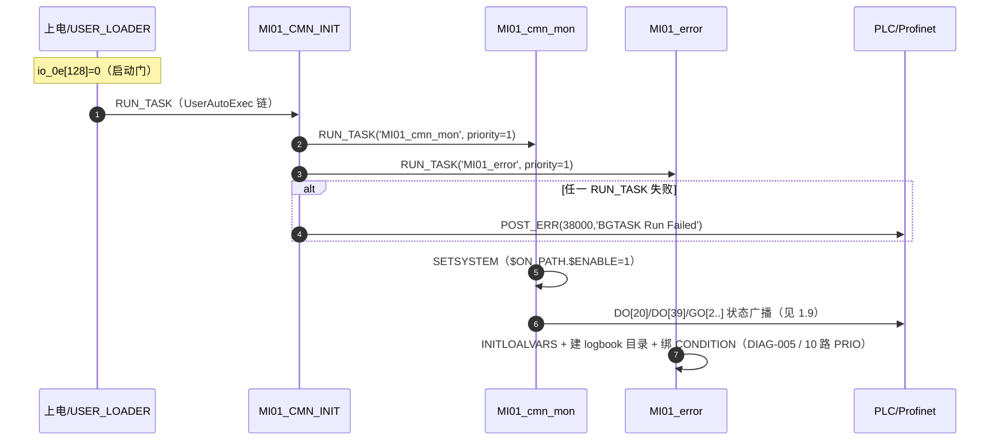

【实证：MI01_CMN_INIT.KL:21-33；MI01_ERROR.KL:368-388 stmt 残留 `1|148005`（DIAG-005 事件）、`2|13000+602…+652`（10 路 PRIO 故障号）】

### 1.1 指令分发总图（CALL MI01_CMN）

TP 侧调用形态 `CALL MI01_CMN(指令, 参数2…, '注释≤32字符')`，指令编码=参数 1（手册 6.1.1「Parameter select」）：

| 编码 | 指令 | 后续参数（GET_TPE_PRM 序） | 实现 |
|---|---|---|---|
| 1 | Init | — | INITPLCIO |
| 2 | CollZone | 2:Request=1/Release=2，3:ZoneNo 1~32 | REQCOLZONE / RELCOLZONE |
| 3 | Segment | 2:SegNo 1~255 | SEGMENTECHO |
| 4 | DecisionCode | 2:SetToReg=1/OutToPLC=2，3:RegNo 或 InputValue | DECCODESET |
| 5 | Fixture | 2:IN=1/OUT=2，3:FixNo | FIXTURESET |
| 6 | PressCheck | 2:Check=1/NoCheck=2 | 置 B_PRESSCHK（检测在后台） |
| 7 | RIPCheck | 2:SpotWeld=1/NonSpotWeld=2，3:AirON=1/WaterON=2/WaterOFF=3，4(仅AirON):Check/NoCheck | MI01_RIP_CHECK / B_PRESSCHK |
| 8 | ProgNumberCheck | 2:ProgNo | PROGNUMBERCHECK |

分发后统一收尾：`INITVARS(0)` → `B_MON_01=1` → `RUN_MONITOR('MI01_cmn_mon')`（确保后台在跑）。【实证：MI01_CMN.KL:125-229；收尾三句为程序主尾，反编译折叠进 ACTIONSELECT 末尾【推断】】

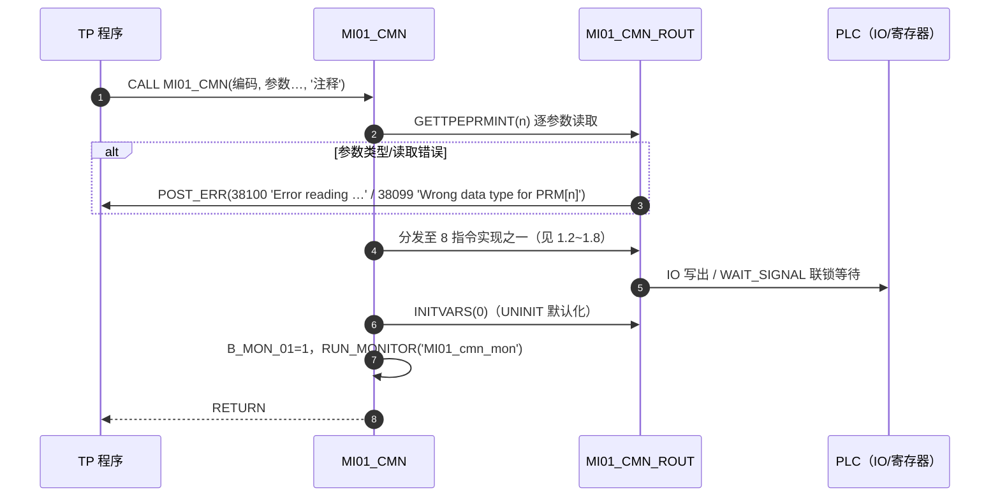

### 1.2 Init（信号初始化）

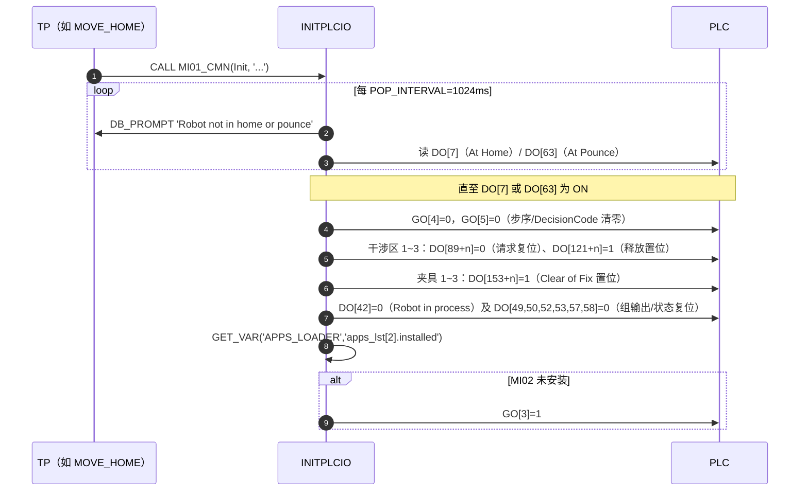

【实证：MI01_CMN_ROUT.KL:365-402；MOVE_HOME.LS「WAIT DO[7:AT HOME]」；MOVE_POUNCE.LS「WAIT DO[63]」；手册 6.3.1】
⚠ 注意：干涉区/夹具初始化循环只覆盖 1~3（`FOR 1 TO 3`），而 CollZone/Fixture 指令支持 1~32——4 号以上区域不被 Init 复位。【实证：INITPLCIO 循环界】

### 1.3 CollZone（干涉区请求/释放，ZoneNo 1~32）

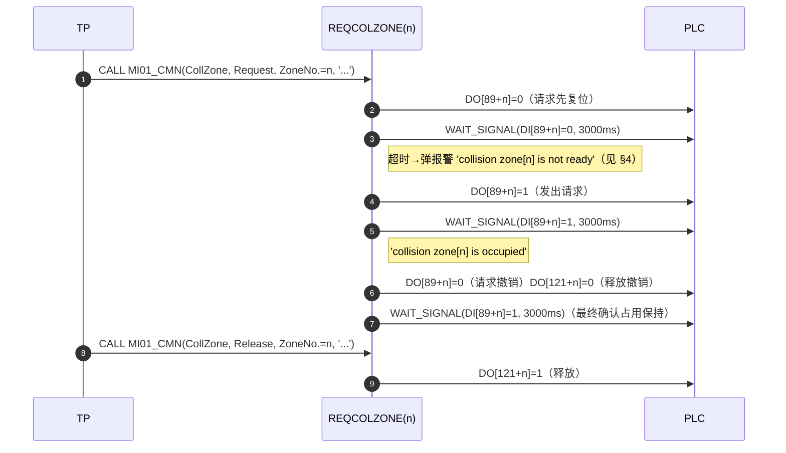

握手语义：DI[89+n] 为 PLC 允许信号（1=可进/占用保持）。请求脉冲式（DO[89+n] 拉高→确认→拉低），释放为电平式（DO[121+n]）。【实证：REQCOLZONE/RELCOLZONE，MI01_CMN_ROUT.KL:404-448；手册 6.3.2】

### 1.4 Segment（步序回显）

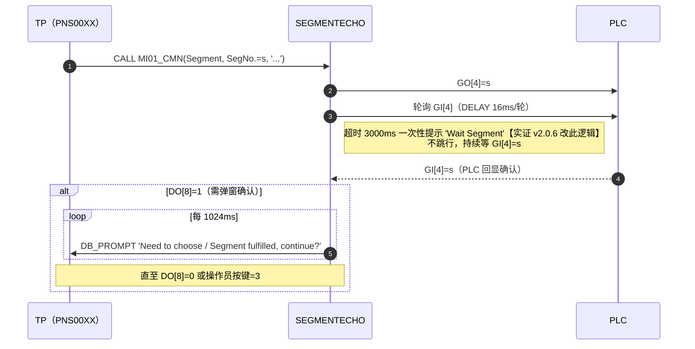

【实证：SEGMENTECHO，MI01_CMN_ROUT.KL:450-469；手册 6.3.3「当 DO[8]为 ON 时发生弹窗确认」】

### 1.5 DecisionCode（SetToReg / OutToPLC）

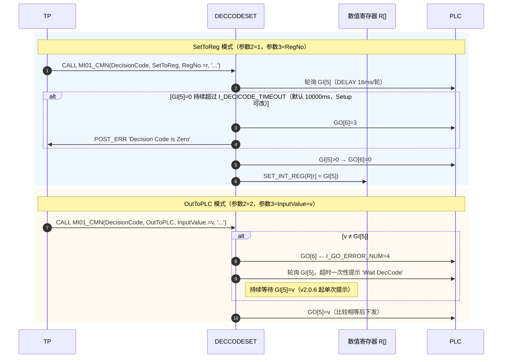

【实证：DECCODESET，MI01_CMN_ROUT.KL:471-507；手册 6.3.4；v2.0.9「Decision Code 加入计时等待，超时设置入 MI01 Setup」】

### 1.6 Fixture（工装区 Clear of Fix）

| 参数 | 动作 | 信号 |
|---|---|---|
| IN（=1） | 在工装区内 | DO[153+FixNo-1]=0（Clear of Fix OFF） |
| OUT（=2） | 离开工装区 | DO[153+FixNo-1]=1（ON） |

【实证：FIXTURESET，MI01_CMN_ROUT.KL:509-519；手册 6.3.5】

### 1.7 PressCheck / RIPCheck（气压与水汽检测）

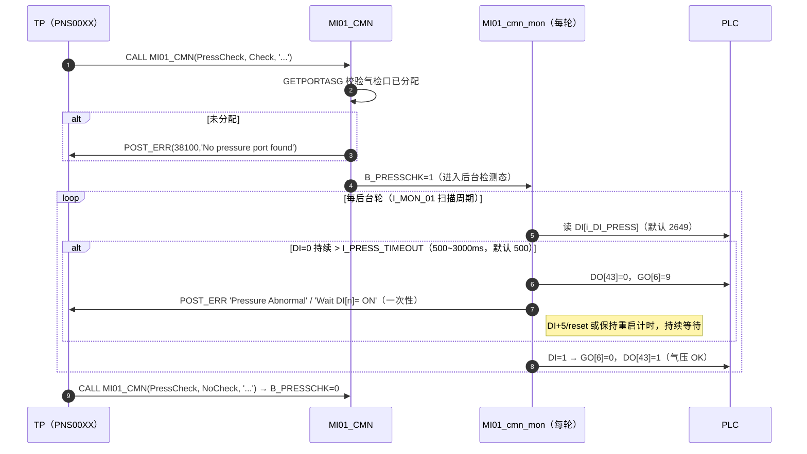

RIPCheck（兼容 Festo/Pliem/SMC，I_RIP_TYPE 品牌选择）：【实证：MI01_RIP_CHECK，MI01_CMN_ROUT.KL:579-641；手册 6.3.7】

| 调用 | 动作序列 | 联锁 |
|---|---|---|
| `(RIPCheck, SpotWeld/NonSpotWeld, AirON, Check/NoCheck)` | I_DI_PRESS ← I_MI01_FS_DI+7（默认 2928+7=2935，即 RIP 气检口），置/清 B_PRESSCHK | 同 PressCheck 后台检测 |
| `(RIPCheck, SpotWeld, WaterON, ...)` | 泵 DO=0；FS_DO+2=0、FS_DO+8=0；Reset 信号脉冲 3s【更新日志 v2.0.5】 | bypass（FS_DI+3）须=0 否则 'RIP Bypass is not OK'；flow（FS_DI+1）须=1 否则 'RIP Flow is not OK' |
| `(RIPCheck, SpotWeld, WaterOFF, ...)` | FS_DO+2=1（关水阀） | 阀位反馈 FS_DI+2 须=1（'RIP Valve not closed'）；flow FS_DI+1 须=0（v2.0.4「检测 flow ok 为低电平」）；随后 DO[2938]（I_PRIEM_PUMP_DO）脉冲 I_PRIEM_PUMP_PULSE 秒（默认 5s，1~10s 可配，Setup「Prem Pump Pulse」） |

### 1.8 ProgNumberCheck（程序号校验，v2.0.9 新增）

`CALL MI01_CMN(ProgNumberCheck, ProgNo.=p, '...')` → 读 GI[1]；若 p≠GI[1] 则轮询等待（3000ms 后一次性提示 'Wait Prog Num'，持续等 GI[1]=p）。【实证：PROGNUMBERCHECK，MI01_CMN_ROUT.KL:649-659；更新日志 v2.0.9「新增 ProgNumCheck 指令」】
⚠ 手册 v20 的 6.2 参数列表未收录此指令（仅 7 项且第 7 项仍写旧名"FestoCheck"），代码为 8 项——手册滞后于代码。

### 1.9 后台监控主循环（MI01_cmn_mon / MI_HOLD）

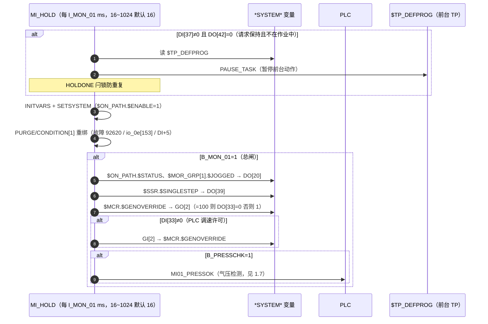

【实证：MI01_CMN_MON.KL:115-257。CHECKONPATH/CHECKSTEP 末尾存在无条件清零语句（DO[20]/DO[39] 恒 0）——疑反编译控制流合并伪影，现场表现以真机为准【存疑】】

### 1.10 MI01_ERROR（PRIO 监控 + Logbook 自动收集）

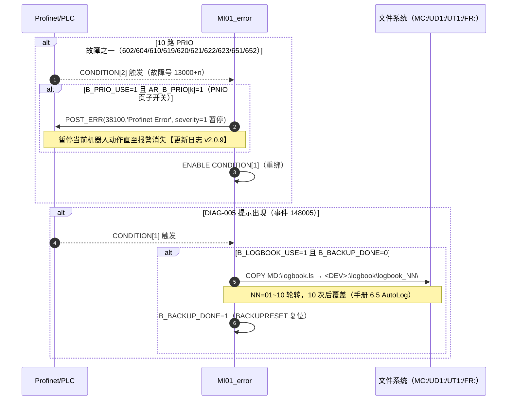

【实证：MI01_ERROR.KL 全文；CONDITION stmt 残留 `1|148005`、`2|13000+602|…|13000+652`】

### 1.11 MI01_AUTOBK（远程自动备份）

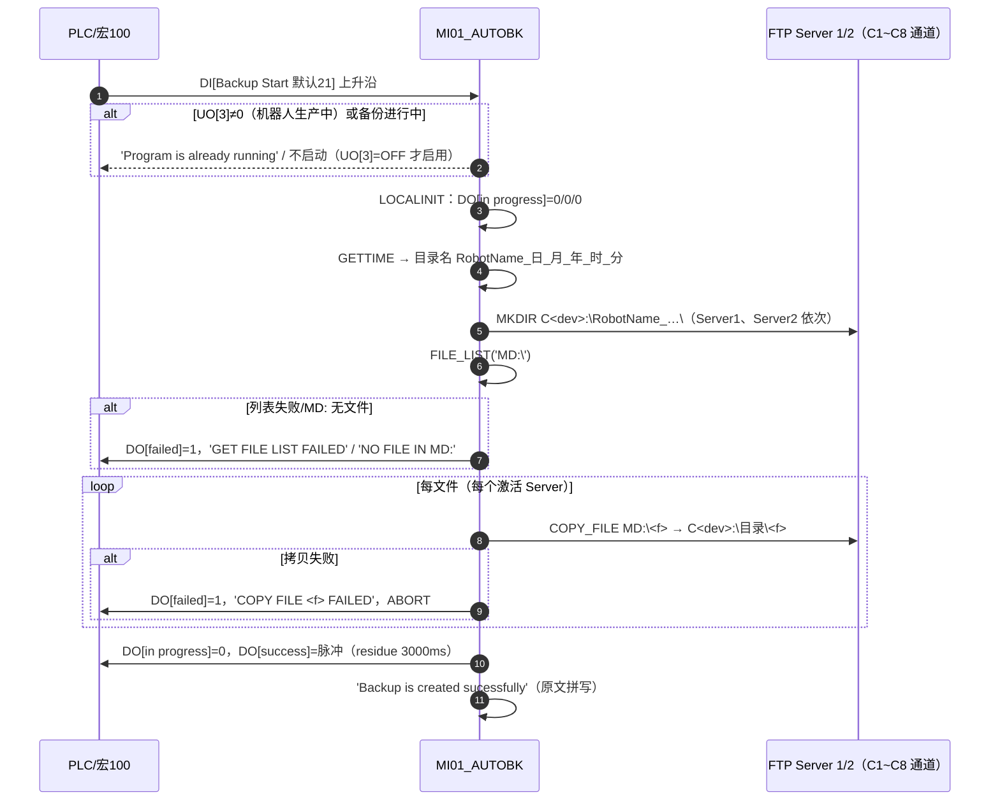

【实证：MI01_AUTOBK.KL:129-251；手册 6.5 AutoBack / 6.6 Filezilla（FTP 用户名必须 ADMIN、D:\BACKUP、端口 21）；v2.0.8「双 Server 依次备份、Robot IP 自动读取」；v2.0.9「设置不覆盖端口 1 的 IP」】

### 1.12 MI01_TCPCHECK（TCP/UT 记录校验，独立指令）

TP 调用形态（不走 MI01_CMN）：`CALL MI01_TCPCHECK("Record"=1|"TCPCheck"=2, "UFrameNo.", "UToolNo.", …)`。【实证：MI01_TCP_CHECK.LS】

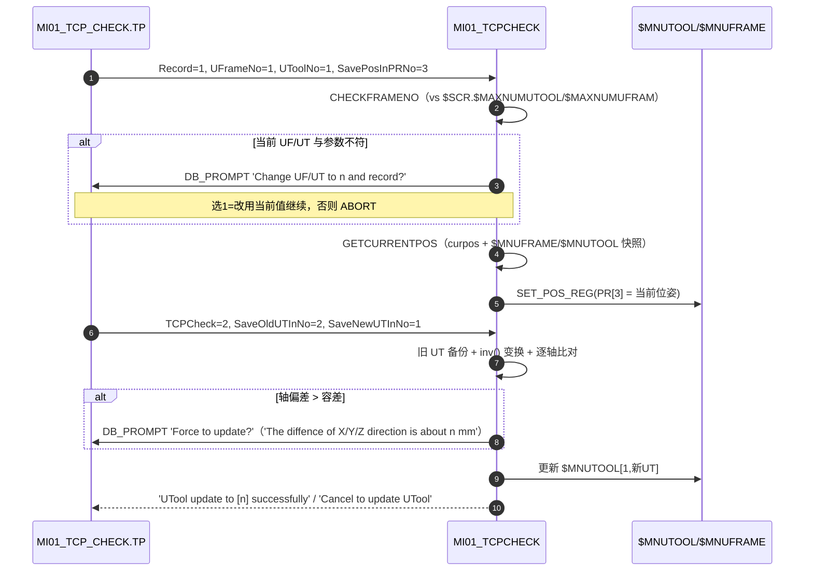

⚠ 手册 v20 已删除 MI01_TCPCHECK 章节（更新日志 v2.0.8 附近「删除 MI01_TCPCHECK 章节」），但模块与 TP 模板仍在 v2.0.9 包内——使用时只能以代码+本篇为据。

---

## 2. 参数表

### 2.1 TP 指令参数速查（CALL MI01_CMN）

| 指令 | 参数 2 | 参数 3 | 参数 4 | 注释参数 |
|---|---|---|---|---|
| Init | — | — | — | '…'≤32 字符 |
| CollZone | Request / Release | ZoneNo.=1~32 | — | 同上 |
| Segment | SegNo.=1~255 | — | — | 同上 |
| DecisionCode | SetToReg / OutToPLC | RegNo.（SetToReg）/ InputValue（OutToPLC） | — | 同上 |
| Fixture | IN / OUT | FixNo. | — | 同上 |
| PressCheck | Check / NoCheck | — | — | 同上 |
| RIPCheck | SpotWeld / NonSpotWeld | AirON / WaterON / WaterOFF | Check / NoCheck（仅 AirON） | 同上 |
| ProgNumberCheck | ProgNo. | — | — | 同上 |

独立指令：`MI01_TCPCHECK(Record|TCPCheck, UFrameNo., UToolNo., SavePosInPRNo.|SaveOldUTInNo., SaveNewUTInNo., '...')`。

### 2.2 MI01 Setup 配置参数（GUI ↔ 变量 ↔ 默认/范围）

| Setup 项 | 变量（MI01_CMN_VAR） | 默认 | 范围/取值 | 作用 |
|---|---|---|---|---|
| BG Scan Time | I_MON_01 | 16 ms | 16~1024 | 后台扫描周期 |
| Decision Code Timeout | I_DECICODE_TIMEOUT | 10000 ms | 100~99999 | DecisionCode 等 GI 非 0 超时 |
| Press Check Timeout | I_PRESS_TIMEOUT | 500 ms | 500~3000 | 气检等待超时（代码硬钳位） |
| Prem Pump Pulse DO | I_PRIEM_PUMP_DO | 2938 | — | 关水脉冲 DO 号 |
| Prem Pump Pulse 时间 | I_PRIEM_PUMP_PULSE | 5 s | 1~10 | 关水脉冲宽度 |
| RIP brand | I_RIP_TYPE | — | SMC / FESTO / PLIEM / NONE | 水汽单元品牌（EXEC 后配水流量信号 $SPOTEQIO[1].$DI_WFOK_I[1]） |
| FANUC Rail Unit | B_FANUC_RAIL | — | 用/不用 | EXEC 后做 DI-DO 关联（写 $THRSDITABLE[12/13]）【实证 GUI】 |
| Robot Name | ST_ROBOT_NAME | 'b2bsrobot' | ≤20 | 备份目录前缀 |
| Robot IP | ST_ROBOT_IP | 自动读 Host Comm | — | 与 Server 同网段 |
| Server 1/2 | AR_B_DEV_USE[1/2]、AR_I_DEVICE[1/2]、AR_ST_SERVER_IP[1/2]、AR_I_DEVPORT[1/2] | — | Device=C1~C8 | FTP 双服务器 |
| Backup Start | I_DI_START | DI 21 | — | 备份启动沿 |
| Backup in progress | I_DO_IN_PROCESS | DO 21 | — | 备份进行中 |
| Backup success | I_DO_SUCCESS | DO 22 | — | 成功脉冲 |
| Backup failed | I_DO_ERROR | DO 23 | — | 失败 |
| PNIO Function Use | B_PRIO_USE | 1（ON） | ENB/DSB | PRIO 监控总开关 |
| PNIO Alarm Set[1..10] | AR_B_PRIO[1..10] | 1~3=ON | ENB/DSB 每路 | 10 路 Profinet 报警子开关 |
| AutoLog Function Use | B_LOGBOOK_USE | 1（ON） | — | DIAG-005 自动收 Logbook |
| Saved in Device | I_LOGBOOK_DEV | 1=MC | MC/UD1/UT1/FR | 存储介质 |
| （气检口） | I_DI_PRESS | 2649 | KAREL VARS 可改 | 气压 DI；RIPCheck AirON 时被重定向为 I_MI01_FS_DI+7 |
| （RIP 基址） | I_MI01_FS_DI / I_MI01_FS_DO | 2928 / 2928 | KAREL VARS 可改 | RIP 信号基址 |
| PLC 信号偏移 | I_MI01_DI/DO/GI/GO | 0 / 0 / 0 / 0 | KAREL VARS 可改 | 手册 6.1.2，非必要勿改 |

【实证：手册 6.5 + MI01_CMN_ROUT INITVARS 默认值 + MI01_CMN_GUI 写 [MI01_CMN_VAR] 变量串证】

### 2.3 IO/信号映射（MI01 域，基址+偏移）

| 信号 | 方向 | 语义 | 出处 |
|---|---|---|---|
| DI[5] | IN | 复位/重启联锁（清等待计时） | DIMSGOUT/MI01_PRESSOK |
| DI[33] | IN | PLC 调速许可 | SPEEDCHANGE |
| DI[37] | IN | 保持请求（暂停前台） | MI_HOLD |
| DI[89+n] | IN | 干涉区 n 允许（1~32） | REQCOLZONE |
| DI[2649]（I_DI_PRESS） | IN | 气压 OK | MI01_PRESSOK |
| FS_DI+1/2/3/7（基 2928） | IN | RIP 流量 OK / 阀关反馈 / bypass / 气检 | MI01_RIP_CHECK |
| DI[Backup Start=21] | IN | 备份启动沿 | MI01_AUTOBK |
| DO[7] / DO[63] | OUT | At Home / At Pounce | INITPLCIO、MOVE_HOME/POUNCE |
| DO[8] | OUT | Segment 弹窗确认态 | SEGMENTECHO |
| DO[20] / DO[39] / DO[33] | OUT | 在路径上 / 单步 / 速度≠100 | MON |
| DO[42] / DO[43] | OUT | Robot in process / 气压 OK | ROBOTINPROC / MI01_PRESSOK |
| DO[49,50,52,53,57,58] | OUT | 状态复位组（Init 清零） | INITPLCIO |
| DO[89+n] / DO[121+n] | OUT | 干涉区 n 请求 / 释放（1~32） | REQ/RELCOLZONE |
| DO[153+n] | OUT | 夹具 n Clear of Fix（1~32） | FIXTURESET |
| DO[193]~DO[200] | OUT | PROG RECORD 程序码输出脉冲 | 手册 6.7 |
| FS_DO+2/8（基 2928）、DO[2938] | OUT | RIP 水阀 / 辅助 / 泵脉冲 | MI01_RIP_CHECK |
| DO[21/22/23] | OUT | 备份中 / 成功 / 失败 | MI01_AUTOBK |
| GI[1] / GI[2] / GI[4] / GI[5] | IN | 程序号 / 速度请求 / 步序回显 / DecisionCode | 各指令 |
| GO[2] | OUT | 当前速度倍率（io_13[2]） | SENDSPDTOPLC |
| GO[3] | OUT | MI02 未安装标志 | INITPLCIO |
| GO[4] / GO[5] | OUT | 步序号 / DecisionCode 下发 | SEGMENTECHO / DECCODESET |
| GO[6] | OUT | 应用错误号（见 §4.1） | 全域 |

---

## 3. GUI 流程

### 3.1 入口与启动器

MENU → TEST CYCLE → **MI GUI**（v1.0.12 起，手册 6.4）→ 弹出菜单只列**已激活应用**的 Setup（MI01_GUI 按 `apps_lst[].INSTALLED` 过滤）→ 选 **MI01 Setup** 进入 MI01_CMN_GUI（表单 acmn/01acmneg）。未选时 'No application selected' / 'No GUI for installed apps'。【实证：MI01_GUI.KL、手册 6.4】

### 3.2 MI01 Setup 四页（手册 6.5）

| 键 | 页 | 内容 | 落盘 |
|---|---|---|---|
| F1 | PLCSetup | BG Scan Time / Decision Code Timeout / Press Check Timeout / Prem Pump Pulse(DO+时间) / RIP brand / FANUC Rail Unit | 写 [MI01_CMN_VAR]；RIP 品牌 EXEC 配水流量 DI；导轨 EXEC 写 $THRSDITABLE[12/13] DI-DO 关联 |
| F2 | AutoBack | Robot Name / Robot IP(自动) / Server1·2(Device C1~C8/IP/Port) / Backup Start·In progress·Success·Failed | 写 [MI01_CMN_VAR] + $HOSTC_CFG[n]（$SERVER_PORT/$STRT_REMOTE/$ASSIGN_ID）+ $MACROTABLE（宏 100）；**F3[EXEC] 一键配置后需重启生效** |
| F4 | PNIO | Function Use 总开关 + 10 路报警 ENB/DSB 子开关 | 写 b_prio_use / ar_b_prо[] |
| F5 | AutoLog | Function Use + Saved in Device（MC/UD/UT/FR） | 写 b_logbook_use / i_logbook_dev |

保存反馈串证：'Configuration saved'（01acmneg.tx）。【实证：MI01_CMN_GUI.KL 变量写入串 + 表单文本】

### 3.3 PROG RECORD（程序修改记录，手册 6.7）

MENU → STATUS → **PROG RECORD**（MI01_REC_GUI，表单 rcproceg）：

```
主界面:  Program Name(仅.TP)  Code(→DO[193..200])  Status(监控中?)
         F1[Clear] 清全部 / F2[Start] 启动后台监控 / F3[Setup]
Setup:   BG Scan Time(s)  Pulse Time(脉冲宽度)  F1[Prev] 返回
```

后台 MI01_REC_MON 按扫描周期比对被监控 TP 的状态（' <>' 差异即视为修改），修改时以 Code 脉冲输出 DO[193]~DO[200] 给 PLC。⚠ 手册明示：**重启机器人后需再次手动 Start**。【实证：MI01_REC_GUI/REC_MON、手册 6.7】

### 3.4 辅助界面（MI01 域一并交付）

| 界面 | 入口 | 功能 |
|---|---|---|
| DCP Faults History | 表单 flhisteg（DCP_HIST） | 查看 DCP 故障历史（DCPFaultNum/DCPLine1-5/时间），空态 'No History Data'/'No DCP Faults Active' |
| Comment Tool / Utility Manager | 表单 iosetpeg/setp（CMT_GUI/CMT_PORT） | IO 注释导入导出（Rob_IO_comment.xml，DIN/DOUT/GIN/GOUT/PREG）；支持 MC:/UD1:/UT1: 设备；保存后提示 'Please cycle power for assigning I/O ports'；v2.0.5 起支持 R/PR 注释 |
| Application Management | 表单 00appleg（APPS_LOADER） | 应用安装/卸载/UPDATE、IO 自动分配（SET_IO_CFG 写全部 MIxx_VAR 基址 + $THRSDITABLE）、按品牌弹窗（RIP 种类/停放站/BK 模块）、DCS 导入、USER 密码；关键操作 'Confirmation required' 弹窗 |

---

## 4. 异常路径

### 4.1 错误号协议（GO[6] + UALM）

TP 惯例：`GO[6]=n → Message[…] → UALM[n] → GO[6]=0`（KAREL 则 POST_ERR + GO[6]）。【实证：MOVE_HOME/PNS00XX/TIMER .LS】

| GO[6] | 来源 | 含义 |
|---|---|---|
| 1 | PNS00XX LBL[55] | DecisionCode NO Error（TP 端兜底） |
| 3 | DECCODESET | Decision Code is Zero（超时） |
| 4 | DECCODESET OutToPLC | 等待 GI[5]=InputValue（I_GO_ERROR_NUM=4） |
| 7 | MOVE_HOME LBL[90] | 无 Home 信号（'Check Home Ref Setting'，UALM[7]） |
| 8 | TIMER_START/STOP LBL[90] | Timer 号非法（UALM[8]，等参数合法后重试） |
| 9 | MI01_PRESSOK | Pressure Abnormal（气检超时） |
| 19 | ERRDETECT（CONDITION 唤醒） | 故障检出（如 92620） |
| 38 | MOVE_POUNCE LBL[90] | 无 Pounce 信号（UALM[38]） |
| I_GO_ERROR_NUM（默认 0） | GIMSGOUT/DIMSGOUT | 通用等待超时（如 'Wait GI[x]=y'） |

### 4.2 指令级异常路径汇总

| 场景 | 表现 | 恢复 |
|---|---|---|
| TP 参数读取失败/类型错 | POST_ERR 38100 'Error reading …' / 38099 'Wrong data type for PRM[n]' | 修正调用 |
| Init 时机器人不在 home/pounce | 每 1s 弹 'Robot not in home or pounce' | 手动移到位后自动继续 |
| CollZone 3000ms 无应答 | 报警栏 'collision zone[n] is not ready' / 'is occupied'（WAIT_SIGNAL 语义） | PLC 应答后继续；复位可清 |
| Segment 等 GI 回显 | 一次性提示 'Wait Segment'，**不跳行持续等待**（v2.0.6 起） | PLC 回显 GI[4] |
| Segment 弹窗（DO[8]=1） | 'Segment fulfilled, continue?' 循环弹 | DO[8]=0 或按键 3 |
| DecisionCode 超时 | GO[6]=3 + 'Decision Code is Zero' | GI[5] 非 0 后继续写寄存器 |
| 气检口未分配 | 'No pressure port found'（指令即报） | 配置 i_DI_press / 重分配 IO |
| 气检超时 | GO[6]=9 + 'Pressure Abnormal'（一次性提示后持续等） | DI 恢复 / NoCheck |
| RIP bypass ON / flow NOK / 阀未关 | 'RIP Bypass is not OK' / 'RIP Flow is not OK' / 'RIP Valve not closed'（WAIT_SIGNAL 3s 粒度） | 设备恢复后继续 |
| PRIO 报警（10 路任一） | POST_ERR 'Profinet Error' severity=1 → **暂停机器人动作直至报警消失** | 报警消除自动恢复 |
| DIAG-005 | 自动拷 logbook.ls 至 <DEV>:\logbook\logbook_NN\（01~10 轮转覆盖） | 自动 |
| 备份 UO[3]=ON（生产中） | 不启动备份 | 停产时再触发 |
| 备份失败 | DO[failed]、'GET FILE LIST FAILED'/'COPY FILE … FAILED'/'NO FILE IN MD:'，ABORT | 检查 FTP Server 在线/共享目录 |
| 备份重入 | 'Program is already running' | 等待完成 |
| 后台任务拉起失败 | POST_ERR(38000,'BGTASK Run Failed') | 检查任务表 |
| TCPCheck 偏差超容差 | 'Force to update?' 逐轴确认（'The diffence of X…'） | 拒绝则 'Cancel to update UTool' |

---

## 5. 与 TP 程序交互

### 5.1 CALL 契约

- 入口程序名 `MI01_CMN`（无后缀=基本程序，手册 6.1.1）；参数依次为指令码、指令参数、字符串注释（≤32 字符）。
- KAREL 侧经 `GET_TPE_PRM` 逐参取用（GETTPEPRMINT/REAL/STR 自带类型校验与 38099/38100 报错）。
- `%NOPAUSE = COMMAND + TPENABLE + ERROR`、`%NOABORT = ERROR + COMMAND`：指令执行不随示教器暂停/中止打断——联锁等待的"不跳行持续等待"语义由实现保证。

### 5.2 配套 TP 程序（仓库 .LS 实证）

| TP | 类型 | 作用 | MI01 交互 |
|---|---|---|---|
| MOVE_HOME | Macro | J PR[1:Home] → WAIT DO[7] TIMEOUT→GO[6]=7/UALM[7] 重试 | 成功后 `CALL MI01_CMN(Init)` |
| MOVE_POUNCE | Macro | J PR[2:POUNCE] → WAIT DO[63] TIMEOUT→GO[6]=38/UALM[38] | 目标位确认 |
| TIMER_START / TIMER_STOP | Macro | AR[1]=1~64 → TIMER RESET/START/STOP；TIMER_STOP 时 R[1]=TIMER[1] | 节拍计时 |
| PNS00XX | 模板 | 标准生产节拍骨架（见下） | Init / PressCheck / Segment 全用上 |
| MI01_TCP_CHECK | 通用 | Record 记 PR[3]；TCPCheck 更新 UT | 调 MI01_TCPCHECK |

**PNS00XX 标准节拍（摘录，逐段标注）**：

```
CALL TIMER_START(1)                       ! 节拍计时开始
CALL MI01_CMN("Init"=1)                   ! 信号初始化（等 home/pounce）
CALL MI01_CMN("PressCheck"=6,"Check"=1)   ! 气检开
CALL MI04_SSW("CapChange"=2,...)          ! （焊枪应用）
CALL MOVE_POUNCE                          ! 走位
GO[4]=10 ; WAIT GI[4]=10 OR DI[63]=ON     ! 步序握手（或 DI[63] 旁路）
CALL <焊接作业>                            ! 工艺 TP
CALL MI01_CMN("Segment"=3,"SegNo."=1)     ! 步序上报
CALL MI01_CMN("Init"=1)                   ! 复位
CALL MOVE_HOME ; CALL TIMER_STOP(1)
IF DI[516] OR R[37]>30 …,CALL TIPCHANGE…  ! 换帽/修磨挂接（MI04 域）
LBL[55]: GO[6]=1 ; UALM[4]                ! DecisionCode 异常兜底
```

### 5.3 跨任务约定

- **B_MON_01**：MI01_CMN 每次指令收尾置 1 并 RUN_MONITOR 保活后台；GUI/Setup 可改配置但监控体以 UNINIT 默认化自愈（INITVARS 每轮）。
- **后台暂停前台**：MI_HOLD 读 `$TP_DEFPROG` 后 `PAUSE_TASK`（DI[37] 请求且 DO[42]=0 时）——与 MI01_ERROR 的 PRIO 暂停（POST_ERR severity 1）构成两套"停机"通道。
- **寄存器**：DecisionCode SetToReg → `SET_INT_REG`；速度倍率走系统变量 `$MCR.$GENOVERRIDE`（GI[2]→SYS，SYS→GO[2]/DO[33]）。

---

## 6. 手册 × 更新日志 × 代码 对照结论

1. **指令清单滞后**：代码 8 指令，手册 6.2 列 7 项且第 7 项用旧名 "FestoCheck"（6.3.7 已是 RIPCheck，v2.0.4 改名）；**ProgNumberCheck（v2.0.9 新增）手册未收**。
2. **MI01_TCPCHECK 章节删除但模块仍在**（v2.0.8 附近删除），现场可用不可查文档。
3. **v2.0.9 修复谱系**（更新日志十段）：自动备份不覆盖端口 1 IP、ProgNumCheck、MI01_ERROR PRIO 监控（暂停动作）、DecisionCode 计时+Setup 超时、DIAG-005→MI01_ERROR 自动收 Logbook；v2.0.8：PROG RECORD、双 Server、Robot IP 自动读取、DCS 速度位置检查自动启用；v2.0.7：远程自动备份、恢复 MOVE_HOME/POUNCE 导入；v2.0.6：GI 等待改"单次提示+持续等待"；v2.0.5：RIP 开水 Reset 3s 脉冲+bypass 报警、RIP/FANUC 导轨品牌选择、WaterOFF 测 flow 低电平；v2.0.4：FestoCheck→RIPCheck、DO[2938] 关水脉冲、FAP_VERSION.XML。
4. **风险/怪癖**（承接总纲 B1/B3/B4）：
   - Init 只复位干涉区/夹具 1~3，CollZone/Fixture 却支持 1~32——4 号以上依赖现场自行初始化。【实证】
   - CHECKONPATH/CHECKSTEP 反编译尾部无条件清零 DO[20]/DO[39]，疑控制流合并伪影，以真机为准。【存疑】
   - 等待类全部"一次性提示+无限等"（v2.0.6 设计），PLC 不应答=产线卡死在等待行——需配合超时报警机制使用。【实证语义】
   - 备份文件名时间串来自 `CNV_TIME_STR` 切片（日_月_年_时_分），与手册"年+月+日+时+分"顺序描述不一致（手册口径 vs 代码切片拼接）。【实证差异】
   - 'Wait Singal' 类拼写问题在本应用无（'floder'/'sucessfully'/'diffence' 三处显示层拼写瑕疵，不影响逻辑）。

---

*输入材料：decompiled/MI01_cmn/（18 .KL）· ref_手册v20.txt §6 · ref_更新日志FAP_v2.0.9.txt（v2.0.9→v1.0.13）· mi-fap 仓库 02_custom/01_MI01_cmn/（.LS/.tx/.vr）· analysis/MI01_cmn.html。*
