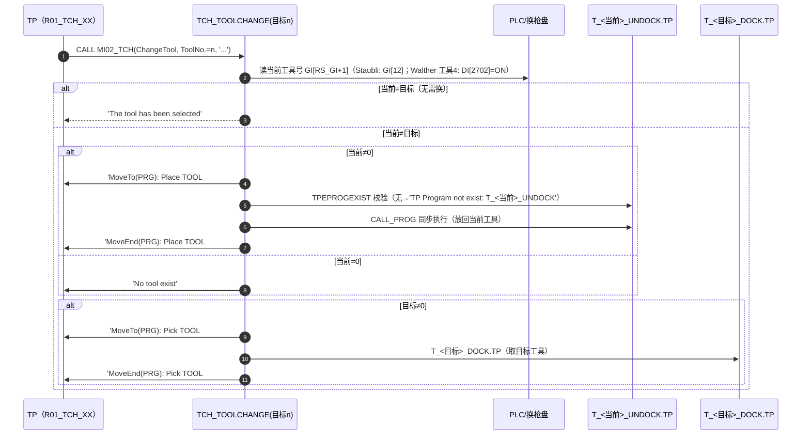
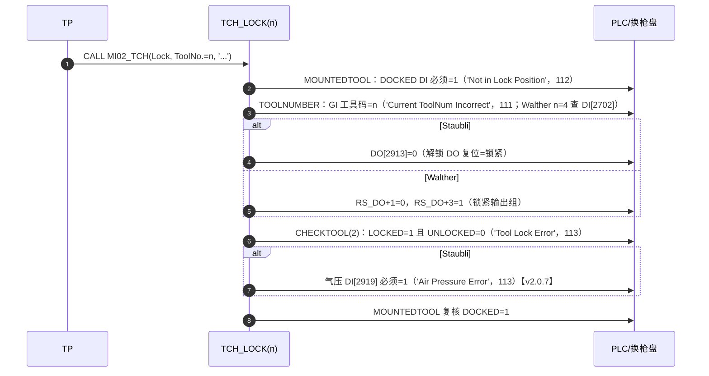
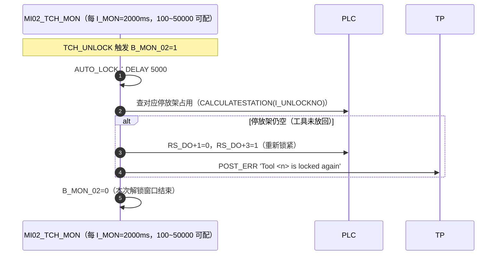
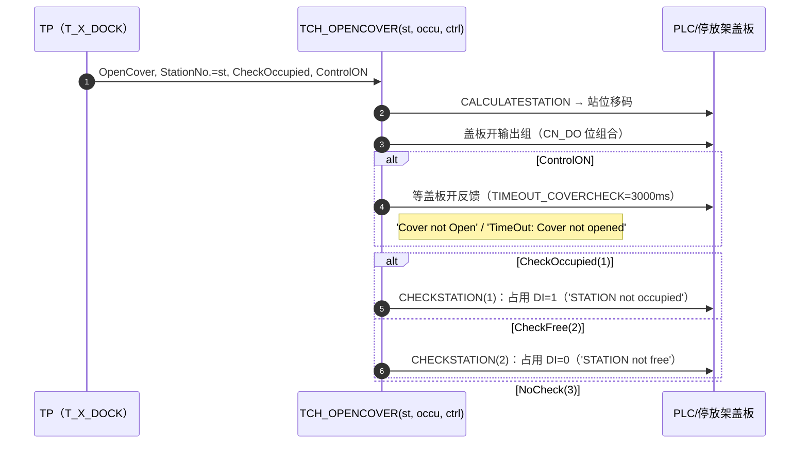

# MI02_TCH 逐应用深拆（FAP v2.0.9）

> 三方对照：pc2kl3 反编译实读（6 模块）× 手册 v20 第 7 章 × 更新日志（v2.0.9→v1.0.x 十段）+ mi-fap 仓库 .LS 模板串证。
> 标注：【实证】代码/文档直接证据；【推断】结构归纳；【存疑】反编译不确定处。生成 2026-11-03，接续 [MI01_CMN_逐应用深拆.md](MI01_CMN_逐应用深拆.md)。

---

## 0. 定位与模块清单

**一句话定位**：换工具（Tool Changer）应用——盖板开/关、工具码校验、锁紧/解锁、停放架占用检查、自动换工具；双设备族支持 **Walther**（默认，走 RS 信号域）与 **Staubli**（Setup 激活，走 STB 信号域 + Euchner 安全监控），停放架品牌 Murr/Elco/Balluff 影响站号寻址。【实证：手册 7.1/7.3 + DECIDE_DIO】

| 模块 | 行数 | 角色 |
|---|---|---|
| MI02_TCH | 218 | TP 指令入口（DOAPP 分发 8 指令） |
| MI02_TCH_ROUT | 756 | 指令实现（TCH_* 全套 + 品牌化 IO 解析 DECIDE_DIO） |
| MI02_TCH_MON | 305 | 后台：Walther 5s 自动重锁（AUTO_LOCK）/ Staubli Euchner 监控 + 手动请求分发 |
| MI02_TCH_MAN | 254 | 手动操作实现（MANUAL_COVEROPEN/CLOSE/LOCK/UNLOCK，Deadman 检查） |
| MI02_TCH_GUI | 560 | MI02 Setup（ToolCHG 品牌页 + ToolSt. 停放架品牌页） |
| MI02_TCH_VAR | 20 | 变量文件壳（CMOS KAREL VARS） |

任务模型：后台 `MI02_TCH_MON` 不随开机自启——**至少运行一次任意 MI02_TCH 指令才拉起**（TCH_UNLOCK 或 DECIDE_DIO(Staubli) 里 RUN_MONITOR）。【实证：TCH_UNLOCK/DECIDE_DIO 中 RUN_MONITOR('MI02_TCH_MON')；手册 6.1.4 通用规则】

---

## 1. 指令级时序图

### 1.1 指令分发总图

`CALL MI02_TCH(指令, 参数…, '注释≤32')`，参数 1=指令码（手册 7.2「Parameter select」）：

| 码 | 指令 | 参数 | 实现 |
|---|---|---|---|
| 1 | OpenCover | 2:StationNo.，3:CheckOccupied/CheckFree/NoCheck，4:ControlON/ControlOFF | TCH_OPENCOVER |
| 2 | CloseCover | 2:StationNo.，3:ControlON/ControlOFF | TCH_CLOSECOVER |
| 3 | CheckToolCode | 2:ToolNo. 0~4 | TCH_TOOLCODE |
| 4 | Lock | 2:ToolNo. 1~4 | TCH_LOCK |
| 5 | UnLock | 2:ToolNo. 0~4 | TCH_UNLOCK |
| 6 | OccupiedChk | 2:StationNo.，3:StateOccupied/StateFree | TCH_OCCCHECK |
| 7 | ChangeTool | 2:ToolNo. 0~4 | TCH_TOOLCHANGE |
| 8 | UnlockChk | — | CHECK_UNLOCK |

主尾（折叠于 DOAPP 末尾【推断】）：`INITVARS` → `DECIDE_DIO(0)`（按品牌装载信号映射）→ 指令循环。

**DECIDE_DIO 品牌路由**（每次指令都走）：【实证：MI02_TCH_ROUT.KL:291-326】

| 信号 | Staubli（B_IS_STABLI=1） | Walther（默认） |
|---|---|---|
| 解锁 DO | I_DO_STB_UNLOCK=2913 | RS_DO+1（基 2696） |
| 锁紧 DI / 解锁 DI | STB_LOCKED=2913 / STB_UNLOCKED=2915 | RS_DI+7 / RS_DI+8 |
| 对接到位 DI | STB_DOCKED=2917 | RS_DI+5 |
| 安全 DI | STB_SAFETY=2928 | RS_DI+1 |
| 工具码 GI | STB_TOOLCOD=12 | RS_GI+1（基 10） |
| 附带 | RUN_MONITOR(MON)、$THRSDITABLE[21/22]：DI 2921/2922→DO[MI01_DO+45/46] | $THRSDITABLE[21/22]：DI 2699/2700→DO[MI01_DO+45/46] |

$THRSDITABLE 关联即更新日志 v1.0.x「DI[2699]->DO[45]，DI[2700]->DO[46]」与 v2.0.8「DCS 工具球停放站信号自动关联」。【实证】

### 1.2 ChangeTool（自动换工具，核心时序）



【实证：TCH_TOOLCHANGE，MI02_TCH_ROUT.KL:668-753；手册 7.2.7】
TP 轨迹约定：T_X_DOCK / T_X_UNDOCK 的 X=1,2,3,**不补 0**（v1.0.x 更名自 T_P_OUTX/T_D_OUTX）；中间轨迹由用户示教，模板已插好 MI02_TCH 调用点位。【实证：T_X_DOCK.LS 头注释 + 更新日志】

⚠ 模板 T_X_DOCK.LS 头注释写 "Place tool to stand station"，与运行时语义（Pick TOOL #n=取工具上枪）相反——**以 TCH_TOOLCHANGE 的 'Pick/Place TOOL' 消息为准**，模板注释是旧文案残留。【实证差异】

### 1.3 Lock / UnLock / UnlockChk



**UnLock**（ToolNo 0~4）：CHECKUNLOCKRELEASE（安全 DI=1，'No SafetyPower'，115）→ Staubli：DO[2913]=1；Walther：记录 I_UNLOCKNO、B_MON_02=1 拉起 MON、RS_DO+3=0、**解锁脉冲 5s**（residue 5000）→ CHECKTOOL(1)（'Tool Unlock Error'，114）。【实证：TCH_UNLOCK，ROUT:608-627；v2.0.4「Unlock 信号以脉冲 5s 形式发出」】

**Walther 5s 自动重锁**（AUTO_LOCK，v2.0.9 从 condition 移入后台）：



【实证：AUTO_LOCK，ROUT:565-583；MON MESSDISP:286；更新日志 v2.0.9/v2.0.4】

### 1.4 OpenCover / CloseCover / OccupiedChk

站号寻址：CALCULATESTATION(StationNo) 按奇偶算出位移组（[1]/[2]/[3]），**I_TOOLSTAND=2（Elco）时 3/4 号站特判 + 偏移 [4]=8**——停放架品牌决定物理 DI/DO 排布。【实证：ROUT:406-435】



CloseCover 对称（'Cover not Close' / 'TimeOut: Cover not closed'）；OccupiedChk=只做 CHECKSTATION±CHECKNOMATCH（双传感器一致性：AR_TCH_TS_f00[st] 启用时查 'Missmatch between configured sensors'）。【实证：TCH_OPENCOVER/CLOSECOVER/OCCCHECK + CHECKNOMATCH/CHECKSTATION，ROUT:437-554,638-666】

### 1.5 CheckToolCode

`CALL MI02_TCH(CheckToolCode, ToolNo.=t, '...')` → TOOLNUMBER(t)：Staubli 等 GI[12]=t；Walther t=4 查 DI[2702]=1，否则等 GI[RS_GI+1]=t；超时 TIMEOUT_TCHCHECK=500ms 一次性报 'Current ToolNum Incorrect'（GO[6]=111）。【实证：TOOLNUMBER，ROUT:328-343；v2.0.8「DI[2702]=ON 代表工具号 4」】

### 1.6 后台监控（MI02_TCH_MON）

每轮（I_MON 扫描，默认 2000ms）：B_MON_02=1 时——Staubli 走 EUCHNERCHECK（DI[2927]≠0 → 'Euchner Error'；启用 Euchner2 时 DI[2920]=0 → 'Euchner 2 Error'，一次性 ERRORONE 闩锁，severity=1 暂停）；Walther 走 AUTO_LOCK。CONDITION 绑定 GUI 手动标志（B_MAN_LOCK/UNLOCK/COVEROPEN/COVERCLOSE）→ 调 MANUAL_*。【实证：MON:241-302】

---

## 2. 参数表

### 2.1 TP 指令参数速查

| 指令 | 参数 2 | 参数 3 | 参数 4 | 备注 |
|---|---|---|---|---|
| OpenCover | StationNo. | CheckOccupied / CheckFree / NoCheck | ControlON / ControlOFF | NoCheck 时参数 4 随意 |
| CloseCover | StationNo. | ControlON / ControlOFF | — | |
| CheckToolCode | ToolNo.=0~4 | — | — | 与工具码 GI 比对 |
| Lock | ToolNo.=1~4 | — | — | |
| UnLock | ToolNo.=0~4 | — | — | Walther 解锁脉冲 5s+自动重锁窗口 |
| OccupiedChk | StationNo. | StateOccupied / StateFree | — | |
| ChangeTool | ToolNo.=0~4 | — | — | 0=只放回当前工具 |
| UnlockChk | — | — | — | 仅查解锁态 |

### 2.2 MI02 Setup 配置（GUI ↔ 变量 ↔ 默认）

| Setup 项 | 变量（MI02_TCH_VAR） | 默认 | 范围/取值 | 作用 |
|---|---|---|---|---|
| STAUBLI TOOL Changer | B_IS_STABLI | DISABLE(0) | ENABLE/DISABLE | 激活后所有指令走 Staubli 时序 |
| 后台扫描时间 | I_MON | 2000 ms | 100~50000 | MON 轮询周期（代码硬钳位） |
| STB 解锁 DO | I_DO_STB_UNLOCK | 2913 | — | Staubli 解锁输出（v2.0.5 曾改默认 2925，v2.0.9 现值 2913【两处文档口径不一，以代码默认为准】） |
| STB 锁紧/解锁/到位/气压/安全/Euchner DI | I_DI_STB_LOCKED / UNLOCKED / DOCKED / AIRPRESSURE / SAFETY / EUCHNER / EUCHN2 | 2913 / 2915 / 2917 / 2919 / 2928 / 2927 / 2920 | — | Staubli 交互信号点位 |
| STB 工具码 GI | I_GI_STB_TOOLCOD | 12 | — | |
| Euchner 2 使能 | B_STB_EUCHNER2 | 0 | — | v2.0.8 双安士能模块 |
| ToolSt.（停放架品牌） | I_TOOLSTAND | 1 | Murr / Elco / Balluff | 影响 CALCULATESTATION 站寻址（Elco=2 特判 3/4 号站） |
| （手动超时） | TIMEOUT_TCHCHECK / TIMEOUT_COVERCHECK | 500 / 3000 ms | 手动界面 Setup General 可设 | 换枪状态 / 盖板状态检测超时 |
| （RS 域基址） | I_TCH_RS_DI/DO=2696、I_TCH_RS_GI/GO=10、I_TCH_CN_DI/DO=2896 | — | KAREL VARS 可改 | Walther 信号域 + 停放架（CN）域 |

【实证：手册 7.3 + INIT_VARS/INITVARS 默认 + GUI 写 [MI02_TCH_VAR] 串证】

### 2.3 IO 映射（偏移语义）

| 域 | 信号 | 语义 |
|---|---|---|
| RS（Walther 换枪盘，基 2696） | DO+1 / DO+3 | 锁紧输出组（Unlock=+3 拉低，Lock=+1=0,+3=1）；解锁脉冲 5s |
| RS | DI+1 / DI+5 / DI+7 / DI+8 | 安全 / 对接到位(Docked) / 锁紧 / 解锁 |
| RS | DI+6（=2702） | 工具号 4 特征位【v2.0.8】 |
| RS | GI+1 | 当前工具码 |
| CN（停放架，基 2896） | DI/DO 位组合 | 盖板开/关反馈与输出、占用检测；位移由 CALCULATESTATION 按站号+品牌算出 |
| STB（Staubli） | DI/DO 2913~2928 | 见 2.2 |
| DCS 关联 | $THRSDITABLE[21/22] | DI 2699/2700（Walther）或 2921/2922（Staubli）→ DO[MI01_DO+45/46]，工具球停放站信号 |
| 全局 | GO[6] | 错误号 111~115（见 §4.1） |

---

## 3. GUI 流程

### 3.1 MI02 Setup（MENU → TEST CYCLE → MI GUI → MI02 Setup）

| 键 | 页 | 内容 |
|---|---|---|
| F1 | ToolCHG | STAUBLI TOOL Changer ENABLE/DISABLE；ENABLE 后展开 Staubli 全部交互信号点位设置（默认值已按图设好）+ 后台扫描时间 100~50000ms |
| F2 | ToolSt. | 停放架品牌：Murr / Elco / Balluff（影响程序逻辑寻址） |

写入 [MI02_TCH_VAR] 全部配置变量；DCS 工具球关联由 DECIDE_DIO/APP SETUP 完成。【实证：MI02_TCH_GUI 字符串 + 手册 7.3】

### 3.2 TCH MAN 手动界面（MENU → NEXT → BROWSER → TCH MAN）

```
手动画面:  F2 [Man.Lock] 锁紧当前工具   F3 [Man.UnLock] 解锁
           F4 [Man.Open] 开盖板         F5 [Man.Close] 关盖板
Setup General:  Tool changer ready 超时（默认 0.5s）  Cover check 超时（默认 3s）
```

手动盖板操作先弹输入框 `Please enter the Station No. (1 ~ 8)`；**Deadman 检查**（io_0e[247/248]）不满足时红字 'Deadman switch required!'；超时 'TimeOut: Cover not opened/closed'（ST_MANSMESS 红字区）。【实证：MI02_TCH_MAN MANUAL_COVEROPEN/CLOSE + 手册 7.4】

---

## 4. 异常路径

### 4.1 错误号（GO[6]，MI02 域）

| GO[6] | 含义 | 触发 |
|---|---|---|
| 111 | Current ToolNum Incorrect | TOOLNUMBER 超时（500ms） |
| 112 | Not in Lock Position | MOUNTEDTOOL 期望在位而 DOCKED=0 |
| 113 | Tool Lock Error / Air Pressure Error | 锁紧双信号不符 / Staubli 气压缺失 |
| 114 | Tool Unlock Error | 解锁双信号不符 |
| 115 | No SafetyPower | 解锁时安全 DI=0 |

### 4.2 指令级异常汇总

| 场景 | 表现 | 恢复 |
|---|---|---|
| 盖板开/关超时 | WAIT_SIGNAL 'Cover not Open/Close' + 'TimeOut: Cover not opened/closed'（3s） | 手动排查盖板 |
| 停放架状态不符 | 'STATION not free' / 'STATION not occupied'（500ms 超时提示） | 状态纠正后继续 |
| 双传感器不一致 | 'Missmatch between configured sensors'（MSG_WRITE） | 检查 AR_TCH_TS_f00 配置与布线 |
| 工具仍在枪上（期望空） | 'Tool changer not emtpy' / 'Tool mounted on robot'（原文拼写 emtpy） | 先放回工具 |
| ChangeTool 找不到 TP | 'TP Program not exist: T_<n>_UNDOCK/DOCK'（38100） | 导入/示教对应 TP |
| ChangeTool 当前无工具 | 'No tool exist'（继续 DOCK） | — |
| 已是目标工具 | 'The tool has been selected'（提示，非报错） | — |
| 解锁后 5s 未放回（Walther） | 自动重锁 + 'Tool <n> is locked again' | 重新执行 UnLock |
| Euchner/安全异常（Staubli） | 'Euchner Error' / 'Euchner 2 Error'（severity=1 暂停） | 复位安全门 |
| 手动无 Deadman | 红字 'Deadman switch required!' | 按使能再操作 |
| 信号点位未分配 | 'DI[n] not assign'（38100，fatal=2） | 重跑 IO 分配 |

---

## 5. 与 TP 程序交互

### 5.1 CALL 契约

同 MI01：`GETTPEPARAM(n,1)` 取整型参数（INTPARAMVALUE），字符串注释最后；`%NOPAUSE/%NOABORT` 语义一致。ChangeTool 内部以 **CALL_PROG 同步调用** TP 子程序（T_X_UNDOCK → T_X_DOCK），存在性先经 TPEPROGEXIST。

### 5.2 配套 TP（仓库 .LS 实证）

| TP | 作用 | 内容骨架 |
|---|---|---|
| R01_TCH_XX | 换工具总入口模板 | `CALL MI02_TCH("ChangeTool"=7,"ToolNo."=1)` 一行搞定 |
| T_X_UNDOCK | 放回当前工具 X（用户示教中间轨迹） | CheckToolCode(X) → OpenCover(CheckFree,ControlOFF) → J → OpenCover(ControlON) → Unlock(X) → CheckToolCode(0) → CloseCover |
| T_X_DOCK | 取目标工具 X | CheckToolCode(0)（确认枪上无工具）→ OpenCover(CheckOccupied,ControlOFF) → J Home → OpenCover(ControlON) → **Lock(1)** → PAYLOAD 切换 → CheckToolCode(1) → J Home → CloseCover(ControlOFF) |

模板细节：X=1,2,3 不补前缀 0；PAYLOAD 在锁紧前后切换（放工具前 9 / 拿工具后 1，按现场配置）；UFRAME_NUM=0 / UTOOL_NUM=1。【实证：T_X_DOCK.LS】
典型换枪节拍（当前 2 → 目标 1）：`T_2_UNDOCK`（解锁放回 2）→ `T_1_DOCK`（锁紧取 1）。【实证：手册 7.2.7】

### 5.3 与 MI01 的边界

- 工具球停放站信号关联写 $THRSDITABLE（DO[45/46] 挂在 **MI01_DO 域**）——跨应用共用 MI01 的 DO 空间。
- MI02_DIMSGOUT/GIMSGOUT 复用 MI01 的等待-报错协议（GO[6] 同一错误号通道、CONDITION 复位绑 DI[MI01_DI+5]）。

---

## 6. 手册 × 更新日志 × 代码 对照结论

1. **ToolNo 范围演进**：v1.0.x `ChangeTool/Unlock 0~3 → 0~4`（DT 扩 4 个工具，v2.0.7）；v2.0.8 工具 4=DI[2702] 特征位。手册 7.2.4 Lock 写 1~4、7.2.5/7.2.7 写 0~4——与代码一致。
2. **Walther 时序三迁**：v2.0.4 解锁脉冲 5s+停放站占用检查（非占用重锁）→ v2.0.5「Unlock 删除停放站在位检测」→ v2.0.9「5s 自动锁紧从 condition 移入后台」（现 AUTO_LOCK 只查对应站占用）。现行逻辑=脉冲 5s + 后台 5s 后查停放架，未放回即重锁。
3. **Staubli 支持谱系**：v2.0.3 品牌选择界面+Euchner → v2.0.5 STABLI unlock 默认 2913→2925 → v2.0.7 Lock 增气压 I2919 → v2.0.8 Euchner2（DI[2920] ON=正常）+ChangeTool 读信号失败修复（v2.0.9）。⚠ 代码默认 I_DO_STB_UNLOCK=2913 与更新日志「改为 2925」不一致——**以现场 Setup 实配为准**。【存疑】
4. **模板注释陷阱**：T_X_DOCK 头注释 "Place tool to stand station" 与运行语义相反（应为 Pick）；T_X_DOCK 里第二处 "Check Current No Tool" 实际是 CheckToolCode(1)。文档以手册+TCH_TOOLCHANGE 消息为准。
5. **风险点**：站号寻址位运算（p1[3]*8+p1[1]*4+p1[2]*8 类组合）为反编译还原的位移算式，Elco(I_TOOLSTAND=2) 特判路径复杂——改站数/品牌时务必真机逐站验证盖板与占用动作。【存疑·高风险】

---

*输入：decompiled/MI02_tch/（6 .KL）· ref_手册v20.txt §7（行 1319-1526）· ref_更新日志FAP_v2.0.9.txt MI02 TCH×10 段 · 仓库 02_custom/02_MI02_tch/04_tp（T_X_DOCK/UNDOCK、R01_TCH_XX）· analysis/MI02_tch.html。*
