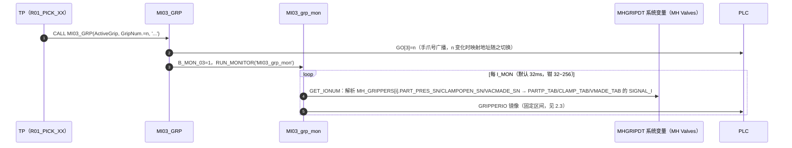
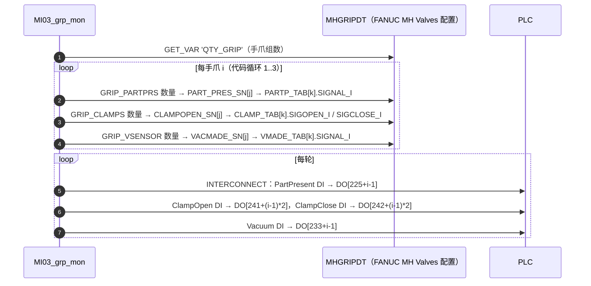
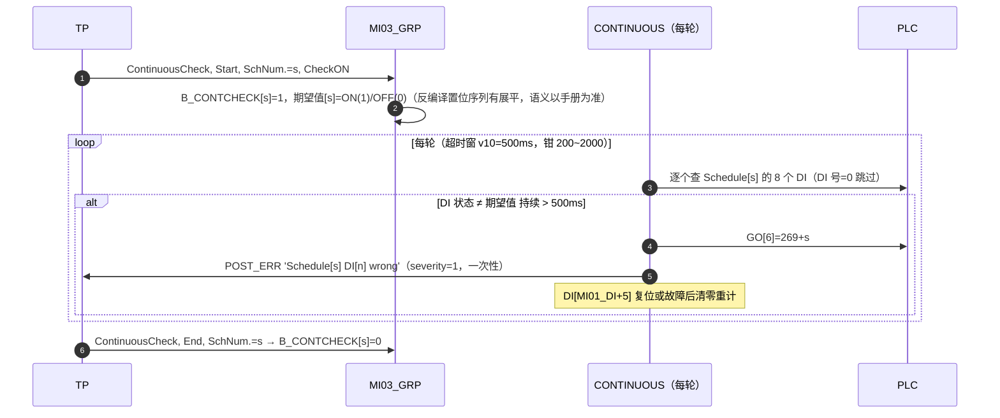

# MI03_GRP 逐应用深拆（FAP v2.0.9）

> 三方对照：pc2kl3 反编译实读（4 模块）× 手册 v20 第 8 章 × 更新日志（5 段）+ 仓库 R01_PICK_XX.LS 模板串证。
> 标注：【实证】/【推断】/【存疑】。生成 2026-11-03，接续 [MI02_TCH_逐应用深拆.md](MI02_TCH_逐应用深拆.md)。

---

## 0. 定位与模块清单

**一句话定位**：搬运（Gripper/Material Handling）应用——把 FANUC 系统 **MH Valves 界面**（MHGRIPDT 数据）里配置的 PartPresent / CylinderOpen/Close / VacuumMade DI 信号，按《车身机器人组态标准》固定 DO 区间镜像给 PLC；外加 10 路 Schedule 信号连续检测。【实证：手册 8.1 + GET_IONUM/GRIPPERIO】

| 模块 | 行数 | 角色 |
|---|---|---|
| MI03_GRP | 185 | TP 指令入口（ACTIONSELECT：ActiveGrip / ContinuousCheck） |
| MI03_GRP_MON | 406 | 后台：MHGRIPDT 解析（GET_IONUM）+ DI→DO 镜像（GRIPPERIO）+ 连续检测（CONTINUOUS） |
| MI03_GRP_GUI | 372 | MI03 Setup（Schedule 计划表配置） |
| MI03_GRP_VAR | 20 | 变量文件壳 |

⚠ 本应用**没有 _ROUT 模块**——全部指令逻辑内联在 MI03_GRP/MON 里。后台 `MI03_grp_mon` 由任一指令运行时 RUN_MONITOR 拉起（不随开机自启）。【实证】

---

## 1. 指令级时序图

### 1.1 指令分发

`CALL MI03_GRP(指令, …, '注释≤32')`，参数 1=指令码（手册 8.2「Parameter select」）：

| 码 | 指令 | 参数 | 动作 |
|---|---|---|---|
| 1 | ActiveGrip | 2:GripNum（手爪号） | GripNum→GO[3]，切换 DI→DO 映射集，拉起 MON |
| 2 | ContinuousCheck | 2:Start=1/End=2，3:SchNum 1~10，4(仅Start):CheckON=1/CheckOFF=2 | 启停指定 Schedule 的连续检测 |

主尾（折叠【推断】）：置 B_MON_03=1 → `RUN_MONITOR('MI03_grp_mon')` → INIT → 循环。

### 1.2 ActiveGrip（激活手爪 + 映射启动）



语义（手册 8.2.1）：运行指令即启动后台映射；GripNum 变化时原 DI→DO 映射停止，切换到新手爪号对应映射。DO 位按《车身机器人组态标准》固定，用户无需设定。【实证】
⚠ GO[3] 与 MI01_INITPLCIO 的 "MI02 未安装" 标志同为 GO[3] 位——两者属不同站型（搬运站 vs 点焊站）组合使用，同站并存时会争位。【实证位址重合·推断站型互斥】

### 1.3 后台映射链（MI03 核心）



【实证：GET_IONUM/GRIPPERIO/INTERCONNECT，MI03_GRP_MON.KL:192-332；手册 8.3（MH Valves 配 Clamp Inputs / Part Present Inputs）】
v2.0.9 更新两处正对应代码：「VACCUM 配置的 DI→DO 映射」= v3 真空组、「增加 cylinder close 信号的映射」= CLAMP_SIGCLOSE_I→DO[242…] 分支。【实证】

### 1.4 ContinuousCheck（信号连续检测，Schedule 1~10）



【实证：CONTINUOUS，MI03_GRP_MON.KL:334-403；手册 8.2.2/8.5】
手册示例：SchNum=1 含 DI[4]，不为 ON 时弹 "Schedule[1] DI[4] wrong" 类报警；界面禁用该 DI（设 0）后不再报。10 个 Schedule 可同时检测。【实证】

---

## 2. 参数表

### 2.1 TP 指令参数速查

| 指令 | 参数 2 | 参数 3 | 参数 4 | 备注 |
|---|---|---|---|---|
| ActiveGrip | GripNum（手爪号） | — | — | → GO[3]；换号=换映射集 |
| ContinuousCheck | Start / End | SchNum.=1~10 | CheckON / CheckOFF（仅 Start） | Start/End 只作用于指定 SchNum |

### 2.2 MI03 Setup（GUI ↔ 变量 ↔ 默认）

| Setup 项 | 变量（MI03_GRP_VAR） | 默认 | 范围 | 作用 |
|---|---|---|---|---|
| BG Scan Time | I_MON | 32 ms | 手册 32~1024；**代码钳 32~256**【差异】 | 后台扫描周期 |
| Schedule 号 | I_SCHNUM | 1 | 1~10（F1/F2 切换） | 当前编辑的计划号 |
| DI 号 ×8/计划 | AR_I_DI_LST | 全 0（0=不检测） | — | 每 Schedule 最多 8 个 DI |
| DI 注释 | AR_ST_DI_LST | — | — | 界面自动显示 DI 当前状态+注释 |
| DI 启用 | AR_B_DI_LST | — | 禁用后不报警 | 跳过问题信号的旁路 |

【实证：手册 8.5 + GUI 写 [MI03_GRP_VAR] 串证】

### 2.3 DI→DO 映射区间（《车身机器人组态标准》固定）

| 源（MHGRIPDT 解析） | 目标 DO | 说明 |
|---|---|---|
| PARTP_TAB[k].SIGNAL_I（每手爪 PartPresent 组） | DO[225+i-1] | 在件检测镜像 |
| VMADE_TAB[k].SIGNAL_I（VacuumMade 组） | DO[233+i-1] | 真空形成镜像【v2.0.9】 |
| CLAMP_TAB[k].SIGOPEN_I | DO[241+(i-1)*2] | 气缸开镜像 |
| CLAMP_TAB[k].SIGCLOSE_I | DO[242+(i-1)*2] | 气缸关镜像【v2.0.9】 |

v2.0.8「DO 区间保持不变，无论抓手号是多少」——目标 DO 编号是固定绝对位，不随 GripNum 漂移。【实证】

---

## 3. GUI 流程

MENU → TEST CYCLE → MI GUI → **MI03 Setup**（表单 AGRP）：

```
主画面:  BG Scan Time(32~1024ms)   Schedule 号(1~10, F1/F2 切换)
计划页:  每 Schedule 8 行: [启用] DI号 | DI 当前状态 | 注释(自动显示)
         DI=0 或禁用 = 该行不检测/不报警
```

配置持久化到 [MI03_GRP_VAR]（i_mon/i_schnum/ar_i_di_lst/ar_st_di_lst/ar_b_di_lst）。
前置配置在 **FANUC 系统 MH Valves 界面**（非 MI GUI）：配 Clamp Inputs 与 Part Present Inputs 的 DI 地址与阀对应关系（手册 8.3，详见 material handling 手册）。【实证：手册 8.3/8.5 + GUI 串】

---

## 4. 异常路径

| 场景 | 表现 | 恢复 |
|---|---|---|
| 连续检测超窗（DI≠期望 >500ms） | GO[6]=269+SchNum + 'Schedule[s] DI[n] wrong'（severity=1 一次性） | 修信号或界面禁用该 DI；DI[MI01_DI+5] 复位清除 |
| DI 号配 0 | 该行静默跳过 | — |
| MH Valves 未配/UNINIT | GET_IONUM 跳过该组（NOT UNINIT 守卫） | 按 8.3 配置 MH Valves |
| ContinuousCheck End | 只停指定 SchNum，其余继续 | — |

⚠ 异常面窄是本应用特点：映射是无条件镜像（INTERCONNECT 无等待、无超时），错映射只会表现为 PLC 侧信号错，无本地报警——排查需对照 §2.3 区间表。【推断】

---

## 5. 与 TP 程序交互

### 5.1 CALL 契约

同族：`GETTPEPARAM(n,1)` 整型参数 + 尾注释；`%NOPAUSE/%NOABORT`。ActiveGrip 建议在搬运程序开头调用一次（模板即如此）。

### 5.2 配套 TP（仓库 .LS 实证）

**R01_PICK_XX**（HANDLING:TRUE 搬运模板）骨架：

```
PAYLOAD[5] ; UFRAME_NUM=1 ; UTOOL_NUM=1 ;
CALL MI03_GRP("ActiveGrip"=1, '...')    ! 启动 Part Present/Cylinder On-Off 后台映射
Check No Part(1)                        ! MH 宏（手册 8.4）
Release Part(1) ;
CALL MI01_CMN("Segment"=3,"SegNo."=28)  ! 步序上报
J PR[...] ;
Grip Part(1) ;                          ! MH 宏：抓取（内部走 MH Valves 阀输出）
CALL MI01_CMN("Segment"=3,"SegNo."=29)
...
```

- **MH 宏程序**（Check No Part / Grip Part / Release Part 等）由 FANUC material handling 功能提供，负责阀动作；MI03 只做状态镜像与连续检测——**动作在 MH 宏，监视在 MI03**。【实证：手册 8.4 + 模板】
- 与 MI01_CMN 配合：搬运节拍照常用 Segment 报步序。

### 5.3 跨应用边界

- MI03 无独立 IO 基址变量（不设 I_MI03_DI），直接读全局 DI 号（AR_I_DI_LST、SIGNAL_I 均为绝对 DI 号）；DO 目标也是绝对位 225/233/241/242 段。
- GO[3]（GripNum）与 MI01 的 GO[3] 标志同位——站型互斥使用【见 1.2】。

---

## 6. 手册 × 更新日志 × 代码 对照结论

1. **抓手数量口径不一**：v2.0.7「DT/Mon 扩大到 4 个」，但 MON 内三组循环（PART/CLAMP/VAC）界仍为 `1 TO 3`，ACTIVEGRIP 的 INIT 默认化也是 1..3——**4 号手爪路径存疑**，现场 4 爪站须真机验证映射是否覆盖。【存疑·高优先】
2. **BG Scan Time 上限不一**：手册 32~1024ms vs 代码 DELAY 钳 32~256。设 256 以上会被静默压回。【实证差异】
3. **v2.0.8 修的坑**：「抓手应用激活抓手号，解决参数未初始化问题」= 现在 ACTIVEGrip 内 INIT 默认化 v1/v2/v3；「DO 区间保持不变」= GRIPPERIO 固定 225/233/241/242 绝对段。历史 bug 是映射区随抓手号漂移+首次未初始化。【实证】
4. **v2.0.9 新增**：真空组映射（VMADE_TAB）与气缸关（SIGCLOSE_I）映射——老版本只发开/在件。升级后 PLC 侧可收到完整的开/关/真空三态。【实证】
5. **反编译局限**：MI03_GRP/MI03_GRP_MON 的 GET_VAR 参数串大量落在 stmt 残留里（'MHGRIPDT','MH_GRIPPERS[…]' 等），变量名 v1~v20 为合成名；本文映射关系由残留串+手册 8.1/8.3 三方互证得出，置信度高但行级细节（如 v4 计时增量位置）不可见。【存疑·局部】

---

*输入：decompiled/MI03_grp/（4 .KL）· ref_手册v20.txt §8（行 1527-1646）· ref_更新日志FAP_v2.0.9.txt MI03 GRP×5 段 · 仓库 03_MI03_grp/04_tp/R01_PICK_XX.LS · analysis/MI03_grp.html。*
