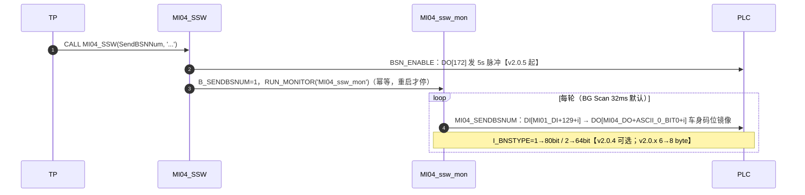
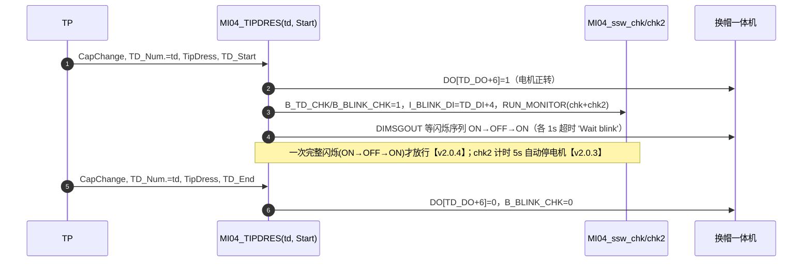
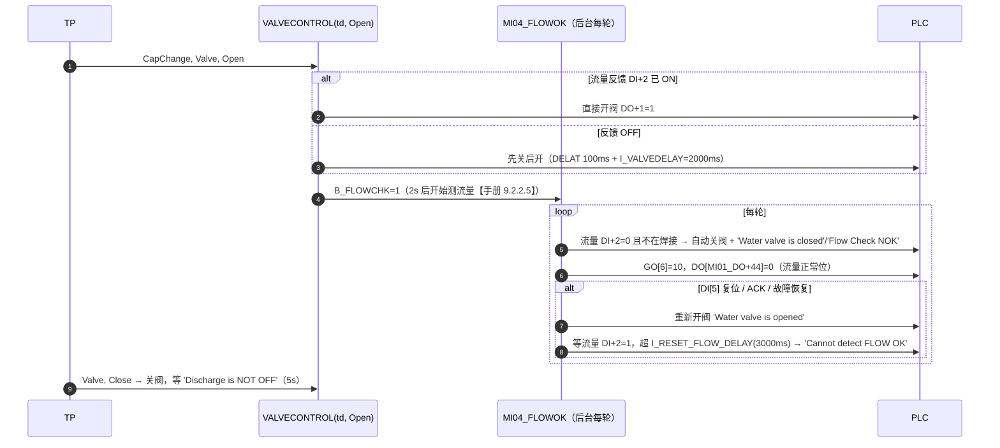

# MI04_SSW 逐应用深拆（FAP v2.0.9）

> 三方对照：pc2kl3 反编译实读（9 模块 4792 行，本应用最大）× 手册 v20 第 9 章 × 更新日志 20 段（v2.0.9→v1.0.x）。
> 标注：【实证】/【推断】/【存疑】。生成 2026-11-03，接续 [MI03_GRP_逐应用深拆.md](MI03_GRP_逐应用深拆.md)。

---

## 0. 定位与模块清单

**一句话定位**：点焊工位应用——传车身码（BSN）、换帽一体机（CapChange）、摆臂修磨（SwimTipDress）、修磨服务（TipService）、FRES 修磨换帽一体机（FRES-TD）；后台负责焊控三协议（HarmsWende/Sunke/Bosch）的焊接辅助、干湿模式、水流量闭环、进程信号 DO[42]、GI[17] 报警记录。焊机品牌选择（I_WELDTIMER=1/2/3）驱动全部 IO 位图。【实证：手册 9.1 + WELDASSIST SELECT I_WELDTIMER】

| 模块 | 行数 | 角色 |
|---|---|---|
| MI04_SSW | 544 | TP 指令入口（ACTIONSELECT，**I_DT_TYPE 新旧参数向导兼容**） |
| MI04_SSW_ROUT | 1157 | 指令实现（SENDBSNUM/FLOWOK/TIPDRES/CAP*/VALVECONTROL/SWIMMOTION/TS_*/FRES_*） |
| MI04_SSW_MON | 546 | 后台：RECORD(GI[17]记录)/DRYORWETMODE/WELDASSIST/BOSCHWELDASSIST/WELDPROCCHK/AUTODISABLEWATER |
| MI04_SSW_CHK | 190 | 修磨 DI 闪烁监控（CHECK_BLINK/KEEP_ALARM） |
| MI04_SSW_CHK2 | 354 | 自动停/过载/UO3 联动（AUTOTDEND/CHECK_MOTOR_OVERLOAD/FRES_*） |
| MI04_TD_POP | 43 | 修磨弹窗（pop_interval=256；YES→R[100]=1 / NO→0） |
| ISV_VG | 1127 | 视觉补焊（TCP socket 对接视觉，VG_X_* 状态机） |
| MI04_SSW_GUI | 811 | MI04 Setup（WeldSys/TipDress/RIP 三页） |
| MI04_SSW_VAR | 20 | 变量文件壳 |

IO 域：焊机主域 I_MI04_DI/DO（基 512）、换帽一体机 ×2（ar_I_MI04_TD_DI/DO[1/2]=2648/2680）、摆臂修磨 I_MI04_SW_DI/DO=2664、FRES 手持 ×2（3664/3680）+ 落地 ×2（3672/3688）、GI/GO 基 15（手册 6.1.2 表）。【实证】

---

## 1. 指令级时序图

### 1.0 参数体系：I_DT_TYPE 新旧参数向导（先读这段再看各指令）

Setup 的 **Argument Type**（v2.0.9 新增）选 New/1.0.12：`I_DT_TYPE=1`（New）时 CapChange/TipService 的参数序列**整体右移一位**（显式带 TD_Num/GunNumber）；Old 时 TD_Num 默认 1、旧 CALL 语句不变。这就是"保持 v1.0.12 指令不用切换"的实现机制。【实证：ACTIONSELECT CASE(2) 各分支 IF I_DT_TYPE=1 双取参路径】
判别导入是否成功：FR 目录 ARGDISPEG04.DT / ARGDISPCH04.DT 中查 {V1.0.12} 标识。【手册 9.4】

指令码（Parameter select）：**1:SendBSNNum 2:CapChange 3:SwimTipDress 4:TipService 5:FRES-TD**。

### 1.1 SendBSNNum（传车身码）



【实证：MI04_SENDBSNUM，ROUT:201-222；手册 9.2.1（执行一次即常驻后台）】

### 1.2 CapChange（换帽一体机，5 个子命令）

**TipDress / TD_Start·TD_End**（修磨电机 + 闪烁握手）：



**Prepare**：查弹夹上帽 TD_DI+7 / 下帽 TD_DI+8（'NO upper/lower electrode cap of spring clip'，WAIT 3s）→ 电机正转 DO[TD_DO+4]=1 → DELAY DelayTime(默认 1s) → 复位。【实证：CAPCHANGEPRE】

**MotorControl**：Remove=脱帽（正转 PulseTime，默认 3s）/ Eject=松帽（反转，1s）。⚠ 反编译 CONTROLMOTOR 函数体字面量丢失（CASE 空壳）——动作细节以手册 9.2.2.3 为准。【存疑】

**Check High/Low**：读 TD_DI+5 帽有无 → R[ResultInRegNo=100] = 1/0；3s 不符 → GO[6]=157 + 弹窗循环（见 §4.2）。【实证：CHECKCAPVAL/CHECKCAPUNIT】

**Valve Open/Close**（水阀 + 流量闭环，I_TD_TYPE=2 走 TD 域）：



【实证：VALVECONTROL/MI04_FLOWOK，ROUT:264-368,502-553；v2.0.x「开水先检测反馈」「断水功能」「水流量报警栏+GO[6]」全谱系吻合】
⚠ 手册"2 秒内无反馈报警"与代码 I_RESET_FLOW_DELAY=3000 两套时限并存（开阀后延迟检测 2s=I_VALVEDELAY 语义、复位延迟 3s）——报警节拍以代码为准。【实证差异·轻微】

### 1.3 SwimTipDress（摆臂修磨，SW 域基 2664）

**MotorControl Forward**（合枪加压前）联锁串（每个 DI 3s 超时）：

```
TD Breaker(SW_DI+3)=1 → Swim Breaker(+4)=1 → SP21VR(+10)=1 → SE21R(+8)=1
→ SW_DO+4=1（摆臂电机）→ Contactor(+11)=0 → SP21RV(+9)=1 → SE21V(+7)=1
→ SW_DO+4=0 → Contactor(+11)=0 确认 → DELAY 2000 → SW_DO+3=1（修磨电机）
→ DI+12=1 到位 → B_BLINK_CHK=1, I_BLINK_DI=SW_DI+5, RUN_MONITOR(chk)
```

**Backward**：SW_DO+4=1 → 停闪烁监控 → SP21VR/SE21R 复位确认 → SW_DO+4=0、SW_DO+3=0。
**Valve Open/Close**：同 CapChange 水阀闭环，但走 SW 域（I_TD_TYPE=3）。双设备共存时手册指明：**水流量控制统一用换帽一体机指令**。【实证：SWIMMOTION，ROUT:555-618；手册 9.2.3】

### 1.4 TipService（修磨服务，枪号 1~2）

| 子命令 | 动作 | 实现 |
|---|---|---|
| Check_Wear, TipChange/TipDress, GunNumber | 新帽检查 / 修磨切削量检查（CHECK_TD_WEAR.TP 配合） | TS_CHECKWEAR |
| RESET_TD, Request/Stepper, GunNumber | 重置修磨请求/计数（脉冲改 no-wait【v2.0.7】） | TS_RESET_TD / **TS_RESET_TD_BOSCH**（Bosch 焊机走独立分支【v2.0.6】） |
| Clear_Tipwear, Fixed/Movable, GunNumber | 重置固定/移动侧修磨补偿 | TS_TWD_RET |

v2.0.6 起 TipService **删除指令级焊机选择**，按 Setup 选好的焊机品牌自动走对应逻辑。【实证：ACTIONSELECT CASE(4) + 更新日志】

### 1.5 FRES-TD（FRES 修磨换帽一体机，DevNum 1~2）

```
RobotHeld（手持）:  CheckBox ON/OFF        → FRES_CHECK_BOX（帽盒报警/空缺后台检测）
                    Remove Open/Close, PulseTime 1~10s 默认5s → FRES_REMOVE_CAP（反转拆帽/正转装帽）
                    HighSpeed ON/OFF       → FRES_MOTOR_HIGHSPEED（正反转同开，修磨）
                    Check Top/Bottom × High/Low, ResultInReg → FRES_CHECK_CAP（弹窗同 1.2 Check）
Pedestal（落地）:   MotorON / MotorOFF     → FRES_SWING_MOTOLCTRL
                    SwingADV / SwingRET, WaitTime 1~15s 默认5s → FRES_SWING_CONTROL（后台摆臂过载检测）
```

后台联动（v2.0.7【实证 CHK2】）：HighSpeed/MotorON 期间监控 **UO3**——UO3 下降沿关修磨+吹气，上升沿恢复；OFF/RET 时停监控。Remove 的 DO 输出 v2.0.6 改 WAIT 形式（逐个确认）。【实证：CHK2 FRES_STOP_HSPD/SWING_* 族】

### 1.6 后台 MON 功能块（每轮，BG Scan 32~1024ms 默认 32）

| 功能块 | 作用 | 关键信号 |
|---|---|---|
| RECORD | GI[17]（Message number）非零且变化 → 记 RecordLogx.DDT 到 FR:（时间戳+值） | 手册 9.3：200 行/文件，9 文件轮转删最旧 |
| DRYORWETMODE | 干湿切换：DO[35]≠0 且 DO[393]=0 → $SPOTCONFIG.$SIM_ENBL=1/$WELD_ENBL=0（干跑）；反之湿焊 WITH_CURRENT=1；双枪 I_WELDTIMER=2 时 DO[670] 联动 | $SGSCH1[1].$USE_MANUAL 常置 0（v2.0.7） |
| WELDASSIST / BOSCHWELDASSIST | 焊接辅助 F[1]：Sunke 走条件式（weld sched ack DO[2648]+焊点号+SPOT_SELECTION_OK）；Bosch 走 DI[513] 上升沿→延迟 100ms→F[1] ON 1s（CLOSEFLG，I_F1_PULSE=1000） | v2.0.7/2.0.8 |
| WELDPROCCHK | 焊接进程判定（协议 2/3 位图不同）→ **DO[42]=Robot in process**；v2.0.9 增加 DO[513]=OFF/DO[515]=OFF 关闭条件 + **Flag[11] 输出开关** | v2.0.9 |
| AUTODISABLEWATER | 停焊断水：DI[48] 上升沿（Bosch 水冷）→ VALVECONTROL 关水 | v2.0.8 |
| INTER_DOTODO | WITH_CURRENT → DO[MI01_DO+397] 映射 | v1.0.x 映射族 |
| TD_DATE_DISPLAY | GET_REG(36) 焊接数据 round×1000 → DO[360] 等广播 | 总纲 2.3 数据平面 |

### 1.7 ISV_VG 视觉补焊（v1.0.x 新增）

SOCKET_INIT → VG_SEND/VG_RECV（TCP 报文）→ 状态机 VG_X_READY/CAP/MEAEND/CPEND/CYCEND + VG_CHKOFFSET 偏移校验；ISV2_GIN/VG_MSG 读视觉数值。与 MI09 的 TCP3D 分立——本模块服务点焊视觉补焊。【实证：ISV_VG routine 族；细拆建议并入后续专项，本文从简】

---

## 2. 参数表

### 2.1 指令参数速查（★=I_DT_TYPE=1 时序号右移一位）

| 指令 | 参数树 |
|---|---|
| SendBSNNum | — |
| CapChange | ★TD_Num + 子命令：TipDress(TD_Start/TD_End)｜Prepare(DelayTime[s]=1)｜MotorControl(Remove/Eject, PulseTime[s]=3/1)｜Check(High/Low, ResultInRegNo=100)｜Valve(Open/Close) |
| SwimTipDress | 子命令：MotorControl(Forward/Backward)｜Valve(Open/Close) |
| TipService | ★GunNumber + 子命令：Check_Wear(TipChange/TipDress)｜RESET_TD(Request/Stepper)｜Clear_Tipwear(Fixed/Movable) |
| FRES-TD | DevNum(1/2) + RobotHeld：CheckBox(ON/OFF)｜Remove(Open/Close, PulseTime 1~10s=5)｜HighSpeed(ON/OFF)｜Check(Top/Bottom, High/Low, ResultInReg=100)；Pedestal：MotorON/OFF｜SwingADV/RET(WaitTime 1~15s=5) |

### 2.2 MI04 Setup（手册 9.4 + 代码默认）

| 页 | 项 | 默认 | 范围/取值 | 影响 |
|---|---|---|---|---|
| WeldSys | With Gun Change | No | Yes/No | 气检信号起始地址、Major Alarm 配置 |
| WeldSys | Gun Install Method | Robot | Robot/Pedestal | 同上 |
| WeldSys | Weld Timer Brand | — | HarmsWende/Sunke/Bosch | **I_WELDTIMER=1/2/3 全套 Weld IO 位图**（EXEC） |
| WeldSys | Gun Type | Singal | Singal/Dual（仅 Sunke） | 双枪 DO[670] 等 |
| WeldSys | BNS Number Select | 80-bits | 80/64 | I_BNSTYPE 车身码位数 |
| WeldSys | BG Scan Time | 32ms | 32~1024 | 后台扫描 |
| WeldSys | Guan's welding | No | Yes/No（EXEC；J672 选项联动） | 钢凸点焊配置；Yes 时 SMC 水检停用【v2.0.8】 |
| WeldSys | Argument Type | New | New/Old(1.0.12) | **I_DT_TYPE 参数移位**；切 Old 需 Set Arg+重启 |
| TipDress | Blink check timeout | 1000ms | 500~30000 | 修磨 DI 闪烁超时报警 |
| TipDress | Motor auto stop After | 5000ms | 3000~30000 | 修磨电机自动停（AUTOTDEND） |
| TipDress | Tip Dress FRES Used | False | True/False + Install(RobotHeld/Pedestal) + Total Device(1/2) + Compensator(Enable/Disable 摆臂气缸) | FRES 全家桶 |
| TipDress | Tip Dress Method | — | 1-Step/2-Step（EXEC 导入 CAP_PRESSURE.TP） | 换帽工艺 |
| RIP | Water Reset Delay | 3000ms | 1000~20000 | I_RESET_FLOW_DELAY |
| RIP | Open Valve Delay | 2000ms | 1000~10000 | I_VALVEDELAY 开阀→检测延迟 |

其他代码默认【实证 ROUT INIT 区】：I_DI_PRESS（气检）、I_WELDTIMER 协议位图在 INIT SELECT、TipDress RegNo=100、FRES PulseTime=5s。

### 2.3 关键 IO 映射（协议位图随 I_WELDTIMER 变化，此处列稳定位）

| 信号 | 语义 |
|---|---|
| DI[512+1..]（WELD_END/PREWARNING/REQELECCHG/READY…按协议位图） | 焊控交互（总纲 2.4） |
| DI[MI01_DI+129..]→DO[ASCII_0_BIT0..] | 车身码位镜像 |
| DI[2648+2]/DO[2648+1/2]（TD1）、DI[2680+…]（TD2） | 换帽一体机 流量/阀 |
| DI[2664+3..12]/DO[2664+3/4] | 摆臂修磨 断路器/接触器/电机 |
| DI[3664/3680]（手持）、DI[3672/3688]（落地） | FRES 设备 1/2 |
| GO[6] | 错误号（10 流量、157 帽检测、水报警族；39/41 已删【v2.0.8】） |
| DO[172] | BSN 5s 脉冲 |
| DO[MI01_DO+42] | Robot in process（WELDPROCCHK） |
| DO[MI01_DO+44] | 水流量正常 |
| DO[MI01_DO+35/393/397]、DO[670] | 干湿/映射/双枪 |
| GI[15+2]（=GI[17]） | Message number 记录源 |
| DO[2648]（weld sched ack） | Sunke 辅助条件 |

---

## 3. GUI 流程

MENU → TEST CYCLE → MI GUI → **MI04 Setup**：F1 WeldSys / F2 TipDress / F3 RIP 三页（内容见 2.2）。
配置要点：焊机品牌/安装方式按 **F5 EXEC** 生效（联动 spot config 压力转换系数【v2.0.6】、weld sched ack 点位 Bosch=DI[2648]【v2.0.8】）；Argument Type 切换要 Set Arg+**重启**；Tip Dress Method EXEC 弹窗导入 CAP_PRESSURE（YES 覆盖/NO 取消）。
配套界面：App Setup IO 自动分配时选焊机品牌/RIP 种类（APPS_LOADER MI04_SPECIAL）；Weld Interface/Cell Interface 信号配置由 xvr 注入。【实证：手册 9.4 + GUI 串 + 更新日志】

---

## 4. 异常路径

### 4.1 GO[6] 错误码（MI04 域）

| GO[6] | 含义 | 来源 |
|---|---|---|
| 10 | Flow Check NOK（水流量异常/阀关） | MI04_FLOWOK |
| 157 | 帽检测不符（Check High/Low 3s） | CHECKCAPUNIT |
| （水报警族） | 'Water valve is closed/opened'、'Cannot detect FLOW OK'（报警栏） | FLOWOK |
| 39/41 | 已删除 | v2.0.8 |

### 4.2 异常汇总

| 场景 | 表现 | 恢复 |
|---|---|---|
| 修磨无闪烁 | 'Wait blink'（1s 超时）；chk 报警 KEEP_ALARM 保持 | 检查修磨电机/传感；电机 5s 自动停后 Reset |
| 修磨报错后 | **DI[5] 不再复位报警**（v2.0.4），须电机停后示教器 Reset | — |
| 帽检测不符（Check） | GO[6]=157 + 弹窗循环：按键3=重测（满足→R=1/0），按键4=**R=-1** 放行 | Re-teach 或 Retry |
| 弹夹无帽（Prepare） | 'NO upper/lower electrode cap of spring clip'（WAIT 3s） | 补帽 |
| 水阀开后无流量 | 延迟 I_VALVEDELAY 后测；I_RESET_FLOW_DELAY 内无反馈 → 'Cannot detect FLOW OK' + 自动关阀 + GO[6]=10 | 查水路；DI[5] 复位重开（v2.0.4 开阀后 DI[5] 会重新开水） |
| 关阀后流量不灭 | 'Discharge Error'/'Discharge is NOT OFF'（5s） | 查阀 |
| 断水（Bosch 水冷） | DI[48] 沿触发 AUTODISABLEWATER 关水；水流量未 OFF 前再触发无效 | 排查后手动恢复 |
| 摆臂联锁缺失 | 'TD/Swim Breaker OFF'、'SP21VR/SE21R/SP21RV/SE21V OFF'、'Contactor OFF/ON'（各 3s） | 逐级复位 |
| FRES 帽盒空/报警 | CheckBox 后台报警（ON 期间） | 补帽盒 |
| FRES 摆臂过载 | SwingADV 期间 CHECK_MOTOR_OVERLOAD 报警 | 停用检查 |
| UO3 跌落（FRES 修磨中） | 自动关修磨+吹气，UO3 恢复再开 | 查 UO3 联锁 |
| 空运行 | v2.0.6 起修磨不跳过（正常执行）；v2.0.8 空运行不测水流量 | — |

⚠ 手册 9.2.2.4 弹窗文案（YES 重测/NO 赋-1）与代码实际弹窗文案（'Last process NOK' 'YES: Re-teach position and continue. NO: Retry process.'，键码 3/4）**不一致**——以现场弹窗为准。【实证差异】

---

## 5. 与 TP 程序交互

### 5.1 CALL 契约

`CALL MI04_SSW(指令码, 参数…, '注释≤32')`；注意 **Argument Type=Old 时少一个 TD_Num 参数**（§1.0）。`%NOPAUSE/%NOABORT` 同族。

### 5.2 配套 TP（更新日志/手册串证）

| TP | 用途 |
|---|---|
| TIPCHANGE_GUN_XX.TP | 换帽流程（PNS00XX 尾部按 R[37:TD Count]>30 等条件挂接） |
| TIPDRESS_GUN_XX.TP | 修磨流程（DI[514: Milling demand] / DI[515: Prewarning] 触发） |
| CHECK_TD_WEAR.TP | 磨损检查（v2.0.4 删 R[36]>0.3 判断，与 Check_Wear 指令同步） |
| CAP_PRESSURE.TP 等 10 个 | 换帽/压力工艺（v2.0.3 起不自动加载，Tip Dress Method EXEC 导入） |
| FRES 模板 | v2.0.5 加入 |
| ~~AUXILIARYWELDING.TP~~ | 已废弃——辅助焊接改后台 WELDASSIST【v2.0.3】 |

**PNS00XX 中的挂接**（MI01 站已引）：`CALL MI04_SSW("CapChange"=2,"Valve"=5,"Open"=1)` 于开工前开水；尾部 `IF DI[516:Request electrode change]=ON OR R[37]>30 …,CALL TIPCHANGE_GUN1` / `IF DI[514] OR DI[515],CALL TIPDRESS_GUN1`。

### 5.3 与 TP/系统变量的边界

- 焊接动作本身走 TP（CTRLACTPROGTPE）+ 焊控；MI04 管联锁、数据、服务。
- 系统变量写入：$SPOTCONFIG（$SIM_ENBL/$WELD_ENBL/$STROKE_ENBL）、$SGSCH1[1].$USE_MANUAL、$SPOTEQIO（RIP 水检）。
- 与 MI01 共用：DI[5] 复位、DO[42]（进程）、GO[6]（错误号）、I_VALVEDELAY/I_DI_PRESS。

---

## 6. 手册 × 更新日志 × 代码 对照结论

1. **I_DT_TYPE 是兼容性的总开关**（v2.0.9 Argument Type）：Old=参数右移省略 TD_Num/GunNumber。切换需 Set Arg + 重启，FR 内 ARGDISP*.DT 有 {V1.0.12} 标识可验。【实证】
2. **三焊机协议位图**（I_WELDTIMER=1/2/3）在 INIT 的 SELECT 里写死 DI/DO 位映射——总纲 B5 的 ELSE 空分支即此（协议号不匹配时静默不配置）。品牌选择必须 EXEC 且与现场焊机一致。
3. **水流量闭环是本应用最复杂的运行时**：开阀双路径（已反馈直开/先关再开）、断水自动关阀、DI[5] 重开、复位延迟三套时限（100ms/2s/3s）、干湿模式旁路——排查水路问题先看 §1.2 Valve 图。【实证】
4. **v2.0.9 三处收口**：DO[513]/DO[515]=OFF 作为 DO[42] 关闭条件（HarmsWende/Sunke vs Bosch）、Flag[11] 做 DO[42] 输出开关、参数向导双版本。
5. **字面量丢失区**（不影响主线）：CONTROLMOTOR 函数体（Remove/Eject 脉冲细节）、TD_DATE_DISPLAY 尾段（R36/R39→R168 换算广播）在反编译里部分丢失，本文以手册+更新日志补全并标注。【存疑】
6. **弹窗文案**手册 vs 代码不一致（§4.2）；Gun Type 手册写 "Singal"（原文如此，Single 的拼写）。

---

*输入：decompiled/MI04_ssw/（9 .KL）· ref_手册v20.txt §9（行 1647-2106）· ref_更新日志FAP_v2.0.9.txt MI04×20 段 · analysis/MI04_ssw.html。*
