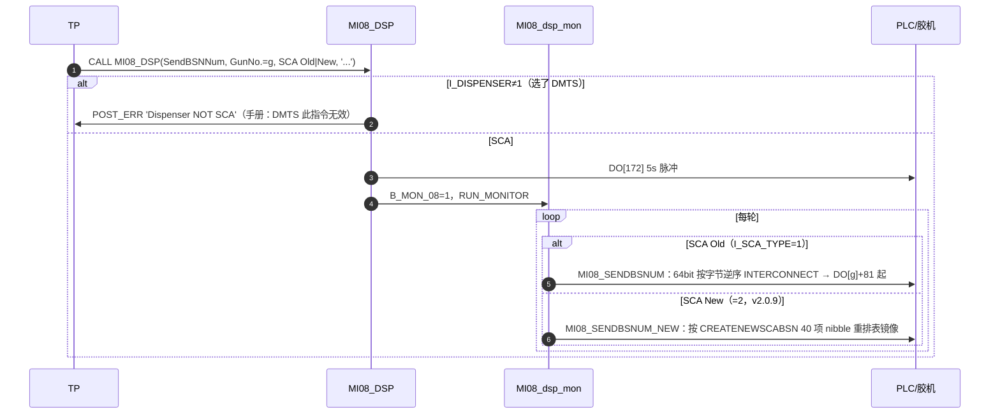
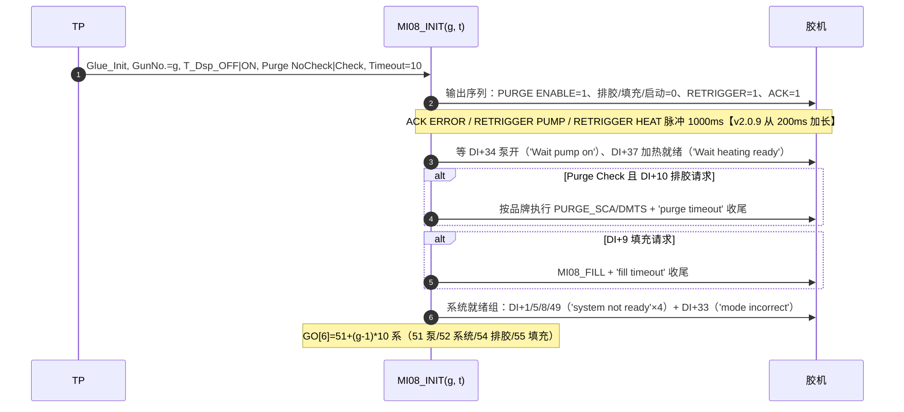
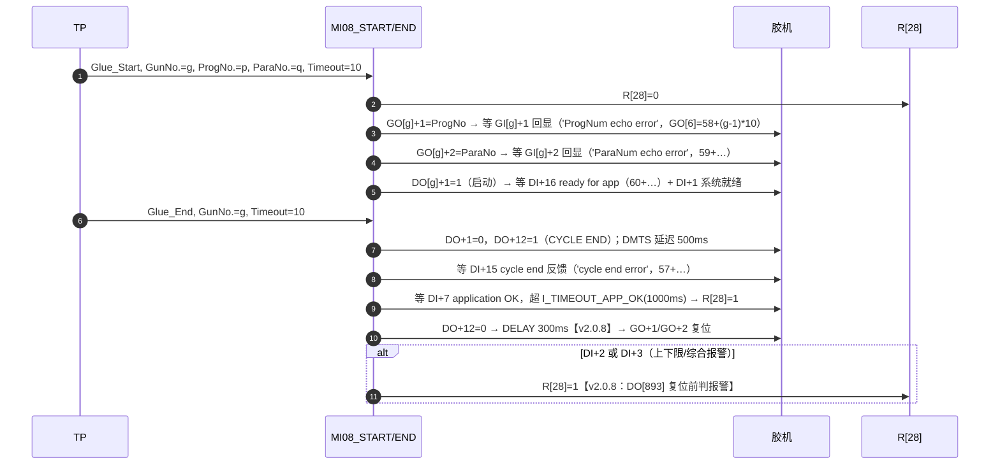

# MI08_DSP 逐应用深拆（FAP v2.0.9）

> 三方对照：pc2kl3 反编译实读（8 模块 5800 行）× 手册 v20 第 10 章 × 更新日志 14 段。
> 标注：【实证】/【推断】/【存疑】。生成 2026-11-03，接续 [MI04_SSW_逐应用深拆.md](MI04_SSW_逐应用深拆.md)。
> ⚠ 本应用含总纲 B2 点名的 **TCP 协议缺陷密集区**（TCP_MSG 27 错 / TCP_MEA 22 错 / TCP_COMM 11 错 G1 反编译错）——见 §1.8 审计要点。

---

## 0. 定位与模块清单

**一句话定位**：涂胶应用——传车身码、初始化、开始、排胶（Purge）、填充（Fill）、结束；对接 **SCA（Schucker）/ DMTS（大铭）** 两类胶机，可选单/双组份、单/双枪/三枪；Leoni TCP（BizLink）涂胶控制器的协议栈（TCP_COMM/TCP_MSG/TCP_MEA）一并打包在本应用目录。【实证：手册 10.1 + README + 代码串 'Dispenser NOT SCA'、fr:\BizLink_Backup.txt】

| 模块 | 行数 | 角色 |
|---|---|---|
| MI08_DSP | 303 | TP 指令入口（ACTIONSELECT，I_DT_TYPE 新旧参数向导） |
| MI08_DSP_ROUT | 654 | 指令实现（INIT/START/END/PURGE_SCA/PURGE_DMTS/FILL/SENDBSNUM×2） |
| MI08_DSP_MON | 193 | 后台：干湿模式（$SLGNSTUP.PROC_WET_RUN）、BSN 镜像、TCP 速度、上下限→DO 映射 |
| MI08_DSP_GUI | 502 | MI08 Setup（Gun Type/Brand/Component/Timeout/Argument Type） |
| TCP_COMM | 1420 | Leoni/BizLink G2 协议库（标定/补偿/参数读写，德语串 Lesen/Schreiben） |
| TCP_MSG | 1080 | 报文构造/解析（'Vom TCP Controller auf Roboter' 德语协议） |
| TCP_MEA | 1628 | 测量/备份数据（BizLink_Backup.txt / BizLink_Data.txt、TC 标定计算） |
| MI08_DSP_VAR | 20 | 变量文件壳 |

IO 域（默认基址）：设备 1=880、设备 2=1008（SCA）/1040（DMTS，I_DISPENSER 选择）、设备 3=2192；GI/GO=20/25/45；每枪 GO[6] 错误码按 `基础号+(枪号-1)*10` 编址。【实证：INIT】

---

## 1. 指令级时序图

### 1.0 分发与参数体系

`CALL MI08_DSP(指令, GunNo=1~3, …, '注释≤32')`——**参数 2 恒为 GunNo**（I_ACT_TOOL）。指令码：**1:SendBSNNum 2:Glue_Init 3:Glue_Start 4:Glue_Purge 5:Glue_Fill 6:Glue_End**。
I_DT_TYPE=1（New 参数向导）时 Glue_Purge 显式带 T_Dsp 参数；Old（1.0.12）时参数少一位且 Dispenser Brand 自动切 SCA。【实证：ACTIONSELECT + 手册 10.3-5】
干跑门：多数指令以 `DI[MI01_DI+35]=0`（非干跑）才执行工艺动作。【实证】

### 1.1 SendBSNNum（车身码，SCA 专用）

【实证：CREATENEWSCABSN 40 项映射表（IN DI[MI01_DI+129+0..3,8..11,…72..75] → OUT DO[g]+81+重排）；v2.0.9「新 SCA 车身码后台映射」】

### 1.2 Glue_Init（初始化，timeout 默认 10s）

【实证：MI08_INIT，ROUT:410-545；T_Dsp_On 时不测 DI[929]【v2.0.8】= 双组份分支跳过】

### 1.3 Glue_Start / Glue_End（R[28] 协议）

【实证：MI08_START/END，ROUT:547-651；手册 10.2.3/10.2.6 的 R[28] 语义逐点吻合】

### 1.4 Glue_Purge / Glue_Fill

| 动作 | SCA 单组份/DMTS | SCA 双组份（I_COMPONET=2） | 反馈 |
|---|---|---|---|
| Purge | DO+9=1（DO[889] 路径） | T_Dsp OFF→DO+41=1（**DO[921] 单组份排胶**）；T_Dsp ON→DO+9=1（DO[889] 双组份） | DI+14，超时 GO[6]=54+(g-1)*10 'purge error' |
| （DMTS 特有） | PURGE 输出 **2s 脉冲**（residue 2000）；SCA 为长 ON | — | 【v2.0.8：SCA 长 ON / 大铭脉冲】 |
| Fill | DO+5=1 + DO+8=1 | 同 | DI+13，'fill error' GO[6]=55+(g-1)*10 |

【实证：MI08_PURGE_SCA/DMTS/FILL，ROUT:324-408；手册 10.2.4 双组份路径逐句吻合】

### 1.5 后台 MON（每轮 I_MON=32ms，钳 32~256【vs 手册 1024 差异】）

| 功能块 | 作用 |
|---|---|
| DRYORWETMODE | DI[35] 干跑位 → $SLGNSTUP[1].PROC_WET_RUN 0/1 |
| DRYWETTOPLC | 湿模式 → DO[448] / DO[464]（DI_WET_MODE=448） |
| SENDBSNUM×2 | 车身码镜像（SCA Old 逆序 / New 重排表） |
| TCP_SPD_OUT | GET_REG(29)×2 → GO[g]+3（TCP 速度） |
| IO_INTER | DI+2 OR DI+3（上下限）→ DO[MI01_DO+445+(g-1)*16]；主编排 |

【实证：MI08_DSP_MON.KL:104-190】

### 1.6 系统变量/映射配置（更新日志串证）

- $SLSETUP[1].CONV_FACTOR1/2=6553.5、MAX_IO_COUNT=65535（v2.0.8 数值溢出修复——与总纲 6.3「Coherix GO 溢出」同根源类）。
- xvr 映射族：DI[882/883]→DO[445]、DI[1010/1011]→DO[461]、DI[916]→DO[449]、DI[1044]→DO[465]、DI[447]→DO[448]、DI[463]→DO[464]；若干历史映射（DI[896]→DO[441] 等）已删。

### 1.7 Leoni TCP 协议栈（TCP_COMM / TCP_MSG / TCP_MEA）

| 模块 | 职责 | 证据 |
|---|---|---|
| TCP_COMM | G2 协议：G2_INIT/KORR（补偿）、G2_VECMEIN/VECMAUS/REFMEIN/REFMAUS（参考点/向量）、G2_PARA_ON/OFF、G2_BACK*（参数读写）、CALC_CW2G/A/L 坐标变换 | 德语串 'Lesen'/'Schreiben'、'G2BS_IP'、LS_Tool_No/Kum_Korr_Val |
| TCP_MSG | 报文层：MSGWRITE（大 CASE 分派）、EXTMSGFC、MSGTR1T/MSGTI1T、INFO_MSG、SHOW_FRAME、KM_GR_CHECK | 'Vom TCP Controller auf Roboter'、'TCP Time Out'、'TCP Dim. Master/Slave'、'Lese Prog-Nr.'/'Erstvermessung' |
| TCP_MEA | 测量/备份：TC_COUNT、READ/WRITEBACKUP、READ/WRITEDATA、SET_TOOL/SET_FRAME、CALC_POS_DK/PE、DK1/DK2/PENDELN/SYM_CHECK | fr:\BizLink_Backup.txt、fr:\BizLink_Data.txt、TCP Depth/Sensor Measurement/Radius PrgNo |

**审计要点**（总纲 B2）：三模块 G1 错 60 处集中于此——报文解析/主从维度交换/标定计算复杂度最高且带德语原文分支；**生产环境改动此区风险最高**，建议专项审计 + 改后跑回归比对 BizLink_Backup.txt 快照。【实证：G1 错计数 + routine 族】

---

## 2. 参数表

### 2.1 TP 指令参数速查

| 指令 | 参数 |
|---|---|
| SendBSNNum | GunNo.=1~3 + SCA Old / SCA New |
| Glue_Init | GunNo. + T_Dsp_OFF(单)/T_Dsp_ON(双) + Purge NoCheck/Check + Timeout=10s |
| Glue_Start | GunNo. + ProgNo. + ParaNo. + Timeout=10s（置 R[28]=0） |
| Glue_Purge | GunNo. + T_Dsp OFF/ON + Timeout=10s |
| Glue_Fill | GunNo. + Timeout=10s |
| Glue_End | GunNo. + Timeout=10s（异常置 R[28]=1） |

### 2.2 MI08 Setup（手册 10.3）

| 项 | 默认 | 取值 | 影响 |
|---|---|---|---|
| Gun Type | Single | Single/Dual（F3 EXEC） | Open Gun 信号配置 |
| BG Scan Time | 32ms | 32~1024 | 后台扫描（**代码钳 32~256**【差异】） |
| Dispenser Brand | SCA | SCA / DMTS | I_DISPENSER=1/2；IO 自动分配、排胶路径、设备 2 基址 1008/1040 |
| Dispenser Component | — | Single / Two（仅 SCA） | I_COMPONET：双组份启用 DO[921] 单组份排胶路径 |
| Glue_End Timeout For DI application OK | 1000ms | — | I_TIMEOUT_APP_OK（MI08_dsp_var） |
| Argument Type | New | New / Old(1.0.12) | I_DT_TYPE 参数移位；Old 自动切 SCA；验证 ARGDISPEG08.DT {V1.0.12} |

### 2.3 GO[6] 错误码（每枪 +10）

| 枪 1 | 枪 2 | 枪 3 | 含义 |
|---|---|---|---|
| 51 | 61 | 71 | 泵/加热就绪（Init） |
| 52 | 62 | 72 | system not ready |
| ~~53~~ | ~~63~~ | ~~73~~ | 已删除【v2.0.8】 |
| 54 | 64 | 74 | purge error/timeout |
| 55 | 65 | 75 | fill error/timeout |
| 56 | 66 | 76 | （保留） |
| 57 | 67 | 77 | cycle end error |
| 58 | 68 | 78 | ProgNum echo error |
| 59 | 69 | 79 | ParaNum echo error |
| 60 | 70 | 80 | not ready for app |

---

## 3. GUI 流程

MENU → TEST CYCLE → MI GUI → **MI08 Setup**：Gun Type（F3 EXEC）→ BG Scan → Dispenser Brand（SCA 时再选 Component Single/Two）→ Glue_End Timeout（F3 EXEC 配涂胶 IO）→ Argument Type（SHIFT+F5 Set Arg，旧版导入重启生效）。
App Setup IO 分配时弹窗选胶机品牌（SCA/DMTS）；按品牌 F3 配涂胶 IO（v2.0.5）。【实证：手册 10.3 + 更新日志】

---

## 4. 异常路径

| 场景 | 表现 | 恢复 |
|---|---|---|
| DMTS 下跑 SendBSNNum | 'Dispenser NOT SCA'（38100，sev1） | 换 SCA 或不调 |
| Init 泵/加热未就绪 | 'Wait pump on' / 'Wait heating ready'（WAIT 超时 timeout） | 设备侧恢复 |
| 排胶/填充请求超时 | 'purge timeout' / 'fill timeout' + GO[6] | 等信号消除（DI+10/9→0） |
| 系统未就绪 | 'system not ready'（DI+1/5/8/49 四路分别报） | 逐路排查 |
| 模式不对 | 'mode incorrect'（DI+33） | 切胶机模式 |
| Start 回显不匹配 | 'ProgNum echo error' / 'ParaNum echo error'（GI 回显等待） | 程序号/参数号配置 |
| 涂胶未就绪 | 'not ready for app'（DI+16） | 胶机状态 |
| 结束无反馈 | 'cycle end error'（DI+15） | 查 CYCLE END 链路 |
| application OK 超时 | R[28]=1（I_TIMEOUT_APP_OK=1000ms） | 查 DI+7；TP 侧按 R[28] 判废/补胶 |
| 上下限/综合报警 | R[28]=1 + DO[445+…] 输出 | 清报警 |
| Glue_Purge DO[42] | v2.0.8 起 Purge 也输出 DO[42] 进程信号（Start/End 不再分空循环） | — |

---

## 5. 与 TP 程序交互

- **CALL 契约**：参数 2 恒 GunNo；I_DT_TYPE=Old 时 Glue_Purge 少一个 T_Dsp 参数。`%NOPAUSE/%NOABORT` 同族。
- **寄存器协议**：Glue_Start 置 **R[28]=0**；Glue_End 任一异常（app OK 超时/上下限报警）置 **R[28]=1**——TP 用 R[28] 判本循环涂胶是否成功（典型：`IF R[28]=0, ...补胶/报警`)。
- **进程信号**：Start→ROBOTINPROC(1)（DO[42]=1）、End→ROBOTINPROC(2)（DO[42]=0）、Purge 也占 DO[42]。
- **配套 TP**：Leoni TCP 的 TP 模板+PC 程序随包（v2.0.8「加入 Leoni TCP 的 TP 程序模板」）；车身码/步序走 MI01_CMN（Segment）协同，PNS 模板中 Glue 与 Weld 同节拍挂接。
- **参数向导**：ARGDISPEG08.DT / ARGDISPCH08.DT（{V1.0.12} 标识验旧版导入）。

---

## 6. 手册 × 更新日志 × 代码 对照结论

1. **R[28] 协议是涂胶质量闭环的核心**（Start=0/End 异常=1），v2.0.8 强化：app OK 指定时间（i_timeout_app_OK）内未收到即置 1，且 CYCLE END OFF 后延迟 300ms 先判上下限报警再复位 GO。【实证】
2. **双组份排胶双路径**（DO[889] vs DO[921]）由 I_COMPONET×I_T_DSP 矩阵决定——配置错=排错胶，Setup 与 TP 参数必须一致。【实证】
3. **车身码两套映射**：SCA Old=64bit 字节逆序循环；SCA New=40 项 nibble 重排表（v2.0.9）。选错类型=车身码错乱。【实证】
4. **发现一处代码疑点**：INIT 中 `IF (UNINIT(I_COMPONET)) THEN I_DISPENSER = 1`——判定的是 I_COMPONET，赋值却写 I_COMPONET 未赋（写成 I_DISPENSER）；首次上电 I_COMPONET 可能保持 UNINIT，双组份判据不稳。【实证·建议现场确认 I_COMPONET 已由 Setup 写入】
5. **缺陷密集区**：TCP_COMM/MSG/MEA（G1 60 错）为 BizLink/Leoni 协议实现，审计优先级最高（总纲 B2）；另 MON 的 I_MON 上限 256 与手册 1024 不一致（与 MI03 同类差异）。
6. **v2.0.9 修复谱系**：Glue_End 逻辑、新 SCA BSN 映射、ACK/RETRIGGER 脉冲 200→1000ms（PLC 丢沿修复——与总纲 6.3 时序类修复同批）、参数向导双版本、删干湿反馈功能。

---

*输入：decompiled/MI08_dsp/（8 .KL）· ref_手册v20.txt §10（行 2107-2301）· ref_更新日志FAP_v2.0.9.txt MI08×14 段 · analysis/MI08_dsp.html。*
