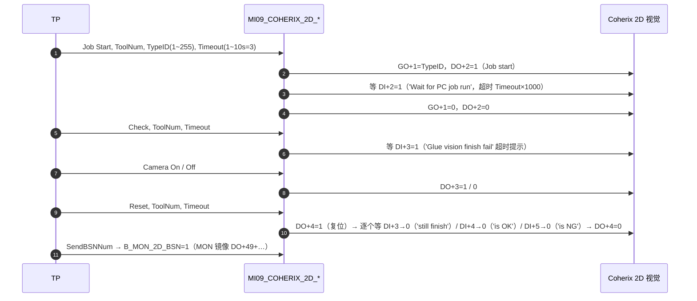
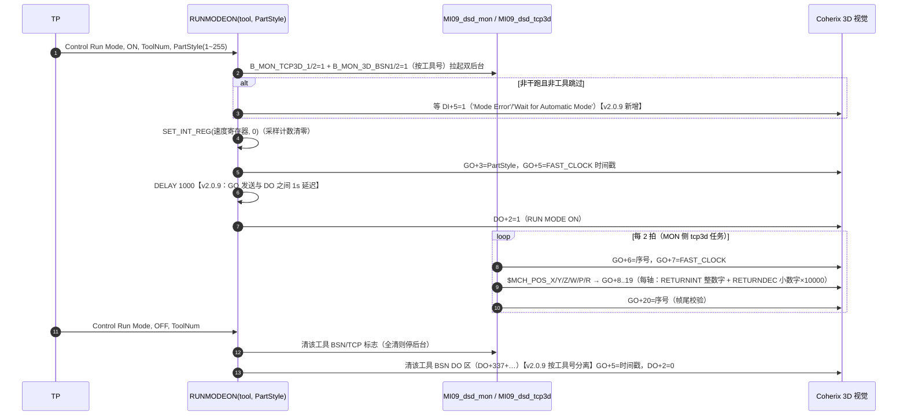

# MI09_DSD 逐应用深拆（FAP v2.0.9）

> 三方对照：pc2kl3 反编译实读（6 模块 1860 行）× 手册 v20 第 11 章 × 更新日志 11 段。
> 标注：【实证】/【推断】/【存疑】。生成 2026-11-04，接续 [MI08_DSP_逐应用深拆.md](MI08_DSP_逐应用深拆.md)。

---

## 0. 定位与模块清单

**一句话定位**：涂胶**视觉检测**应用——三品牌工艺逻辑分流：**BetterWay**（DI 状态检测型）、**Coherix 2D**（相机+Job 型）、**Coherix 3D**（Run Mode+TCP 位姿流型）。外加 3D 独有的 **TCP（Tool Center Point）位姿流输出**：把机器人 MCH 坐标 X/Y/Z/W/P/R 实时广播给 3D 视觉做检测配准。【实证：手册 11.1 + MI09_COHERIX_3D_TCP 读 $SCR_GRP[1].$MCH_POS_*】

| 模块 | 行数 | 角色 |
|---|---|---|
| MI09_DSD | 538 | TP 入口（**ACTIONSELECT + ACTIONSELECT_OLD 双树**，I_DT_TYPE 选择） |
| MI09_DSD_ROUT | 618 | 三品牌指令族 + TCP 位姿流 + RETURNINT/DEC 防溢出 |
| MI09_DSD_TCP3D | 111 | 后台 2：TCP 位姿广播任务（MI09_dsd_tcp3d） |
| MI09_DSD_MON | 130 | 后台 1：按品牌×工具号 BSN 车身码镜像 |
| MI09_DSD_GUI | 443 | MI09 Setup（品牌选择/扫描时间/参数向导） |
| MI09_DSD_VAR | 20 | 变量文件壳 |

IO 域：旧域 I_MI09_DI/DO[p]（基 3000/3048，BetterWay）；新域 I_MI09_NEW_DI/DO[p]（p=1:3000，p=2: **3416**（2D）/**3512**（3D，v2.0.8 改）——分发器内硬编码【实证 ACTIONSELECT CASE(2)/(3)】）。

---

## 1. 指令级时序图

### 1.0 参数体系（第三种兼容实现！）

主尾：`INIT → I_DT_TYPE=1 ? ACTIONSELECT : ACTIONSELECT_OLD`【实证 MI09_DSD.KL:525-533】。
与 MI04/MI08 的"参数移位"不同，MI09 用**双例程树**：OLD 树 6 子命令（旧 BetterWay 指令集，无品牌参）；NEW 树 = 品牌参 + 子命令。指令码：

```
NEW: CALL MI09_DSD(品牌, 子命令, …)   品牌: 1 BetterWay / 2 Coherix 2D / 3 Coherix 3D
OLD: CALL MI09_DSD(子命令, ToolNum, …)  1 Check 2 OpenApplicator 3 CloseApplicator 4 CycleEnd 5 SendBSNNum 6 Start
```

**干跑双门**（几乎每条指令）：`DI[MI01_DI+35]=0`（全局干跑位）且 `DI[MI01_DI+481+ToolNum-1]=0`（**工具级跳过位**）才执行工艺动作。【实证】

### 1.1 BetterWay 族（6 子命令）

| 子命令 | 动作 | 联锁/异常 |
|---|---|---|
| Start(tool, TypeID) | DO+1..4 清零 → GO+1=TypeID → DO+1=1（**先 ON 后复位**式） | 【v1.0.x 删脉冲参数】 |
| Check(tool, DelayTime 0.1~2s=0.5) | 查 DI+5=0→'Simulation Mode NOT OK'/'Training template not loaded'（3s）；DI+13≠0→'Debug Mode'/'It is Debug Mode'（3s）；DO+1=0；**DELAY DelayTime**（cycle start 后延迟） | 仿真/调试模式门 |
| OpenApplicator(tool, PulseTime=0.1s) | MI09_APPSTART——**函数体为空**（v2.0.x 改 no-wait 后逻辑外移）【存疑·体空】 | |
| CloseApplicator(tool, PulseTime) | MI09_APPEND——同上空体 | |
| CycleEnd(tool, PulseTime) | MI09_STOP：DI+6=0→'Check failed'/'Check is not finished'（3s）→ DO+1..4/GO+1 清零 | |
| SendBSNNum(tool) | B_MON_BTW_BSN=1 拉起 MON：64bit 车身码 DI[129+…]→DO+17+… 镜像（每轮） | 重启才停 |

### 1.2 Coherix 2D 族（6 子命令，IO 基 3000/3416）



【实证：MI09_COHERIX_2D_*，ROUT:257-375】

### 1.3 Coherix 3D 族（Run Mode / Gun + TCP 位姿流）



**TCP 数值防溢出**（v2.0.9 修复本体，RETURNINT/RETURNDEC）【实证 ROUT:494-519】：

```
RETURNINT(x) = trunc(x)；x ≤ -1 时 65536 + trunc(x)   ← 负数 16 位回绕
RETURNDEC(x) = (trunc(x×10000) MOD 10000)；负数 65536 + MOD  ← 小数部独立字
```

即每个位姿分量拆"整数字+小数字"两个 GO 输出，负值按 65536 回绕编码——**GO 16 位装不下 REAL 的溢出问题根治**。【实证 + 更新日志 v2.0.9 第 2 条】

**Gun 控制**：Control Gun ON/OFF → GO+5=时间戳 + DO+3=1/0（开枪信号）。

### 1.4 后台双任务

| 任务 | 轮询 | 内容 |
|---|---|---|
| MI09_dsd_mon | I_MON 32~256ms（手册写 1024 上限，代码钳 256【差异，同 MI03/MI08】） | 按 I_DSD_BRAND×工具号标志分发 BSN 镜像（BTW:DO+17 / 2D:DO+49 / 3D:DO+337） |
| MI09_dsd_tcp3d | 速度寄存器节拍（MOD 2 分频） | MCH 位姿六分量双字广播（仅 B_MON_TCP3D_1/2 开启的工具） |

---

## 2. 参数表

### 2.1 TP 指令参数速查

| 品牌 | 子命令 | 参数 |
|---|---|---|
| 1 BetterWay | Check | ToolNum + DelayTime[s] 0.1~2=0.5 |
| | OpenApplicator / CloseApplicator / CycleEnd | ToolNum + PulseTime[s] 默认 0.1 |
| | SendBSNNum | ToolNum |
| | Start | ToolNum + TypeID |
| 2 Coherix 2D | Check / Reset | ToolNum + Timeout[s] 1~10=3 |
| | Camera On / Off | ToolNum |
| | SendBSNNum | ToolNum |
| | Job Start | ToolNum + TypeID(Job 号 1~255) + Timeout |
| 3 Coherix 3D | Control Run Mode | ON/OFF + ToolNum + Part Style 1~255=1 |
| | Control Gun | ON/OFF + ToolNum |

### 2.2 MI09 Setup（手册 11.3）

| 项 | 默认 | 取值 | 落盘 |
|---|---|---|---|
| BG Scan Time | 32ms | 32~1024 | I_MON（**代码钳 32~256**） |
| Dispense Detect Brand | BetterWay | BetterWay / Coherix 3D / ISV | I_VISIONBRAND；F3 EXEC 配 IO 映射 |
| Argument Type | New | New / Old(1.0.12) | I_DT_TYPE 双例程树切换；Old 自动切 BetterWay；验 ARGDISPEG09.DT {V1.0.12} |

⚠ 手册 Setup 品牌列表（BetterWay/Coherix 3D/**ISV**）与指令 Parameter select（BetterWay/Coherix 2D/Coherix 3D）**不一致**——ISV 出现在 Setup 却无对应指令码（ISV 视觉补焊在 MI04 的 ISV_VG 模块）；现场以指令码 1/2/3 为准。【实证差异】

### 2.3 关键 IO 映射

| 信号 | 语义 |
|---|---|
| DI[MI01_DI+35] | 全局干跑位 |
| DI[MI01_DI+481+tool-1] | 工具级跳过位 |
| BetterWay: DI+5/13/6、DO+1..4、GO+1、BSN→DO+17 | 仿真模板/调试/完成、开始/结束、TypeID、车身码 |
| 2D: DI+2..5、DO+2..4、GO+1、BSN→DO+49 | Job run/finish/OK/NG、Job start/相机/复位 |
| 3D: DI+5（Automatic Mode）、DO+2/3（Run Mode/Gun）、GO+3/5/6~20（PartStyle/时戳/序号/位姿双字流）、BSN→DO+337 | v2.0.8 第二设备偏移 3512 |
| xvr 历史映射 | DI[3013/3061]→DO[487/488]、DI[3014/3062]→DO[491/492]、DI[3008/3056]→DO[485/486]、DI[3009/3057/3006/3054]→DO[481/482/483/484] |

---

## 3. GUI 流程

MENU → TEST CYCLE → MI GUI → **MI09 Setup**（表单 DSD）：BG Scan Time → Dispense Detect Brand（F3 EXEC 按品牌配 IO）→ Argument Type（SHIFT+F5 Set Arg + 重启）。写 [MI09_DSD_VAR] i_mon / i_visionbrand。【实证：GUI 串证 + 手册 11.3】

---

## 4. 异常路径

| 场景 | 表现（WAIT_SIGNAL 语义） | 恢复 |
|---|---|---|
| BetterWay 仿真模板未载 | 'Simulation Mode NOT OK' / 'Training template not loaded'（3s） | 载入训练模板 |
| BetterWay 调试模式 | 'Debug Mode' / 'It is Debug Mode'（3s） | 退出调试 |
| BetterWay 检测未完（CycleEnd） | 'Check failed' / 'Check is not finished'（3s） | 等检测完成 |
| 2D 检测超时 | 'Vision Error' / 'Glue vision finish fail'（Timeout） | 查视觉 |
| 2D 复位残留 | 'Glue vision still finish' / 'is OK' / 'is NG'（逐信号清） | Reset 全流程 |
| 2D Job 不启动 | 'Wait for PC job run'（Timeout） | 查 PC 侧 Job |
| 3D 非自动模式 | 'Mode Error' / 'Wait for Automatic Mode'（3s）【v2.0.9】 | 切自动模式 |
| 干跑/工具跳过 | DI[35] 或 DI[481+n] 有效时**静默跳过工艺动作** | — |
| TCP 数值溢出 | （历史 bug）GO 溢出——已由 RETURNINT/DEC 负数回绕+小数分字根治【v2.0.9】 | — |

---

## 5. 与 TP 程序交互

- **CALL 契约**：NEW 树 `CALL MI09_DSD(品牌, 子命令, ToolNum, …)`；OLD 树少品牌参。`%NOPAUSE/%NOABORT` 同族。
- **典型节拍**（涂胶检测工位）：`SendBSNNum`（一次常驻）→ `Start/Job Start/Run Mode ON`（带 TypeID/PartStyle）→ 涂胶（MI08_DSP 或 Control Gun）→ `Check/CycleEnd` 取结果 → `Run Mode OFF`（3D 停流）。
- **3D 特有**：Run Mode ON 后 tcp3d 后台持续把机器人位姿流给视觉——TP 运动轨迹本身就是检测数据源。
- 与 MI08（涂胶）天然配对：MI08 出胶 + MI09 检测，车身码通道各走各的 BSN 镜像区（MI08:DO+81 / MI09:DO+17/49/337）。

---

## 6. 手册 × 更新日志 × 代码 对照结论

1. **第三种参数向导兼容实现**：MI09 用双例程树（ACTIONSELECT_OLD/NEW），不是 MI04/MI08 的参数移位——三个应用三种兼容手法，改参数时勿套用别家经验。
2. **TCP=位姿流**（不是网络协议）：$SCR_GRP[1].$MCH_POS_* 六分量×整数/小数双字 GO 广播 + FAST_CLOCK 时戳 + 序号帧尾——**v2.0.9 溢出修复=RETURNINT/DEC 的 65536 负数回绕+小数分字**，总纲 6.3 的"数值溢出"条目根因在此。【实证】
3. **v2.0.9 收口三件**：3D Run Mode ON 增 Automatic Mode DI 检测、GO→DO 间 1000ms 延迟、车身码/TCP 输出按工具号分离（OFF 清对应工具 BSN DO 区）。
4. **文档差异**：Setup 品牌列表含 ISV 但指令无 ISV 码；第二设备偏移手册表 3048 vs 代码/v2.0.8 3512（且 v2.0.8 明说"已有程序需手动改"）；I_MON 上限 256 vs 手册 1024（MI03/MI08 同款差异）。
5. **空体函数**：MI09_APPSTART/APPEND（BetterWay Open/CloseApplicator）函数体为空——v2.0.x "脉冲改 no-wait"后动作疑似已由信号层承担，现场如仍需脉冲行为须核对真机输出【存疑】。
6. **升级注意**：v2.0.7 品牌树引入时"TP 中已用 MI09 指令需重新插入才能刷新"（参数向导变了）。

---

*输入：decompiled/MI09_dsd/（6 .KL）· ref_手册v20.txt §11（行 2302-2574）· ref_更新日志FAP_v2.0.9.txt MI09×11 段 · analysis/MI09_dsd.html。*
