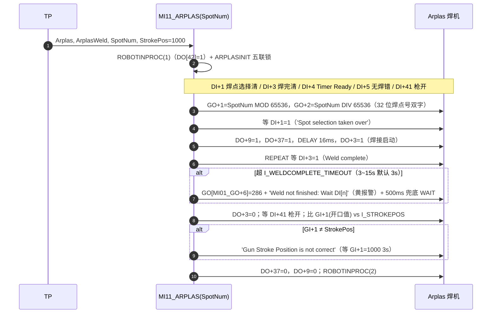
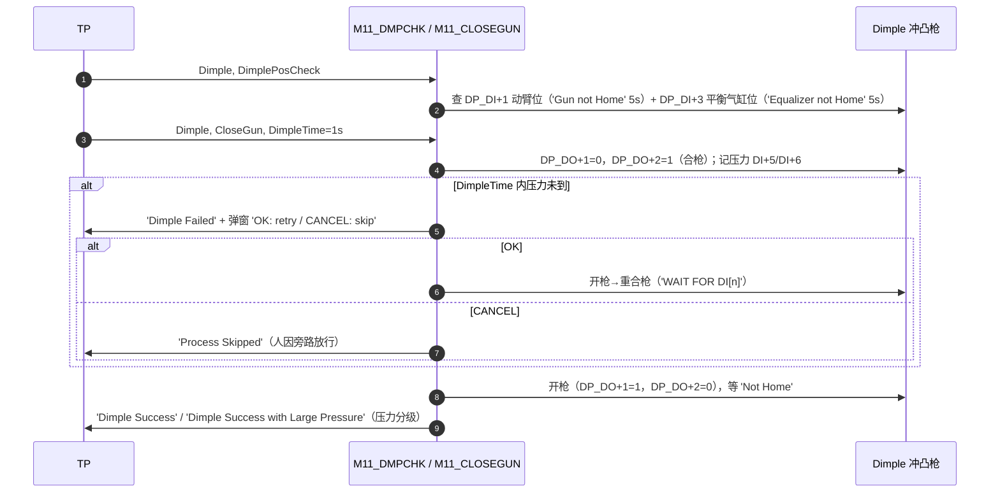

# MI11_APL 逐应用深拆（FAP v2.0.9）

> 三方对照：pc2kl3 反编译实读（5 模块 1197 行）× 手册 v20 第 12 章 × 更新日志 9 段。
> 标注：【实证】/【推断】/【存疑】。生成 2026-11-04，接续 [MI09_DSD_逐应用深拆.md](MI09_DSD_逐应用深拆.md)。

---

## 0. 定位与模块清单

**一句话定位**：Arplas 焊（电阻焊变体）+ Dimple（冲凸）双工艺应用——Arplas 焊点调度/开口检测/焊后确认，Dimple 动臂/平衡气缸检查+合枪冲凸；v2.0.9 新增 **Arplas 修磨 TCP 补偿**（GI[112]×系数→Tool1 Z 轴，R[32]/R[33] 记账）。【实证：手册 12.1 + MI11_TIPDRESS】

| 模块 | 行数 | 角色 |
|---|---|---|
| MI11_APL | 254 | TP 入口（ACTIONSELECT：1 Arplas / 2 Dimple） |
| MI11_APL_ROUT | 466 | ARPLASINIT/MI11_ARPLAS/M11_DMPCHK/M11_CLOSEGUN/TIPDRESS/TD_NEW/IOINTER |
| MI11_APL_MON | 62 | 后台（BSN 残留 + 信号关联；I_MON 钳 32~1024 **与手册一致**） |
| MI11_APL_GUI | 395 | MI11 Setup（主参数页 + Arplas 修磨页） |
| MI11_APL_VAR | 20 | 变量文件壳 |

IO 域：Arplas 域 I_MI11_DI/DO/GI/GO（基 1688）、Dimple 域 I_MI11_DP_DI/DO（基 1680，v2.0.9 从 1681→1680）。【实证：手册 6.1.2 + 更新日志】

---

## 1. 指令级时序图

### 1.0 分发与干跑

`CALL MI11_APL(工艺, 子命令, …)`：1 Arplas（子 1 ArplasWeld / 2 Tipdress）；2 Dimple（子 1 DimplePosCheck / 2 CloseGun）。
⚠ 手册 Parameter select 写"2: ArplasWeld"是**笔误**——代码 CASE(2)=Dimple。【实证差异】
干跑门 `DI[MI01_DI+35]`：干跑时**不执行工艺，DELAY I_DRYRUNTIME**（模拟工艺时间 500~5000ms 默认 1000，Setup「Delay for dry run」）——MI 系列里干跑处理最完整的一站。【实证】

### 1.1 ArplasWeld（焊点号双字 + 五联锁 + 开口检测）



【实证：MI11_ARPLAS/ARPLASINIT，ROUT:183-331；v2.0.8「超时产生黄色报警」=GO[6]=286+sev1】

### 1.2 Tipdress（修磨 TCP 补偿，v2.0.9 新增）

```
Update:  修磨量 = GI[112] × R_SCALE（Setup「Tip dress scale」）
         $MNUTOOL[1,1].Z = R_ORIGINAL_TCP_Z + 修磨量   （写回 Tool 1）
         R[32] = 修磨量（本次）；R[33] 累计（MON 记账）
New Tip: $MNUTOOL[1,1].Z = R_ORIGINAL_TCP_Z（恢复）；R[32]=0
         未设原始值 → 'Set original TCP in GUI first'
```

【实证：MI11_TIPDRESS/MI11_TD_NEW，ROUT:432-463】
⚠ 手册 12.2.1.1 写"GI[121]×系数"，12.3 Setup 页写"GI[112]"——**代码实为 GI[112]**（io_12[112]），指令节是笔误。【实证差异】

### 1.3 Dimple（双传感器检查 + 合枪冲凸 + 人因旁路）



【实证：M11_DMPCHK/M11_CLOSEGUN，ROUT:333-430；手册 12.2.2 弹窗=确认直到条件满足】

### 1.4 信号关联（DCS）

任意指令激活 MI11_IOINTER：$THRSDITABLE[111]：DO_NO=171，DI_NO=Arplas DI+3 或 Dimple DP_DI+1（按工艺）。【实证：v2.0.x「任意指令激活信号关联」】

---

## 2. 参数表

### 2.1 TP 指令参数速查

| 工艺 | 子命令 | 参数 |
|---|---|---|
| Arplas | ArplasWeld | SpotNum（32 位，双字下发）+ StrokePos 0~2000=1000（开口检测值） |
| Arplas | Tipdress | Update（GI[112]×系数补 Tool1 Z）/ New Tip（恢复） |
| Dimple | DimplePosCheck | — |
| Dimple | CloseGun | DimpleTime[s] 默认 1 |

### 2.2 MI11 Setup（手册 12.3）

| 项 | 默认 | 范围 | 变量 |
|---|---|---|---|
| BG Scan Time | 32ms | 32~1024 | I_MON（**代码钳 32~1024，与手册一致**——MI 系列例外） |
| Delay for dry run | 1000ms | 500~5000 | I_DRYRUNTIME（干跑模拟工艺） |
| Pulse | 1s | 0.5~2.0 | R_COMPULSE（钳 0.5~2）→ I_COMPULSE=×1000 |
| Newspot select pulse | 500ms | 300~3000 | I_NEWSPOT_SELCT_PULSE |
| Weld complete timeout | 3000ms | 3000~15000 | I_WELDCOMPLETE_TIMEOUT（代码硬钳位） |
| Tip dress scale | — | 系数 | R_SCALE（GI[112]×R_SCALE=修磨量） |
| Origial TCP saved(mm) | — | Z 值 | R_ORIGINAL_TCP_Z（原文拼写 Origial） |

---

## 3. GUI 流程

MENU → TEST CYCLE → MI GUI → **MI11 Setup**：主参数页（上表 5 项）→ **F2 Arplas 修磨页**（Tip dress scale + Origial TCP saved）。修磨前必须在 GUI 设原始 TCP（否则 TD_NEW 报 'Set original TCP in GUI first'）。【实证：手册 12.3 + ROUT 字符串】

---

## 4. 异常路径

| 场景 | 表现 | 恢复 |
|---|---|---|
| 焊点选择残留 | 'Spot Selection Invalid'/'Spot selection taken over'（3s） | 等 DI+1 清/置 |
| 焊接序列未结束 | 'Weld complete Error'/'Not at end of sequence' | 等 DI+3 清 |
| Timer 未就绪 | 'Timer Ready Error'/'Timer is not Ready' | 等 DI+4 |
| 焊接故障 | 'Welding Error'/'Welding Error Happened' | 清 DI+5 |
| 枪未开 | 'Gun Opened Error'/'Gun is not opened' | 等 DI+41 |
| 焊接超时 | GO[6]=286 + 'Weld not finished'（**黄色报警**） | 查焊机 |
| 开口不符 | 'Gun Stroke Position is not correct'（等 GI+1=1000） | 核 StrokePos 参数 |
| Dimple 枪/气缸不在位 | 'Gun not Home' / 'Equalizer not Home'（5s） | 复位 |
| Dimple 冲凸失败 | 'Dimple Failed' + **OK 重试 / CANCEL 跳过**弹窗 | 人因旁路（跳过='Process Skipped'，质量追溯风险点，同总纲 B7 类） |
| Dimple 成功 | 'Dimple Success' / '**with Large Pressure**'（压力分级提示） | — |
| 未设原始 TCP | 'Set original TCP in GUI first' | GUI 设置 |

---

## 5. 与 TP 程序交互

- `CALL MI11_APL(1|2, 子命令, …)`；干跑=DELAY 模拟。
- ROBOTINPROC 与 MI01 共用 DO[42] 进程信号（v2.0.9：Arplasweld/Dimple 都输出 DO[42]）。
- 焊点号走 GO+1/+2 双字（MOD/DIV 65536）——支持超 65535 焊点号。
- 修磨流程挂接：TP 在换帽/修磨节拍（参考 MI04 PNS00XX 的 TIPCHANGE 类挂点）调 Tipdress Update/New Tip。
- BSN 车身码（MI11_SENDBSNUM→DO+145）为**残留死代码**（v2.0.x 删除功能但例程仍在）。

---

## 6. 手册 × 更新日志 × 代码 对照结论

1. **手册两处笔误已由代码定谳**：Parameter select "2: ArplasWeld"→实为 Dimple；指令节 "GI[121]"→实为 **GI[112]**。
2. **修磨 TCP 补偿链**（v2.0.9）：GI[112]×R_SCALE→Tool1 Z 轴增量补偿 + R[32] 本次量 + R[33] 累计量——电极磨损闭环的标准做法；换新帽（New Tip）回原始 Z。
3. **人因旁路两处**：Dimple 失败 CANCEL 跳过（'Process Skipped'）、Arplas 超时黄报警后 500ms 兜底放行——质量追溯注意点。
4. **干跑最完善**：DELAY I_DRYRUNTIME 模拟工艺时长（Setup 可调），不会误发工艺 DO——对比 MI03/MI08/MI09 的静默跳过更安全。
5. **MON 钳位 32~1024 与手册一致**（MI03/MI08/MI09 均为 256 与手册 1024 不符）——本应用是口径正确的一站，反证其他站是实现缩水或手册失真。
6. **Dimple 基址演进**：1689→1681（v2.0.x）→**1680**（v2.0.9）——升级机器注意变量地址迁移（同 v2.0.8 Coherix 3512 的坑）。

---

*输入：decompiled/MI11_apl/（5 .KL）· ref_手册v20.txt §12（行 2575-2677）· ref_更新日志FAP_v2.0.9.txt MI11×9 段 · analysis/MI11_apl.html。*
