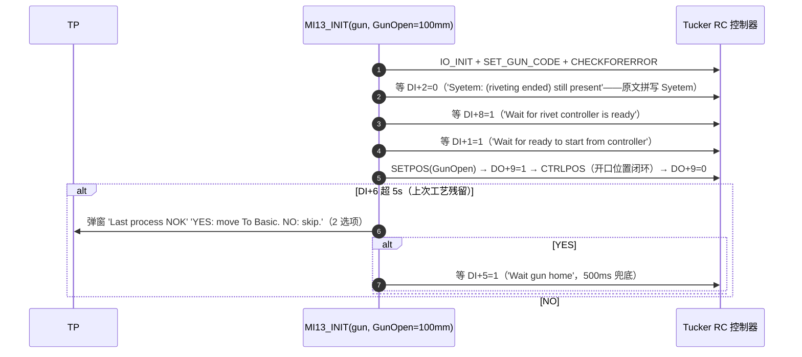
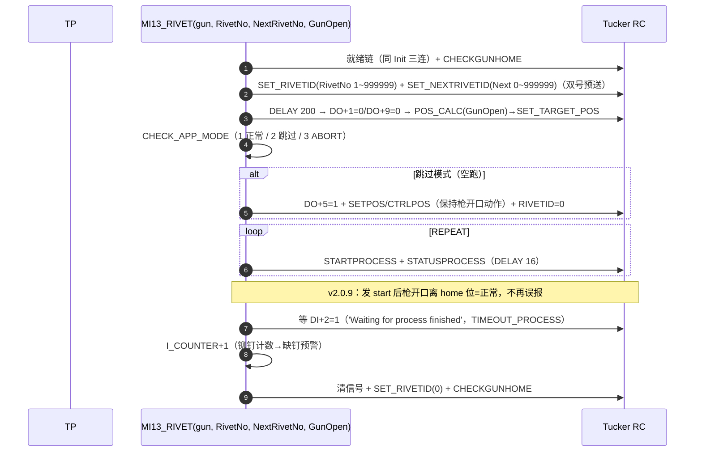

# MI13_RVH 逐应用深拆（FAP v2.0.9）

> 三方对照：pc2kl3 反编译实读（7 模块 3288 行）× 手册 v20 第 13 章 × 更新日志 13 段。
> 标注：【实证】/【推断】/【存疑】。生成 2026-11-04，接续 [MI11_APL_逐应用深拆.md](MI11_APL_逐应用深拆.md)。
> ⚠ README 称本应用为"焊枪管理"，手册实为**自冲铆接（SPR）旧款 Tucker 枪**——以手册+代码为准（MI13=旧 Tucker / MI14=新 Tucker / MI15=Gripp，三胞胎之一）。

---

## 0. 定位与模块清单

**一句话定位**：SPR 自冲铆接（旧 Tucker）——初始化/铆接/开枪定位/铆钉仓前处理/充钉(EPF)/枪连接控制；枪开口位置闭环控制族；缺钉计数预警；RC 控制器双枪配置（GUNCFG_LST 映射）。【实证：手册 13.1 + MI13_ROUT 全文】

| 模块 | 行数 | 角色 |
|---|---|---|
| MI13_RVH | 387 | TP 入口（DOAPP：6 指令分发） |
| MI13_RVH_ROUT | 955 | 33 例程：工艺族+位置控制族+RC 交互+人因弹窗族 |
| MI13_RVH_DCP | 966 | RC 故障→人读消息表（ERROR_MSG） |
| MI13_RVH_MON | 350 | 后台：警报/故障显示 + 手动请求分发（MAN_*） |
| MI13_RVH_MAN | 262 | 手动操作实现 |
| MI13_RVH_GUI | 348 | MI13 Setup + RVH MAN 界面 |
| MI13_RVH_VAR | 20 | 变量文件壳 |

IO 域：RC 控制器域 **AR_M13_RC_DI/DO[GUNCFG_LST[枪号]]**（双枪可配，手册 6.1.2 基 1136/1448=Tucker 旧 设备 1/2）；关键偏移：DI+1 ready-to-start / +2 rivet-finish / +5 gun-home / +8 controller-ready / +65 magazine-ready / +66 loaded / +67 magazine-empty；DO+5 process-start / +9 pos-ctrl / +65 predocking / +66 load / +97 BSN。【实证：ROUT 偏移全表】

---

## 1. 指令级时序图

### 1.0 分发

`CALL MI13_RVH(指令, …)`：**1 Init / 2 Rivet / 3 Positioning / 4 PrepareDock / 5 LoadEPF / 6 GunState**。
通用约定：任意指令触发车身码后台（DO[172] 5s 脉冲 + BSN→RC_DO+97）；指令前后 DO[42] 进程信号；干跑 DI[35] 不执行工艺但**保持枪开口动作**【v2.0.x】。

### 1.1 Init（三连确认 + RC 就绪链）



【实证：MI13_INIT，ROUT:679-741；v2.0.x「弹窗 3 选项→2」「restart 前三次弹窗确认 RC 状态」=MANUAL_CHECKRC 族】

### 1.2 Rivet（核心：双铆钉号预送 + 工艺闭环）



【实证：MI13_RIVET，ROUT:743-833；RivetNo 走 SET_RIVETID 双字接口（1~999999 六位）】

### 1.3 Positioning / PrepareDock / LoadEPF / GunState

| 指令 | 动作 | 关键联锁 |
|---|---|---|
| Positioning(gun, GunOpen, GunOpenCtrl/NoCtrl) | CHECKFORERROR → DO+9=0 → Ctrl 则 SETPOS+DELAY 50 → CHECKGUNHOME | 开口到位检查可选 |
| PrepareDock(gun, ActivateON/OFF) | DO+65 = 0/1（**反相映射**：ON→0）【实证】 | 铆钉仓前/后处理 |
| LoadEPF(gun) | 等 DI+65 杂志就绪（'Magazine not ready'）→ DO+66 充钉 → 等 DI+66/超时 TIMEOUT_LOADEPF(6s) → 失败 **GO[6]=208** + 弹窗 'Load EPF Error' 'YES: Acknowledge and repeat. NO: Process was OK.' → I_COUNTER=0（补钉清计数） | v2.0.x 增充钉报错处理 |
| GunState(gun, Couple/Decouple) | MI13_COUPLE / MI13_DECOUPLE（枪机械连接/断开） | v2.0.x 优化 |

### 1.4 缺钉预警（MI13_PRESERVICE，MON 挂接）

```
I_COUNTER ≥ I_PREWARNCOUNTER → 'Warning: Magazine(s) will be empty'（M13_PREWARNING=1）
DI+67（Magazine empty）      → 'Warning: Magazine(s) empty'
```

【实证 ROUT:927-938；手动界面 MAG EMPTY 显示同源】

### 1.5 后台（MI13_RVH_MON）

警报/故障显示（RVHWARNING/FAULTDISP，DCP 消息表供文本）+ 手动请求分发（MAN_RVH/PRELOAD/LOADEPF/COUPLE/DECOUPLE/SETGUNNO/OPENGUN/CLOSEGUN ← RVH MAN 界面）。【实证】

---

## 2. 参数表

### 2.1 TP 指令参数速查

| 指令 | 参数 |
|---|---|
| Init | GunNo. + GunOpen[mm]=100 |
| Rivet | RivetNo. 1~999999 + NextRivetNo. 0~999999 + GunNo. + GunOpen[mm] |
| Positioning | GunNo. + GunOpen[mm] + GunOpenCtrl / GunOpenNoCtrl |
| PrepareDock | GunNo. + ActivateON / ActivateOFF |
| LoadEPF | GunNo. |
| GunState | GunNo. + Couple / Decouple |

### 2.2 MI13 Setup（手册 13.3）+ RVH MAN（13.4）

| 项 | 默认 | 范围 |
|---|---|---|
| BNS Number Select | 80-bits | 80/64 |
| BG Scan Time | 32ms | 32~1024 |
| Max Gun Number | 1 | 1~2（MAN 页 Max.Guns 1~3——两处不一致【实证差异】） |
| Position Tolerance | 1 | 1~5（开口位置允许误差，CHECKINPOS 用） |
| Delay for dry run | 1000ms | 500~5000 |
| Timeout Rivet / Process / LoadEPF | 500 / 5000 / 6000ms | 500~3000 / 500~9000 / 500~9000 |
| （MAN）System ready / Process finished / Magazine loaded | — | 500~5000 / 500~5000 / 500~10000 |
| （MAN 参数页）Opening stroke Gun1 | — | 1~255mm |

RVH MAN 三页：General（超时族）/ Manual Fctns（Cur GunNo/RivitNo/OpenPos、SYSTEM FAULT/WARN、MAG EMPTY、MANUAL RVH/PreLoad/LoadEpf/Couple/Decouple 弹窗输入枪号铆钉号、SHIFT+F4/F5 手动开合枪）/ Setup Parameters（行程设定）。【实证：手册 13.4 + MON MAN_*】

---

## 3. GUI 流程

MENU → TEST CYCLE → MI GUI → **MI13 Setup**（BNS/扫描/枪数/容差/干跑/三超时）；MENU → NEXT → BROWSER → **RVH MAN**（三页手动界面，见 2.2）。手动操作经 MON 的 MAN_* 请求 → MAN 模块执行（Deadman 类约束在 MAN 实现层）。

---

## 4. 异常路径

| 场景 | 表现 | 恢复 |
|---|---|---|
| 上次工艺残留 | 'Syetem: (riveting ended) still present'（原文 Syetem） | 等 DI+2 清 |
| 控制器未就绪 | 'Wait for rivet controller is ready' | 等 DI+8 |
| 未准启 | 'Wait for ready to start from controller' | 等 DI+1 |
| 枪不在 home | 'Wait gun home'（INIT 弹窗 YES 分支 500ms 兜底） | move To Basic |
| 上工序 NOK | 弹窗 'Last process NOK' YES:move To Basic / NO:skip（**2 选项**，v2.0.x 从 3 缩减） | 人因选择 |
| 铆接超时 | 'Waiting for process finished'（TIMEOUT_PROCESS） | 查 RC |
| 充钉失败 | GO[6]=**208** + 'Load EPF Error' 弹窗 YES 重试 / NO 视为 OK | 人因旁路 |
| 杂志未就绪 | 'Magazine not ready' | 等 DI+65 |
| 缺钉预警 | 'Warning: Magazine(s) will be empty / empty' | LoadEPF 补钉（I_COUNTER 清零） |
| RC 故障 | DCP 消息表 ERROR_MSG 转人读文本 | 按表排查 |

---

## 5. 与 TP 程序交互

- `CALL MI13_RVH(1~6, …)`；典型节拍：Init → (Positioning 开枪) → Rivet（双铆钉号流水）→…→ GunState Decouple（换枪/维护）。
- **铆钉号流水**：RivetNo+NextRivetNo 双号预送 RC——控制器可提前备料；I_COUNTER 计数驱动缺钉预警。
- DO[42] 进程信号（v2.0.x 指令前后置/清）与 MI01/MI04 同域。
- BSN 车身码：任意指令拉起后台镜像（DO[172] 5s 脉冲 + RC_DO+97）。
- 与 MI14/MI15 为同工艺三胞胎（Tucker 新旧/Gripp）——指令集相似但 RC 协议不同，勿混用。

---

## 6. 手册 × 更新日志 × 代码 对照结论

1. **README 与手册不符**：README"焊枪管理（枪号 1~3、回枪位）"实为 **SPR 旧 Tucker**（枪号 1~2，Setup Max Gun 1~2 但 MAN 页写 1~3——两处口径不一）。
2. **枪开口位置闭环**是本站特色：POS_CALC/SET_TARGET_POS/CTRLPOS/CHECKINPOS 族（容差 Position Tolerance 1~5）——开口 mm 值经 POS_CALC 换算后与 GI 回读比对。
3. **人因弹窗族完善**（MI 系列之最）：'Last process NOK' 2 选项、'Load EPF Error' 2 选项、RC 状态三连确认（MANUAL_CHECKRC，v2.0.x 弹窗 5s 默认+防重复）——弹窗多=异常恢复路径多，接手排查先看弹窗历史。
4. **v2.0.9 语义修正**：Rivet 发 start 后枪开口**离 home 位属正常**（此前会误报）——升级机器行为差异注意。
5. **空跑最完整**（同 MI11）：干跑保持枪开口动作但不发工艺（v2.0.x）。
6. 偏移即协议：RC 信号偏移表（+1/+2/+5/+8/+65/66/67…）是旧 Tucker 协议实证——MI14/MI15 对比时可直接引用本表找差异。

---

*输入：decompiled/MI13_rvh/（7 .KL）· ref_手册v20.txt §13（行 2678-2900）· ref_更新日志FAP_v2.0.9.txt MI13×13 段 · analysis/MI13_rvh.html。*
