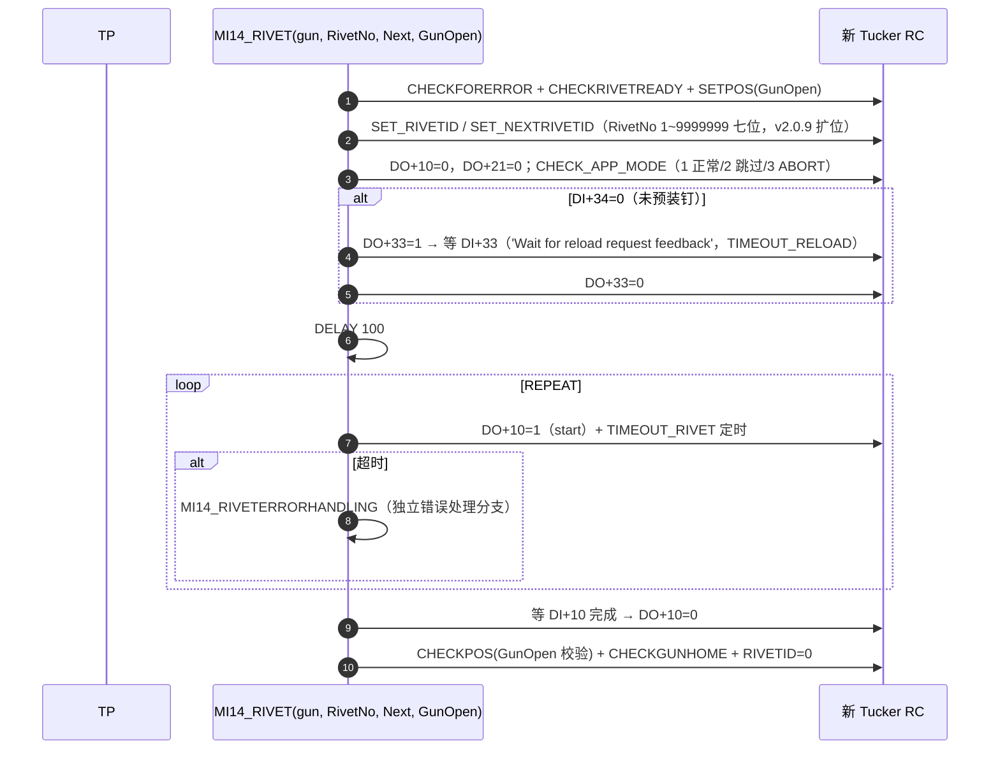
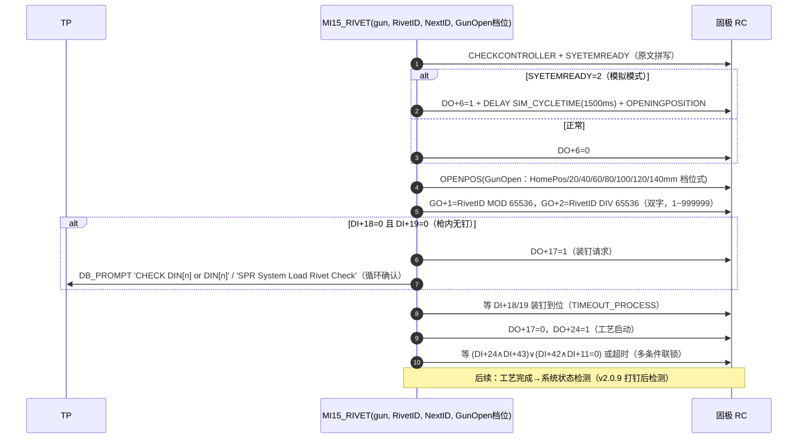

# MI14_SPR + MI15_SPR 逐应用深拆（FAP v2.0.9）——SPR 三胞胎对照

> 三方对照：pc2kl3 反编译实读（MI14 5 模块 1654 行 + MI15 5 模块 1526 行）× 手册 v20 第 14/15 章 × 更新日志（MI14×4 / MI15×3 段）。与 [MI13_RVH_逐应用深拆.md](MI13_RVH_逐应用深拆.md) 构成**新旧 Tucker/固极三胞胎**对照。
> 标注：【实证】/【推断】/【存疑】。生成 2026-11-04。

---

## 0. 定位与模块清单

| | MI14_SPR（新 Tucker） | MI15_SPR（固极 Gripp） |
|---|---|---|
| 定位 | 自冲铆 新 Tucker | 自冲铆 固极（Gripp） |
| 指令集 | Init / Rivet / Reload / Docking / Magazine / SendBSNNum（6） | Init / Rivet / Positioning / GunState / Prepare / FillMag / Reload / SendBSNNum / **DieCheck**（9） |
| 模块 | SPR(315)+ROUT(820)+MON(191)+GUI(348)+VAR | SPR(277)+ROUT(753)+MON(146)+GUI(330)+VAR |
| 发布 | 更新日志"增加适用于新 Tucker SPR 焊机的应用" | "增加适用于固极 SPR 焊机的应用" |

⚠ 手册 15.2 参数清单列 8 项**漏了 DieCheck**（15.2.9 实际有文档）——select 列表滞后老毛病。【实证差异】

---

## 1. 指令级时序图

### 1.1 MI14_RIVET（新 Tucker：reload 内嵌 + 错误处理独立）

【实证：MI14_RIVET，ROUT:478-538；v2.0.8「Init/Rivet 增 home、basic 位检测」「修 GO[52] 无法发数值」；v2.0.9「Dock 先发 DO1139 再等 DI1139」】

**MI14 特有例程**：MI14_SPINDLEHOME/SPINDLETARGET（**主轴定位**——铆接主轴独立回零/走目标）、MI14_RIVETERRORHANDLING、MI14_DOCK（Connect/Disconnect 走 DO1139→DI1139 握手序）、MI14_MAGAZINE（Preparation/ReadyToFill/PostProcessing 三段，超时 TIMEOUT_MAGAZINE）、MI14_RELOAD（独立加载指令）。
**心跳检测**（MON，v2.0.8）：后台心跳监控 RC 存活。【实证骨架+日志】

### 1.2 MI15_RIVET（固极：档位开口 + 双字铆钉号 + 装钉检查弹窗）

【实证：MI15_RIVET，ROUT:383-510；v2.0.9「打钉逻辑增加工艺完成后检测系统状态」「铆模检测未收到 good→弹窗二次确认」】

**MI15 特有**：MI15_DIECHECK(Request/Command **铆模检测**——未收到 good 信号关命令+弹窗 YES 结束/NO 二次确认【v2.0.9】)；MI15_PREMAGAZINE(ActivateON/OFF×Check/NoCheck 供钉系统)；MI15_FILLMAG；MI15_GUNSTATE(Couple/DeCouple)；开口**档位枚举**（非连续 mm——CHECKOPENPOS 档位比对）；BSN **从第 81 点起**（v2.0.9，MI14/MI13 不同）。

### 1.3 通用约定（两站共用）

- SendBSNNum：一次运行常驻后台，DO[172] 5s 脉冲（三胞胎一致）。
- CHECK_APP_MODE 三态（正常/跳过/ABORT）+ 干跑 SIM 模式（MI15 内置 SIM CycleTime=1500ms）。
- 弹窗族 DB_PROMPT（MI15 装钉检查 7 键、DieCheck 二连确认；MI14 错误处理弹窗）。

---

## 2. 参数表

### 2.1 指令参数对照（三胞胎）

| 功能 | MI13（旧 Tucker） | MI14（新 Tucker） | MI15（固极） |
|---|---|---|---|
| 初始化 | Init(GunNo, GunOpen 100mm) | Init(GunNo, GunOpen **0~200 一位小数**×10) | Init(GunNo)（无开口参） |
| 铆接 | Rivet(RivetNo 1~999999, Next, GunNo, GunOpen) | Rivet(GunNo, RivetNo **1~9999999**, Next, GunOpen) | Rivet(GunNo, RivetID 1~999999, NextID, **GunOpen 档位**) |
| 开枪定位 | Positioning(+Ctrl/NoCtrl) | —（Init 内含） | Positioning(GunOpen 档位) |
| 枪连接 | GunState(Couple/Decouple) | Docking(Connect/**Disconnect**) | GunState(Couple/**DeCouple**) |
| 补钉 | LoadEPF | Reload(RivetNo) + Magazine(Preparation/ReadyToFill/PostProcessing) | FillMag + Reload(RivetID, Check/NoCheck) + Prepare(Activate×Check) |
| 铆模检测 | — | — | **DieCheck(Request/Command)** |
| 车身码 | 任意指令常驻 | SendBSNNum | SendBSNNum（**BSN 起点第 81 点**） |

### 2.2 Setup 参数对照

| 项 | MI13 | MI14 | MI15 |
|---|---|---|---|
| Rivet 超时 | 500ms（500~3000） | **4000ms**（100~5000，v2.0.8 从 500 改） | — |
| Process 超时 | 5000（500~9000） | 5000（500~9999） | 5000（500~**20000**） |
| Reload/Dock/Magazine 超时 | LoadEPF 6000 | 各 5000（500~9999） | Filling CycleTime 10000 |
| 干跑 | Delay dry run 1000 | — | **Sim CycleTime 1500**（500~20000） |
| Position Tolerance | 1~5=1 | 1~5=1 | —（档位制无容差） |
| Max Gun Number | 1~2=1（MAN 页 1~3 不一致） | 1~2=1 | 1~2=1 |
| BG Scan | 32~1024=32 | 同 | 同 |

---

## 3. GUI 流程

两站均：MENU → TEST CYCLE → MI GUI → **MI14/MI15 Setup**（超时族+枪数+容差/档位）。MI14 增 Dock/Magazine 专页项；MI15 增 Sim CycleTime/Filling CycleTime。手动界面细节手册未展开（MI13 有 RVH MAN 三页，14/15 沿用同类）。【实证：手册 14.3/15.3 + GUI 模块】

---

## 4. 异常路径（增量，公共类见 MI13 篇）

| 站 | 场景 | 表现 |
|---|---|---|
| MI14 | reload 无反馈 | 'Wait for reload request feedback'（TIMEOUT_RELOAD） |
| MI14 | 铆接超时 | MI14_RIVETERRORHANDLING 独立分支（弹窗/恢复） |
| MI14 | Dock 时序 | 先发 DO1139 等 DI1139（v2.0.9 时序修正） |
| MI15 | 枪内无钉 | 'CHECK DIN[n] or DIN[n]' / 'SPR System Load Rivet Check' 弹窗循环 |
| MI15 | 铆模检测无 good | 关命令 + 弹窗 YES 结束 / NO **二次确认**（v2.0.9） |
| MI15 | 模拟模式 | SYETEMREADY=2 → SIM_CYCLETIME 空跑+开口动作 |
| 共通 | GO[52] | v2.0.8 修"无法发出数值"bug（MI14）——GO 数值通道曾失效 |

---

## 5. 与 TP 程序交互

- 调用族同 MI13（`CALL MI1x_SPR(指令, …)`）；MI15 开口是**档位枚举**（TP 参数向导出 8 档选择），MI14 是 0~200.0 连续值（一位小数，内部 ×10）。
- 铆钉号接口：MI13/MI14 走 SET_RIVETID 专用接口（RC 串行/双字），MI15 直接 **GO+1/+2 双字广播**。
- 车身码：MI13/MI14 任意指令常驻；MI15 独立 SendBSNNum 且 **BSN 起点第 81 点**（与 MI08/MI13 的 17/81/97 起点都不同——跨站联调注意）。
- 三站 RC 协议偏移各不相同（MI13: +1/+2/+5/+8/+65…；MI14: +10/+21/+33/+34；MI15: +11/+17/+18/19/+24/+42/43）——**换供应商=换协议表**，见 §6。

---

## 6. 三胞胎对照结论

| 维度 | MI13 旧 Tucker | MI14 新 Tucker | MI15 固极 |
|---|---|---|---|
| 指令数 | 6 | 6 | **9**（多 DieCheck/Prepare/FillMag/Positioning） |
| 开口控制 | 连续 mm+容差闭环 | 连续 mm 0~200（×10 内部）+CHECKPOS | **8 档枚举** |
| 铆钉号 | 1~999999 | **1~9999999**（v2.0.9 扩） | 1~999999（GO 双字） |
| 主轴 | 无 | **SPINDLEHOME/TARGET 主轴定位** | 无 |
| 错误处理 | 弹窗族 | **RIVETERRORHANDLING 独立分支** | 多条件联锁+弹窗二次确认 |
| 模拟/干跑 | DELAY I_DRYRUNTIME | — | **SIM_CYCLETIME 内置模拟模式** |
| 心跳 | 无 | **后台心跳检测** | 无 |
| 特色 | 缺钉计数预警 I_COUNTER | reload 内嵌 Rivet 流 | 铆模检测 DieCheck |

**升级/运维要点**：
1. 三站 RC 信号偏移表完全不同——跨供应商移植=协议重写，MI13 篇 §6 的偏移表可作基线对照。
2. MI14 Rivet RC 超时 v2.0.8 从 500ms 改 4000ms（旧默认=频繁误超时）。
3. MI15 BSN 起点 81 vs MI13/14 的 17/97 族——PLC 组态表按站配置，混线必查。
4. MI15 手册 select 列表漏 DieCheck（第 9 指令）——照 select 数参数会漏项。
5. MI14 开口值一位小数（×10 内部处理）——TP 传 100.0 而非 100，参数向导已按此出。

---

*输入：decompiled/MI14_spr/、MI15_spr/（10 .KL）· ref_手册v20.txt §14/15（行 2901-3244）· ref_更新日志FAP_v2.0.9.txt MI14×4/MI15×3 段 · analysis/MI14_spr.html、MI15_spr.html。*
