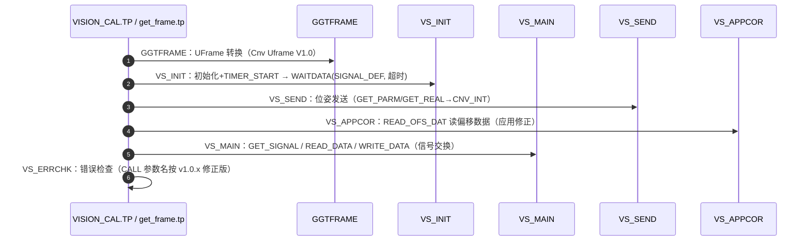

# MI17_OBJ 逐应用深拆（FAP v2.0.9）

> 三方对照：pc2kl3 反编译实读（11 模块 2188 行）× 手册 v20 第 16 章 × 更新日志 7 段 + 仓库 TP。
> 标注：【实证】/【推断】/【存疑】。生成 2026-11-04，接续 [MI14_MI15_SPR_逐应用深拆.md](MI14_MI15_SPR_逐应用深拆.md)。

---

## 0. 定位与模块清单

**一句话定位**：视觉引导**坐标应用**——MI 自研部分极小（车身码 + Setup + UFrame 转换工具 GGTFRAME），**主体是贝特威（BetterWay）视觉随包工具链 VS_* 五件套**（初始化/主控/位姿发送/应用修正/错误检查）。手册只文档了 SendBSNNum 一条指令——因为 VS_* 属供应商程序（changelog："不再安装或删除贝特威程序，用户自行安装、删除"）。【实证】

| 模块 | %COMMENT | 角色 | 归属 |
|---|---|---|---|
| MI17_OBJ / _ROUT / _MON / _GUI / _VAR | 'MI17 2.0.9' | SendBSNNum 分发 + BSN 镜像 + Setup | MI 自研 |
| GGTFRAME | 'Cnv Uframe V1.0' | **UFrame 转换工具**（TP_CLS/CHK_STAT/GET_IPARM） | MI 自研 |
| VS_INIT | 'Vs Init V1.6' | 视觉初始化（TIMER_START/STOP、WAITDATA） | 贝特威 |
| VS_MAIN | 'Vs Main V1.0' | 信号定义中枢（SIGNAL_DEF 结构、GET_SIGNAL/READ/WRITE_DATA） | 贝特威 |
| VS_SEND | 'Vs Send Pos V1.8' | 位姿发送（GET_PARM/GET_REAL/CNV_INT） | 贝特威 |
| VS_APPCOR | 'Vs App V1.8' | 应用修正（READ_OFS_DAT 偏移数据读取） | 贝特威 |
| VS_ERRCHK | 'Vs Chk Err V1.4' | 错误检查（v1.0.x 修"CALL VS_ERRCHK 参数名称错误"） | 贝特威 |

IO：BSN 64bit 逆序镜像 DI[MI01_DI+129+…]→**DO[MI17_DO+233+…]**（起点 233——各站 BSN 起点第四种）。【实证：MI17_SENDBSNUM】

---

## 1. 指令级时序图

### 1.1 SendBSNNum（手册唯一指令）

```
CALL MI17_OBJ(SendBSNNum, '...')
  → DO[172] 5s 脉冲 + 后台常驻（重启才停）
  → MON 每轮：DI[129+…] → DO[MI17_DO+233+…] 64bit 逆序镜像
```

【实证：MI17_OBJ ROUT/MON + 手册 16.2.1】

### 1.2 视觉校准/修正工作流（VS_* 工具链，TP 驱动）



【实证：VS_* 例程族 + 仓库 TP（VISION_CAL.LS、get_frame.LS、R01_OBJ_XX.LS、dis_ualm.tp）+ 更新日志"增加 VISION_CAL.tp"】

---

## 2. 参数表

| 项 | 内容 |
|---|---|
| TP 指令 | SendBSNNum（唯一；参数=注释） |
| Setup | BG Scan Time 32~1024=32（唯一项） |
| VS_* 参数 | 供应商约定（SIGNAL_DEF 结构体族 + PR/R[] 交换）；调用形态见 VISION_CAL.TP |
| GGTFRAME 参数 | GET_IPARM 取 TP 参数（TP_CLS 提示列表） |

---

## 3. GUI 流程

MENU → TEST CYCLE → MI GUI → **MI17 Setup**（仅 BG Scan Time）。VS_* 无人机界面（TP 调用式工具）；GGTFRAME 走 TP_CLS 文本提示。【实证：手册 16.3 + GUI 模块】

---

## 4. 异常路径

| 场景 | 表现 | 恢复 |
|---|---|---|
| VS 数据等待超时 | VS_INIT WAITDATA 超时分支 | 查视觉设备 |
| VS 错误 | VS_ERRCHK 检查输出（参数名曾错，v1.0.x 修） | 按修正版调用 |
| 状态检查失败 | GGTFRAME CHK_STAT | 查转换输入 |
| BSN | 无异常分支（纯镜像） | — |

---

## 5. 与 TP 程序交互

- 配套 TP（仓库实证）：**VISION_CAL.LS**（视觉校准）、**get_frame.LS**（取框架，配 GGTFRAME）、**R01_OBJ_XX.LS**（对象操作模板）、dis_ualm.tp。
- VS_* 族=TP 可调用工具（各带 TP_CLS 参数提示）；总纲"目标位无效"异常面在 VS_APPCOR 修正链。
- BSN 起点 233（MI08=81、MI09=17/49/337、MI13=97、MI15=81——**每站起点都不同**，PLC 组态按站配置）。

---

## 6. 对照结论

1. **应用性质特殊**：MI17 是"壳+供应商工具链"结构——自研 300 行（BSN/Setup/GGTFRAME）+ 贝特威 VS_* 五件套 1400 行。手册只写壳不写工具链（归属边界）。
2. **VS_* 版本谱系**：Init V1.6 / Main V1.0 / Send Pos V1.8 / App V1.8 / Chk Err V1.4——版本不齐=供应商分次交付，升级时成套换。
3. **GGTFRAME（Cnv Uframe V1.0）**=视觉坐标→UFrame 转换工具，是 MI17 "坐标/对象"定位的本体。
4. 排查视觉引导问题先分层：MI 层只有 BSN 镜像（查 DO+233 起）；坐标问题走 VS_*（查 SIGNAL_DEF 交换与 VISION_CAL.TP 流程）。

---

*输入：decompiled/MI17_obj/（11 .KL）· ref_手册v20.txt §16（行 3245-3284）· ref_更新日志FAP_v2.0.9.txt MI17×7 段 · 仓库 11_MI17_obj/04_tp（VISION_CAL/get_frame/R01_OBJ_XX）。*
