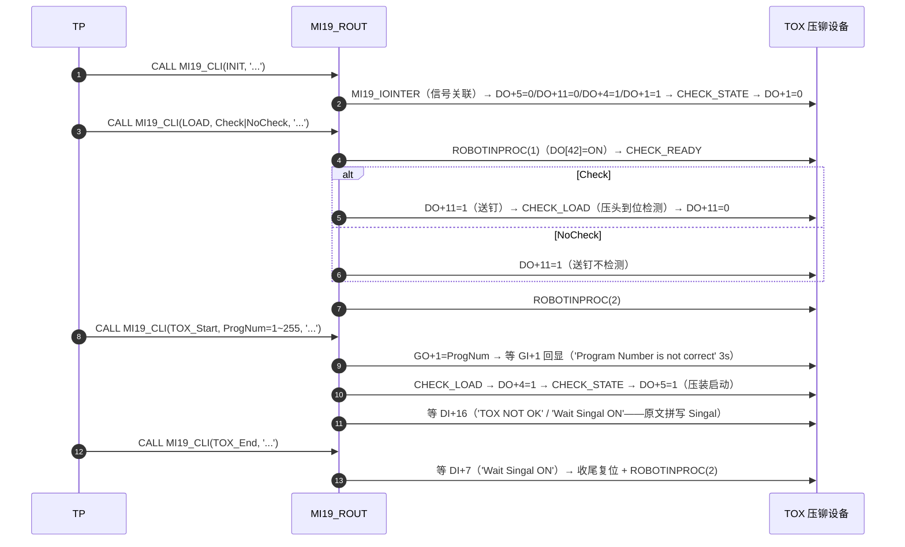

# MI19_CLI 逐应用深拆（FAP v2.0.9）

> 三方对照：pc2kl3 反编译实读（4 模块 978 行）× 手册 v20 第 17 章 × 更新日志 5 段。
> 标注：【实证】/【推断】/【存疑】。生成 2026-11-04，接续 [MI17_OBJ_逐应用深拆.md](MI17_OBJ_逐应用深拆.md)。
> ⚠ README 称"信号联锁（Wait Signal）"，实为 **TOX 压铆（Clinch）**应用——INIT/LOAD/TOX_Start/TOX_End + 伺服变体（手册+代码为准，README 第四处失真）。

---

## 0. 定位与模块清单

**一句话定位**：TOX 压铆——预送螺母（LOAD）→ 压装程序（TOX_Start ProgNum 1~255）→ 收尾（TOX_End）；**液压/伺服双实现**（Setup Mode Select 路由）；4 指令 2 行 TP 调用面。【实证：手册 17.1 + ROUT 双族】

| 模块 | 行数 | 角色 |
|---|---|---|
| MI19_CLI | 212 | TP 入口（ACTIONSELECT：4 指令） |
| MI19_CLI_ROUT | 439 | 液压族（INIT/LOAD/TOXSTART/TOXEND）+ **伺服族（SERVO_*）** + CHECK_STATE/LOAD/READY/SERVO_STATE + MI19_IOINTER |
| MI19_CLI_GUI | 307 | MI19 Setup（Mode Select 伺服/液压） |
| MI19_CLI_VAR | 20 | 变量文件壳 |

**无 MON 模块**（MI 系列唯一）——无后台镜像/扫描逻辑，纯指令式。
IO 域：I_MI19_DI/DO 基 2105（v2.0.x 从 1689 迁移，"删除 xvr 映射改为 Init 指令配置"）；GI/GO 偏移 **180**（v2.0.x 从 130 改）。【实证：更新日志】

---

## 1. 指令级时序图

### 1.1 TOX 压装主链（液压族；伺服族同构）

【实证：MI19_INIT/LOAD/TOXSTART/TOXEND，ROUT:222-345；'Wait Singal' 拼写=总纲 B6 代码实证】

### 1.2 伺服变体（v2.0.x 新增）

同构四指令 **MI19_SERVO_INIT / SERVO_LOAD / SERVO_TOXSTART / SERVO_TOXEND**（CHECK_SERVO_STATE 联锁），由 Setup Mode Select=伺服 时路由。总纲 2.4 的"SERVO_TOXSTART → SERVO_LOAD → SERVO_TOXEND（伺服压机时序）"即此。【实证：ROUT:352-419】

---

## 2. 参数表

| 指令 | 参数 | 说明 |
|---|---|---|
| INIT | — | 初始化 DO+检测 DI 状态 |
| LOAD | Check / NoCheck | 预送螺母（推送螺母到压头）+ 可选到位检测 |
| TOX_Start | ProgNum 1~255=1 | GO+1 下发压装程序号，GI+1 回显校验 |
| TOX_End | — | 关闭压装程序 |

Setup：**Mode Select** 伺服（默认）/ 液压——唯一配置项。GO 偏移 180（旧 130）。【实证：手册 17.3 + 更新日志】

---

## 3. GUI 流程

MENU → TEST CYCLE → MI GUI → **MI19 Setup**：Mode Select（伺服/液压）。v2.0.x "MI19 CLI 界面文件可选液压或伺服控制方式，并增加选择伺服控制后的 TOX 逻辑"。【实证】

---

## 4. 异常路径

| 场景 | 表现 | 恢复 |
|---|---|---|
| 程序号不匹配 | 'Program Number is not correct'（GI+1 回显，3s） | 核 ProgNum 与设备程序表 |
| TOX 无反馈 | 'TOX NOT OK' / **'Wait Singal ON'**（原文拼写）（3s） | 查压装完成信号 DI+16/DI+7 |
| 送钉未到位 | CHECK_LOAD 联锁 | 检查压头螺母 |
| 就绪链失败 | CHECK_READY / CHECK_STATE（状态联锁） | 按状态排查 |
| 等待文案 | UI 'Wait Singal ON/OFF'（厂商拼写，总纲 B6） | 显示层瑕疵不影响逻辑 |

---

## 5. 与 TP 程序交互

- 典型节拍：INIT → LOAD(Check) → TOX_Start(ProgNum) → 压装 → TOX_End。
- ROBOTINPROC 与全系共享 DO[42]（v2.0.9：Start/End 输出 DO[42]；v2.0.x：LOAD 送钉期间 DO[42]=ON）。
- GO+1/GI+1 = 压装程序号握手（1~255）。
- 伺服压机（SERVO_TOX 系列）与液压压机同指令面——TP 不感知，Setup Mode 决定。

---

## 6. 对照结论

1. **README 第四处失真**："信号联锁（Wait Signal）"实为 TOX 压铆（前三处：MI03 抓手✓、MI13"焊枪管理"✗、MI17"坐标/对象"半对）——README 模块表不可作身份依据，以手册+代码为准。
2. **双实现单接口**：液压/伺服同 4 指令码，SERVO_* 例程族随 Mode 路由——移植到伺服压机只改 Setup。
3. **'Wait Singal' 拼写定位**：MI19_CLI_ROUT 两处（TOXSTART DI+16 / TOXEND DI+7）——总纲 B6 的三文件之一。
4. **无 MON 站**：纯指令式（无后台扫描/BSN）——MI 系列唯一，BG Scan 项在 Setup 但无对应后台（或由 GUI 通用层使用）。
5. **IO 迁移史**：基址 1689→2105（v2.0.x）+ GO 偏移 130→180 + xvr 映射内联进 Init——升级机注意变量地址三连改。

---

*输入：decompiled/MI19_cli/（4 .KL）· ref_手册v20.txt §17（行 3285-3369）· ref_更新日志FAP_v2.0.9.txt MI19×5 段 · analysis/MI19_cli.html。*
