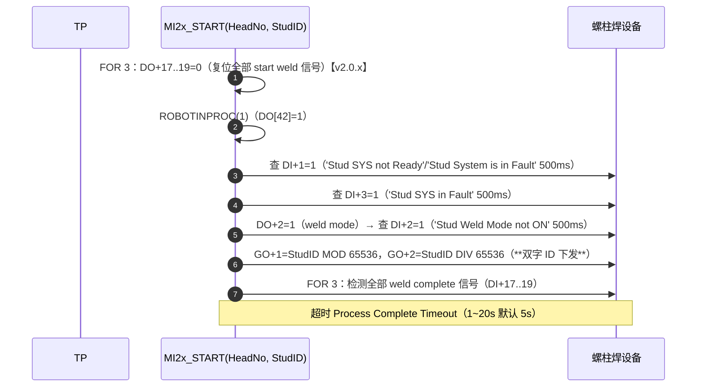

# MI20_SWH + MI21_SWH 逐应用深拆（FAP v2.0.9）——螺柱焊双胞胎对照

> 三方对照：pc2kl3 反编译实读（MI20 6 模块 2219 行 / MI21 5 模块 1090 行）× 手册 v20 第 18/19 章 × 更新日志（MI20×12 / MI21×2 段）。
> 标注：【实证】/【推断】/【存疑】。生成 2026-11-04，接续 [MI19_CLI_逐应用深拆.md](MI19_CLI_逐应用深拆.md)。

---

## 0. 定位与模块清单

**一句话定位**：螺柱焊（Stud Welding）——MI20=旧款/固极设备，MI21=新 Tucker 设备。指令面完全同构（SendBSNNum / Init / Start），差异在 StudID 范围、设备协议与 DCP 故障表。【实证：手册 18/19】

| | MI20_SWH（旧款/固极） | MI21_SWH（新 Tucker） |
|---|---|---|
| 模块 | SWH(194)+ROUT(349)+MON(74)+GUI(346)+**DCP(1295 故障表)**+VAR | SWH(196)+ROUT(393)+MON(52)+GUI(370)+VAR |
| 指令 | SendBSNNum / Init / Start(HeadNo 1~2, StudID) | 同三指令 |
| StudID | **1~134217728（2^27）**，字符串入参 | **1~999999999（10 位）**，字符串入参 |
| 发布史 | 12 段（老系统多轮迭代） | 2 段（新 Tucker 专版+双枪配置） |

---

## 1. 指令级时序图

### 1.1 Start（螺柱焊工艺，双站同构）

【实证：MI20_START，ROUT:228+；MI21_START 同构（ROUT:257+）；v2.0.x「Start 前复位所有 start weld+检测所有 weld complete」】

### 1.2 Init / SendBSNNum

- **Init**：DO 信号初始化 + DI 状态检测（就绪/故障链）。
- **SendBSNNum**：常驻后台 + DO[172] 5s 脉冲（双站一致）；MI20 BSN 64/80bit 可选（BNS Number Select）。

### 1.3 双枪（Gun Type，两站 v2.0.9 同步）

Setup 选单/双枪 → F5 EXEC 配置 Weld Interface 自动配置（重启生效）；**双枪时系统"焊接设备数量/焊接控制器数量"=2**（v2.0.9 两站同款修复）。Start 的 HeadNo 1~2 选枪头。【实证：更新日志两站 v2.0.9 条】

---

## 2. 参数表

| 项 | MI20 | MI21 |
|---|---|---|
| Start 参数 | HeadNo 1~2 + StudID 字符串（1~2^27） | HeadNo 1~2 + StudID 字符串（1~10 位） |
| Process Complete Timeout | 1.0~20.0s=5.0 | 同（手册 19.3） |
| BNS Number Select | 80/64-bits=80 | 同 |
| BG Scan | 32~1024=32 | 同 |
| Gun Type | 单/双枪（EXEC 重启生效） | 同 |
| GO 下发 | GO+1/+2 双字（MOD/DIV 65536） | 同 |

---

## 3. GUI 流程

MENU → TEST CYCLE → MI GUI → **MI20/MI21 Setup**（超时/BNS/扫描/Gun Type）。MI20 另有螺柱焊信号配置界面（xvr 注入 Weld Interface）。【实证：手册 18.3/19.3】

---

## 4. 异常路径

| 场景 | 表现 | 恢复 |
|---|---|---|
| 系统未就绪 | 'Stud SYS not Ready' / 'Stud System is in Fault'（500ms） | 查设备状态 DI+1 |
| 系统故障 | 'Stud SYS in Fault' | 清 DI+3 |
| 模式未开 | 'Stud Weld Mode not ON' | 查 DI+2 |
| 工艺完成超时 | Process Complete Timeout（默认 5s） | 查 weld complete DI+17..19 |
| 双枪配置错 | Weld Interface 设备/控制器数量≠枪数 | Setup Gun Type 重配+重启 |
| MI20 故障明细 | **DCP 故障表**（1295 行 ERROR_MSG，同 MI13 机制）转人读文本 | 按表查 |

---

## 5. 与 TP 程序交互

- `CALL MI2x_SWH(SendBSNNum|Init|Start, …)`；StudID 以**字符串**入参（v2.0.4 改），内部转整数双字 GO 下发。
- Start/Init 前后 DO[42]（v2.0.9 两站）。
- 与 MI13/14/15 的铆接族区分：SWH=螺柱焊（焊螺柱到板），SPR=自冲铆（铆钉穿板）——设备/协议完全不同。

---

## 6. 双胞胎对照结论

1. **同构三指令**，差异集中在：StudID 范围（2^27 vs 10 位）、设备 DI/DO 偏移、MI20 多一个 1295 行 DCP 故障表（旧款设备故障码多）。
2. **v2.0.9 双枪修复两站同步**：选双枪必须把系统焊接设备/控制器数量配 2——曾漏配导致单边失效。
3. **Start 前复位全 start weld + 全检 weld complete**（v2.0.x）——多枪头残留信号清场，防串枪。
4. StudID 字符串化（v2.0.4）+ 双字 GO 下发——ID 通道与 MI13/14 铆钉号同构（MOD/DIV 65536），跨站 PLC 组态可复用套路。
5. MI21 迭代少（2 段）=新 Tucker 版本稳定；MI20 12 段=旧款历史包袱多（xvr 映射/F[43]/界面多轮调整）。

---

*输入：decompiled/MI20_swh/、MI21_swh/（11 .KL）· ref_手册v20.txt §18/19（行 3370-3531）· ref_更新日志FAP_v2.0.9.txt MI20×12/MI21×2 段 · analysis/MI20_swh.html、MI21_swh.html。*
