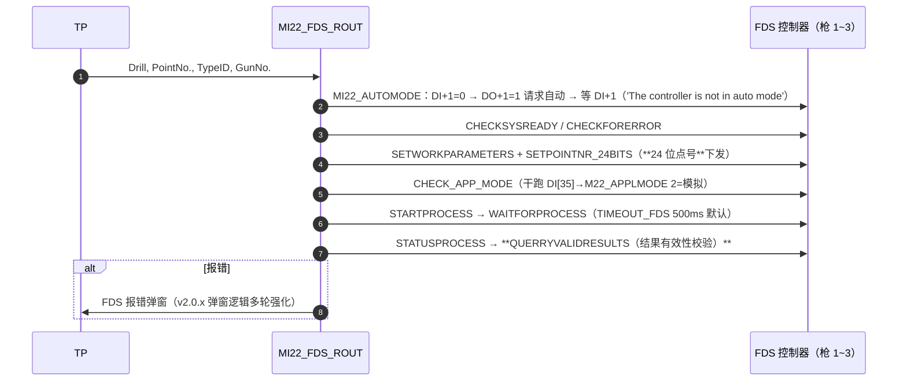

# MI22_FDS 逐应用深拆（FAP v2.0.9）

> 三方对照：pc2kl3 反编译实读（6 模块 2675 行）× 手册 v20 第 20 章 × 更新日志 11 段。
> 标注：【实证】/【推断】/【存疑】。生成 2026-11-04，接续 [MI20_MI21_SWH_逐应用深拆.md](MI20_MI21_SWH_逐应用深拆.md)。

---

## 0. 定位与模块清单

**一句话定位**：**FDS 旋转攻丝铆接**（流钻螺丝/Flow Drill Screw）——7 指令工艺面 + 结果校验/换刀/服务请求族 + **FDS_MAN 手动恢复界面**（总纲点名"扭矩/拧紧错误 FDS_MAN 手动恢复"）。枪 1~3。【实证：手册 20.1 + ROUT 全族】

| 模块 | 行数 | 角色 |
|---|---|---|
| MI22_FDS | 327 | TP 入口（7 指令分发） |
| MI22_FDS_ROUT | 1125 | 工艺族 + 消息系统 + 换刀/服务族（28+ 例程） |
| MI22_FDS_MON | 346 | 后台（扫描变量/状态） |
| MI22_FDS_MAN | 520 | **手动操作/恢复**（FDS MAN 界面） |
| MI22_FDS_GUI | 337 | MI22 Setup + 手动界面 |
| MI22_FDS_VAR | 20 | 变量文件壳 |

IO 域：AR_M22_CN_DI/DO[GUNCFG_LST[枪]]（设备 1 基 1312；v2.0.x 映射 DI[1318]→DO[428]）。【实证】

---

## 1. 指令级时序图

### 1.0 指令集（Parameter select 1~7）

**Init / Drill / PrepareScrew / Adjust / GunState(Couple/Decouple) / EjectScrew / FeedScrew**

### 1.1 Drill（核心工艺链）

【实证：MI22_AUTOMODE 413-434 + ROUT 全族；总纲 2.5 "AUTOMODE：SETWORKPARAMETERS→拧紧→CHECKFORERROR"】

### 1.2 服务/换刀族（本应用特色）

| 例程 | 作用 |
|---|---|
| MI22_REQUESTTOOLCHANGE / CHECKDOCKCOMPLETE | 换刀请求 + 对接完成检测 |
| MI22_CHECKSERVICEREQ | 服务请求监控 |
| MI22_QUERY_JOINTPOINTOK | 接合点校验 |
| MI22_SETLOGPARAM | 工艺日志参数（追溯） |
| MI22_SETMESSAGE / WAITFINISHEDMSG / GETCOUNTMESSAGES | 消息计数系统（弹窗强化基础） |
| GUNPLAUSIBILITYCHECK / MI22_CHECKGUNNO | 枪号合理性/范围校验 |
| MANUAL_REQOPERATOR / STATUSREPEAT | 手动人因交互（FDS MAN） |

---

## 2. 参数表

| 指令 | 参数 |
|---|---|
| Init | GunNo.（1~3） |
| Drill | PointNo. + TypeID + GunNo. |
| PrepareScrew | GunNo. + PointNo. + TypeID |
| Adjust | GunNo. |
| GunState | Couple / Decouple + GunNo. |
| EjectScrew / FeedScrew | GunNo. |

Setup：BG Scan 32~1024=32；Max Gun Number **1~3**=1；Delay for dry run 500~5000=1000；Timeout FDS 500~5000=500。
FDS MAN（手册 20.4）：Setup General（Max.Guns 1~3、System ready 500~5000、Process finished 500~5000）+ MAN.FCTNS 功能页。

---

## 3. GUI 流程

MENU → TEST CYCLE → MI GUI → **MI22 Setup**；MENU → NEXT → BROWSER → **FDS MAN**（手动/恢复界面）——总纲"扭矩/拧紧错误（FDS_MAN 手动恢复）"：工艺报错后经手动界面恢复/重试。【实证：MAN 模块 + 手册 20.4】

---

## 4. 异常路径

| 场景 | 表现 | 恢复 |
|---|---|---|
| 控制器非自动 | 'FDS Controller not in Auto'/'The controller is not in auto mode'（TIMEOUTFLSSYS） | DO+1=1 请求切自动 |
| 工艺超时 | TIMEOUT_FDS（默认 500ms——**偏短**，Setup 可扩 5000） | 查拧紧过程 |
| 结果无效 | QUERRYVALIDRESULTS 判定 + FDS 报错弹窗（v2.0.x 多轮强化） | FDS MAN 手动恢复 |
| 枪号异常 | GUNPLAUSIBILITYCHECK / CHECKGUNNO | 核枪配置 |
| 换刀/对接 | REQUESTTOOLCHANGE/CHECKDOCKCOMPLETE 联锁 | 手动完成对接 |
| 干跑 | DI[35]→M22_APPLMODE=2 模拟模式 | — |

---

## 5. 与 TP 程序交互

- `CALL MI22_FDS(1~7, …)`；典型节拍：Init → PrepareScrew(PointNo, TypeID) → Drill(PointNo, TypeID) →（服务：Adjust/FeedScrew/EjectScrew）→ GunState Decouple（换刀）。
- **24 位点号**（SETPOINTNR_24BITS）——点号通道比 MI20/21 的双字更宽语义（点位表+TypeID 类型矩阵）。
- 与 SPR 族（MI13/14/15）同属"连接件"工艺但机理不同：FDS=旋转攻丝自钻，SPR=冲铆——设备协议独立（AR_M22_CN_* 域）。

---

## 6. 对照结论

1. **FDS 是 MI 系列"服务化"程度最高的工艺**：换刀请求/对接完成/服务请求/接合点校验/日志参数/消息计数——设备全生命周期管理，不止单次拧紧。
2. **结果校验内置**（QUERRYVALIDRESULTS）——对比 MI13/MI20 的"等完成信号"，FDS 直接判结果有效性，配合弹窗+FDS MAN 恢复闭环。
3. **Timeout FDS 默认 500ms 偏短**（与 MI13 Rivet 同款问题，MI14 v2.0.8 已改 4000）——现场误超时优先查此项。
4. v2.0.x 弹窗逻辑两轮强化（"FDS 报错弹窗逻辑修改/增加"）——历史报错体验痛点。
5. 24 位点号 + TypeID 矩阵 = FDS 多规格螺钉混线的配置面（PrepareScrew/Drill 都带 PointNo+TypeID 双参）。

---

*输入：decompiled/MI22_fds/（6 .KL）· ref_手册v20.txt §20（行 3532-3736）· ref_更新日志FAP_v2.0.9.txt MI22×11 段 · analysis/MI22_fds.html。*
