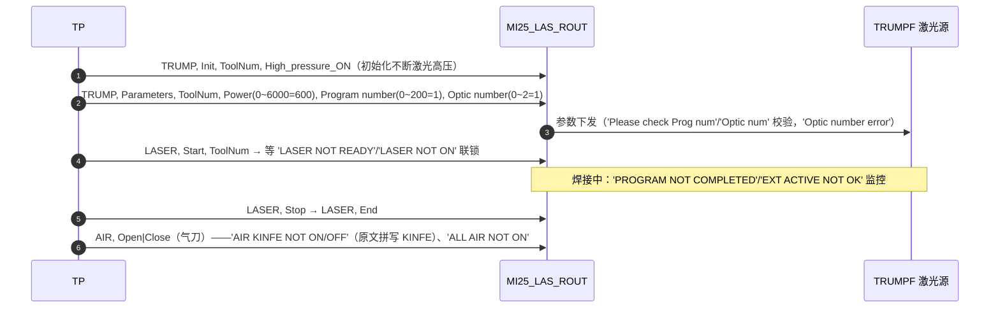

# MI24_ARC + MI25_LAS + MI26_FEW 逐应用深拆（FAP v2.0.9）——收官三联

> 三方对照：pc2kl3 反编译实读（三站合计 11 模块 1377 行）× 手册 v20 第 21/22/23 章 × 更新日志（MI24×1 / MI25×0 / MI26×1 段）。
> 标注：【实证】/【推断】/【存疑】。生成 2026-11-04，**MI_FAP 逐应用系列第 18/18 站完结**（接 [MI22_FDS_逐应用深拆.md](MI22_FDS_逐应用深拆.md)）。

---

## 0. 定位总表

| | MI24_ARC | MI25_LAS | MI26_FEW |
|---|---|---|---|
| 工艺 | **弧焊清枪**（剪丝/铣刀/送丝） | **激光焊 TRUMPF** | **摩擦元件焊接 FEW**（v2.0.9 新增） |
| 指令 | TD(Open/Close) / MOTOR(ON/OFF/UP/DOWN) / WIRE(delaytim) | LASER(Start/Stop/End) / TRUMP(Init/Parameters) / AIR(Open/Close) | Init / GunOpen / FewWeld / Feed / Dock |
| 模块 | ARC(218)+ROUT(242)+GUI(393)+VAR | LAS(224)+ROUT(334)+VAR（**无 GUI/MON**） | FEW(177)+ROUT(357)+VAR（**无 GUI/MON**） |
| 厂商实证 | — | 'TRUMP LASER IS IN FAULT'（总纲） | — |

README 三处身份：MI24"弧焊（信号联锁）"实为**弧焊清枪**（第 5 处失真）；MI25"激光（TRUMPF）"✓；MI26"流程/位置控制"实为**摩擦元件焊接**（第 6 处失真）。

---

## 1. 指令级时序图

### 1.1 MI24_ARC（清枪三件套）

```
CALL MI24_ARC(TD, Open|Close)        夹紧缸/剪丝器（Open=夹紧开+剪丝，Close=夹紧+剪丝器开）
CALL MI24_ARC(MOTOR, ON|OFF|UP|DOWN) 铣刀电机（旋转/停止/上升/下降）
CALL MI24_ARC(WIRE, delaytim 1000~2000ms=1000)  送丝延时
```

典型清枪节拍：TD Open（剪丝）→ MOTOR ON+DOWN（铣刀下降清枪）→ MOTOR UP+OFF → WIRE（送丝回位）→ TD Close。【实证：MI24_TD_*/MOTOR_*/WIRE_FORWARD 七例程 + 手册 21.2】

### 1.2 MI25_LAS（TRUMPF 激光链）



【实证：MI25_LASER_*/TRUMP_*/AIR_* 七例程 + 异常串全表】

### 1.3 MI26_FEW（摩擦元件焊五步）

```
CALL MI26_FEW(Init, GunNo 1~3)                 MI26_INIT 信号初始化
CALL MI26_FEW(GunOpen, GunNo, OpenPos 0~65535=500)   MI26_POSITIONING 枪开口
CALL MI26_FEW(FewWeld, GunNo, OpenPos, ProgNo) MI26_FEWWELD 焊接工艺流程
CALL MI26_FEW(Feed, GunNo)                     MI26_FEWFEED 充钉
CALL MI26_FEW(Dock, GunNo, …)                  MI26_FEWDOCK 装卸枪
```

【实证：五例程 1:1 对应五指令 + 手册 23.2】

---

## 2. 参数表

| 站 | 关键参数 |
|---|---|
| MI24 | WIRE delaytim 1000~2000ms=1000 |
| MI25 | Power 0~6000=600 / Program number 0~200=1 / Optic number 0~2=1 / Init High_pressure_ON |
| MI26 | GunNo 1~3 / OpenPos 0~65535=500 / ProgNo |

MI24 有 Setup（信号配置界面）；MI25/MI26 无 GUI 模块（配置走变量/xvr）。

---

## 3. GUI 流程

MI24：MI GUI → MI24 Setup（信号配置）。MI25/MI26：无 Setup 页（v2.0.9 新应用界面未建，配置=KAREL VARS 手改）。

---

## 4. 异常路径（MI25 为主）

| 场景 | 表现（原文串） |
|---|---|
| 激光未就绪/未开 | 'LASER NOT READY ' / 'LASER NOT ON ' / 'LASER NOT ASSIGNED ' |
| 程序/Optic 号错 | 'Please check Prog num' / 'Please check Optic num' / 'Optic number error  ' |
| 焊接未完成 | 'PROGRAM NOT COMPLETED' |
| 外部激活异常 | 'EXT ACTIVE NOT OK' |
| 气刀/气源 | 'AIR KINFE NOT ON/OFF '（原文 KINFE）/ 'ALL AIR NOT ON ' |

---

## 5. 与 TP 程序交互

- 三站均为指令式（无 BSN 后台、无 MON——MI24 有 GUI 无 MON）。
- MI25 TRUMP Init 的 **High_pressure_ON**（初始化不断激光高压）是安全语义——TP 序列约定先 Init(高压保持)→Parameters→Start。
- MI26 与 SPR 族同为"枪"体系（GunNo 1~3、开口值、Dock），但 FEW=摩擦元件焊（预钻孔+摩擦热压），独立设备域。

---

## 6. 收官对照（MI_FAP 18 应用全景一句话）

| 系列 | 站 | 一句话 |
|---|---|---|
| 框架 | MI01 | PLC 网关+后台调度+全套 Setup |
| 换枪/抓手 | MI02/MI03 | 双品牌换枪 / MHGRIPDT 镜像 |
| 点焊 | MI04 | 三焊机协议+水流量闭环+ISV 视觉 |
| 涂胶 | MI08/MI09 | SCA/DMTS 出胶 / 三品牌检测+TCP 位姿流 |
| 连接件 | MI11/MI13/MI14/MI15/MI19/MI20/MI21/MI22/MI26 | Arplas / SPR×3 / TOX 压铆 / 螺柱焊×2 / FDS / FEW |
| 视觉 | MI17 | 壳+贝特威 VS_* 工具链 |
| 特种 | MI24/MI25 | 弧焊清枪 / TRUMPF 激光 |

**全系通病清单**（横扫可用）：①手册 select 列表滞后代码（MI01/MI09/MI11/MI15 五处）；②README 模块表身份失真六处；③I_MON 钳位 256 vs 手册 1024（MI03/08/09）；④IO 基址迁移不联动（MI19 三连改/MI20/MI21/Coherix 3512）；⑤'Wait Singal'/'KINFE'/'Syetem'/'Sucessfully' 显示层拼写群；⑥BSN 起点每站各异（17/49/81/97/145/233/337…）——PLC 组态必按站核对。

---

*输入：decompiled/MI24_arc|MI25_las|MI26_few/（11 .KL）· ref_手册v20.txt §21-23（行 3737-3995）· ref_更新日志FAP_v2.0.9.txt MI24×1/MI25×0/MI26×1 段。*
